<div align="center">

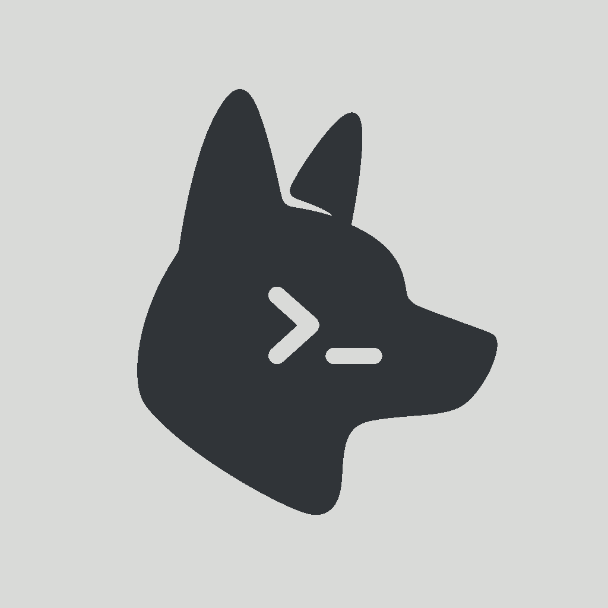

# Heeler

<a href="https://apps.apple.com/us/app/heeler-for-herdr/id6797263135"></a>
<a href="https://testflight.apple.com/join/aXSxRn4r"></a>

**[herdr](https://herdr.dev)（エージェントファーストのターミナルランタイム）のための、ネイティブ iOS コンパニオンアプリです。**

[](https://github.com/ZingerLittleBee/Heeler/stargazers)
[](https://github.com/ZingerLittleBee/Heeler/actions/workflows/ci.yml)
[](LICENSE)
[](https://www.swift.org)
[](https://developer.apple.com/ios/)
[](https://apps.apple.com/us/app/heeler-for-herdr/id6797263135)

<a href="https://trendshift.io/repositories/151670?utm_source=repository-badge&amp;utm_medium=badge&amp;utm_campaign=badge-repository-151670" target="_blank" rel="noopener noreferrer"></a>

[English](./README.md) | [简体中文](./README-zh.md) | [繁體中文](./README-zh-TW.md) | 日本語

</div>

---

Heeler は、iPhone と iPad で使える独立した **herdr モバイルクライアント**であり、Claude Code、Codex などのコーディング Agent のためのエージェントコンソールです。Agent はご自身の Host 上で Herdr TUI または Herdr デスクトップアプリ（herdr-core）とともに動作し、Heeler は SSH で接続します。複数のマシンにまたがる複数の Agent を、対応が必要なものから順に並べて監視し、ライブターミナルや対応している Chat の会話を開いて指示を送れます。

## スクリーンショット

| Agent Console | ライブターミナル | Chat |
| --- | --- | --- |
| 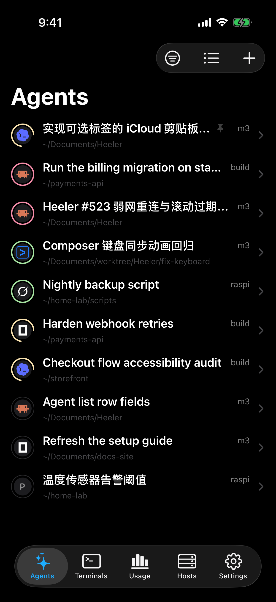 | 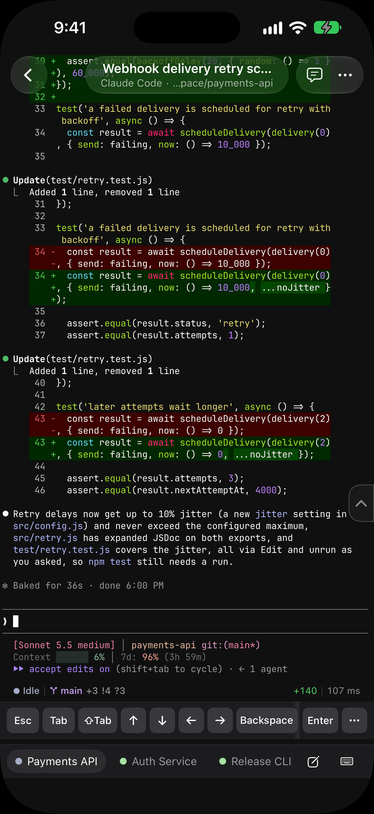 | 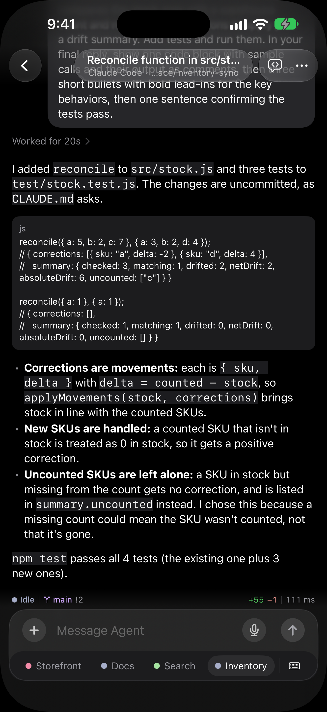 |

| キーボード | Changes | Terminals |
| --- | --- | --- |
| 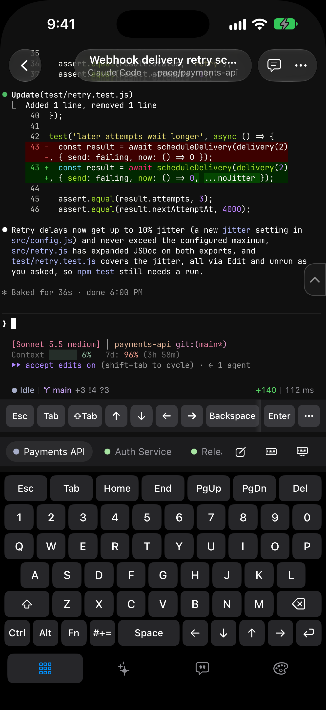 | 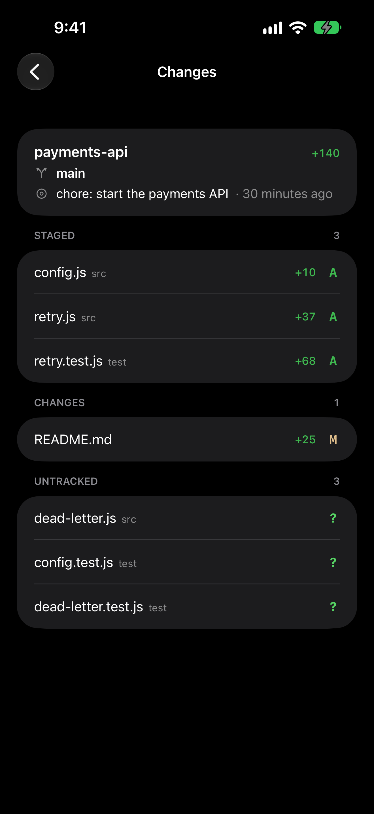 | 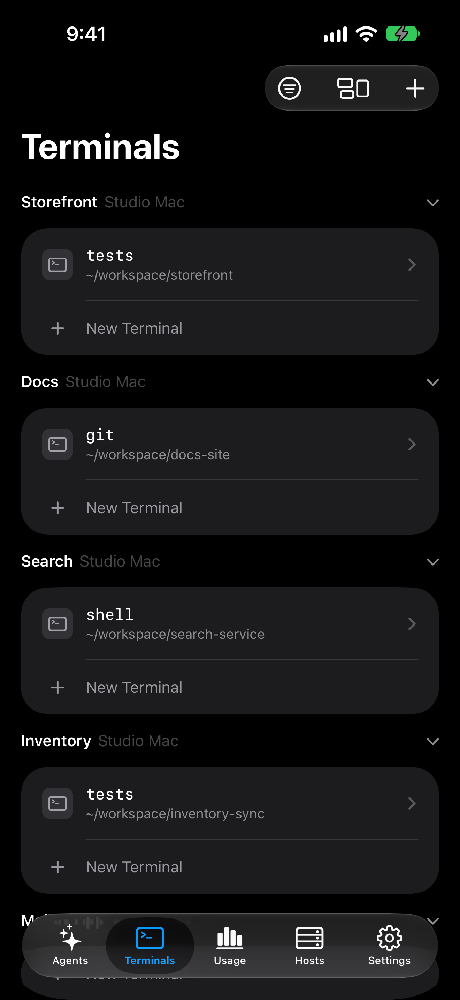 |

| Skills | Hosts | ライブアクティビティ |
| --- | --- | --- |
| 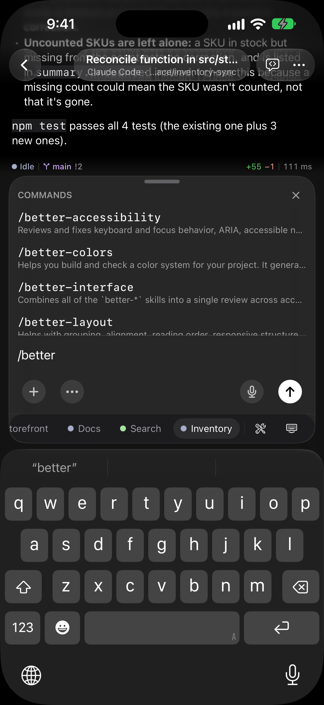 | 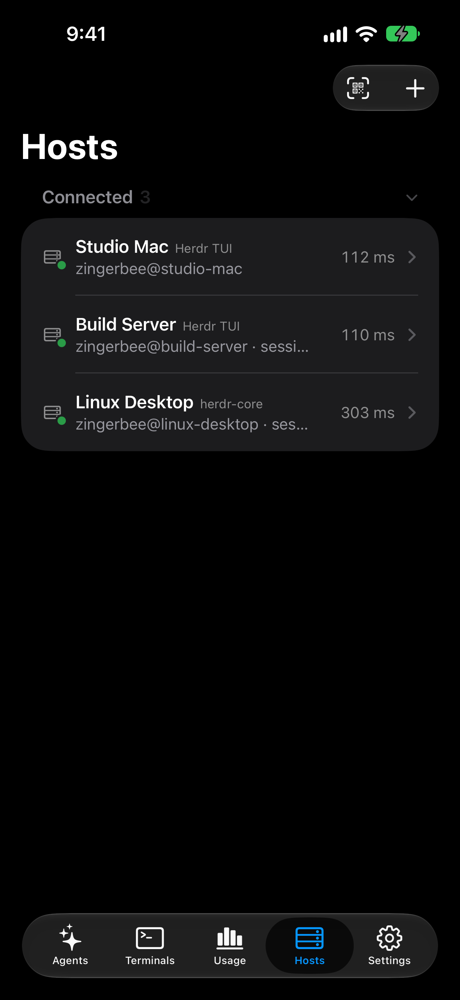 | 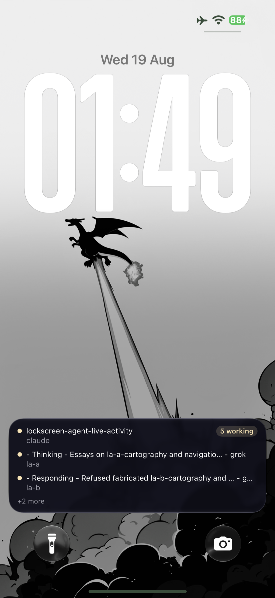 |

| Usage | ウィジェット | ロック画面のウィジェット |
| --- | --- | --- |
| 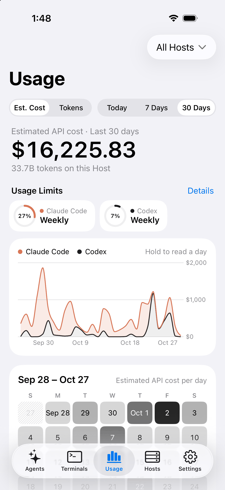 | 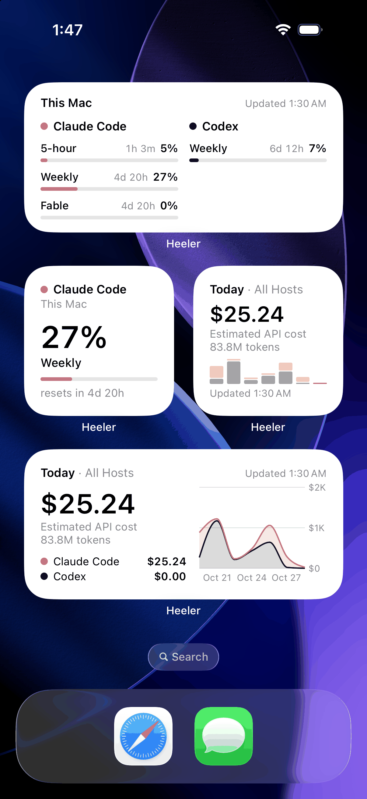 | 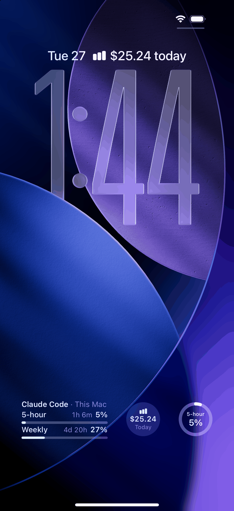 |

<a href="docs/ipad-screenshots.md">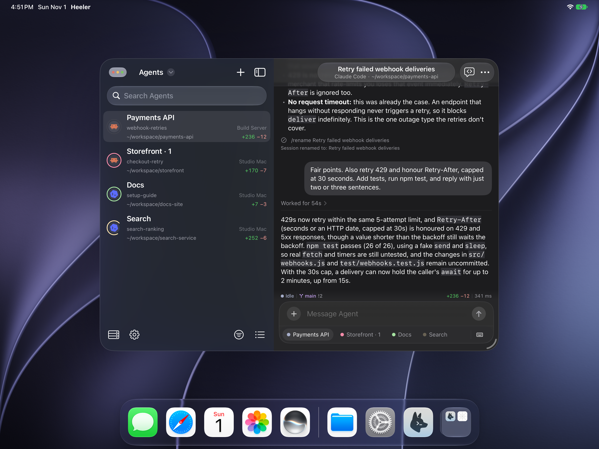</a>

[iPad のスクリーンショットを見る](docs/ipad-screenshots.md)

## 機能

- **Console** — すべてのマシン上のすべての Agent を、ステータス順（Blocked が先頭）の 1 つのリストにまとめます。Host で絞り込むことができ、リアルタイムで更新されます。
- **Herdr デスクトップと herdr-core** — macOS、Linux、ネイティブの Windows で動作する Herdr デスクトップアプリ、またはヘッドレスの herdr-core に接続します。Console はデスクトップアプリのスペースとタブに従い、ライブターミナル、Chat、Composer、New Agent、New Workspace も利用できます（[詳しくはこちら](https://docs.heeler.bybee.dev/herdr-core)）。
- **Attach** — libghostty で描画される Agent の実際のターミナルです。ネイティブのスクロールバック、全画面の TUI も操作できる慣性つきのタッチスクロール、長押しでの選択、古くなったターミナルの所有者からの引き継ぎに対応し、Web リンクを目立たないように集めて、あとで開けるようにします。
- **Chat** — Agent の会話をターミナル画面ではなくネイティブのメッセージとして読み、Composer から返信し、Blocked の Agent にはボタンで回答できます。Claude Code、Codex、Pi、Oh My Pi、Grok Build、OpenCode、Antigravity CLI に対応しています（[詳しくはこちら](https://docs.heeler.bybee.dev/chat)）。
- **Composer** — iOS の完全なキーボード（自動修正、IME、音声入力）を使って手元で下書きし、一度の Send で送信します。ツールキーボードでは、Agent の制御キー、Agent Skills、再利用できる Snippets、ターミナルの外観を利用できます。Voice Input を使うと、ご自身の音声サービスの API キーで Composer に話しかけることができます（[詳しくはこちら](https://docs.heeler.bybee.dev/voice-input)）。
- **Terminal** — Agent のディレクトリで通常のシェルを開きます。Text と Keys の 2 つのモードがあり、Workspace ごとに 1 つのタブを再利用します。
- **添付ファイル** — 写真や 64 MiB までのファイルを SFTP で Host に置き、そのパスを下書きに挿入します。
- **QR ペアリング** — Pairing Code をスキャンしてマシンを追加します。鍵はデバイス上で生成され、秘密鍵は Keychain から出ることはなく、コードによってホスト鍵のフィンガープリントが固定されます。
- **通知 + ライブアクティビティ** — Agent が Blocked または Done になったときのエンドツーエンド暗号化されたプッシュ通知と、Agent をリアルタイムで追跡するロック画面 / Dynamic Island のバナーです。リレーが内容を読むことは決してできません（[PRIVACY.md](PRIVACY.md)）。
- **Usage** — Claude Code と Codex の Usage Limits とそのリセット時刻、および最大 30 日分の Token Usage とその推定 API コストを、すべての Host の合計または 1 台ごとに表示します。ホーム画面とロック画面のウィジェットで、いつでも確認できます（[詳しくはこちら](https://docs.heeler.bybee.dev/usage)）。
- **Worktrees** — Workspace のリポジトリのクリーンなチェックアウトで Agent を起動します。
- **外観** — System、Light、Dark から選べます。Light と Dark で別々に設定でき、ターミナル、Chat、アプリ全体に適用される 30 種類のテーマ、同梱の JetBrains Mono と IBM Plex Mono、ピンチによるズームに対応しています。
- **Jump Host** — SSH のジャンプを経由して直接到達できないマシンにアクセスし、両方のホップで鍵を検証します。

## 接続のしくみ

macOS と Linux の Host では、Heeler は SSH 経由で herdr の JSON API を使います。各リクエストは `herdr.sock` への direct-streamlocal チャネルを開き、1 本の長時間維持されるチャネルがイベントストリームを運び、対話型のターミナルは SSH PTY 上で `herdr agent attach --takeover` を実行します。必要なのは SSH でのアクセスと、動作中の herdr だけです。サーバー側の変更も、追加のパッケージも必要ありません。SSH サーバーでは stream-local フォワーディングが許可されている必要があります（OpenSSH のデフォルト）。無効になっている場合は、オンボーディングで指摘されます。Fedora、RHEL とその派生ディストリビューションでは、フォワーディングが許可されていても SELinux がソケットを開くことを拒否する場合があります。[Fedora または RHEL の Host での SELinux](docs/guides/selinux.md) をご覧ください。

ネイティブの Windows Host（herdr >= 0.9.3）は SSH で接続し、手動で追加します。

herdr-core の Host（Herdr デスクトップアプリを実行しているマシンを含む）は手動で追加し、Server Kind を確認します。Heeler は core との間に 1 本のフレーム化されたリンクを使います。macOS と Linux では core のソケットへの direct-streamlocal チャネル、ネイティブの Windows では SSH exec で実行する `herdr-core connect` です。macOS と Linux では、接続しただけで core が起動することはありません。オプションの Host Helper を入れると、macOS と Linux で通知、ライブアクティビティ、Usage を利用できます（[herdr-core に接続する](https://docs.heeler.bybee.dev/herdr-core)）。

Tailscale、ZeroTier、EasyTier でアクセスする場合は、[Overlay Network のセットアップガイド](docs/guides/overlay-networks.md)に従ってください。macOS へのインストール、Mac で VPN を使わない Tailscale、Heeler の設定、接続の確認について説明しています。Heeler は iOS の VPN 構成を使わずに、アプリ内でこれらのネットワークに参加します。**Settings > Overlay Networks** がある Heeler のバージョンが必要です。

Tailscale、ZeroTier、および EasyTier の 2 つのモードについて、[Heeler のセットアップのスクリーンショットを見る](docs/guides/overlay-networks.md#heeler-setup-screenshots)ことができます。

直接到達できないマシンは、SSH の Jump Host の背後に置くことができます。

- [リモートアクセスを順を追ってセットアップする](docs/guides/vps-jump-host-setup.md)
- [アーキテクチャ、セキュリティの境界、VPS のランブック](docs/guides/vps-jump-host.md)

Host には、自宅では LAN のアドレス、外出先では Overlay Network や Jump Host というように、複数のルートを持たせることができます：[複数のルートで Host に到達する](docs/guides/host-routes.md)。

## インストール

[App Store](https://apps.apple.com/us/app/heeler-for-herdr/id6797263135) または [TestFlight](https://testflight.apple.com/join/aXSxRn4r) から Heeler をインストールしてください。

- **macOS / Linux:** [herdr](https://herdr.dev/docs/install/) をインストールし、SSH を有効にしてから、以下のペアリングの手順に従ってください。
- **ネイティブの Windows:** [Windows のセットアップガイド](docs/guides/windows-setup.md)に従ってください。
- **Herdr デスクトップアプリ / herdr-core:** デスクトップアプリまたは herdr-core を起動し、SSH を有効にしてから、Host を手動で追加してください。[herdr-core に接続する](https://docs.heeler.bybee.dev/herdr-core)をご覧ください。Heeler 0.1.18 以降が必要です。

## マシンの追加

herdr を実行している macOS または Linux のマシン上で（Node >= 20、herdr >= 0.7.5、OpenSSH サーバーが有効。macOS では **システム設定 > 一般 > 共有 > リモートログイン**）、次を実行します。

```bash
herdr plugin install ZingerLittleBee/Heeler --ref plugin --yes
herdr plugin action invoke heeler.pair
```

表示された Pairing Code の QR をスキャンすると、そのマシンが Host として追加されます。コードには、アドレス、ホスト鍵のフィンガープリント、SSH 鍵の登録情報が含まれています。アプリでその Host の通知を有効にすると、同じ[プラグイン](plugin/README.md)が暗号化された通知を配信します。すべての手順、ポップアップのキー、トラブルシューティングについては、[ペアリングガイド](https://docs.heeler.bybee.dev/pairing)をご覧ください。

## 別のアプリから Agent を開く

別のアプリから、リンクを使って Heeler で Agent を開くことができます。

```text
heeler://agent?host=my-mac&session=work&pane=w1%3Ap1
```

- `host` は、そのセッションに保存されている Host を指定します。そのアドレスか、セッション上にそのアドレスを持つ Host がない場合はその名前です。大文字と小文字は区別されません。
- `session` は herdr のセッション名です。省略するか `default` を渡すと、デフォルトのセッションになります。
- `pane` は herdr のペイン ID です。省略すると Console が開きます。

各値はパーセントエンコードし、スペースは `%20` にしてください。`+` はプラス記号のまま扱われるため、フォームエンコード（JavaScript の `URLSearchParams` など）では `Build Box` のような名前に一致しません。そのセッションに一致する保存済みの Host がない場合や、複数の Host が一致する場合は、リンクで Console が開きます。

## スタック

- SwiftUI、iOS 18+、iPhone と iPad。iPad のサポートは 0.1.8 で復活し、Magic Keyboard のショートカット、マルチウィンドウ、ドラッグ＆ドロップに対応しています。
- SSH には、リポジトリ内の `Packages/HeelerSSH`（libssh2 + OpenSSL）
- ターミナルのエミュレーションと Metal での描画には [libghostty-spm](https://github.com/lakr233/libghostty-spm)

その理由については `docs/adr/` をご覧ください。特にトランスポートの経緯は自明ではありません。

## コントリビュート

Issue と PR を歓迎します。構成、ビルド / テスト、規約については [CONTRIBUTING.md](CONTRIBUTING.md) をご覧ください。

## ステータス

[App Store](https://apps.apple.com/us/app/heeler-for-herdr/id6797263135) で公開されています。まだすべての国や地域で入手できるわけではありません。入手できない地域では、[TestFlight](https://testflight.apple.com/join/aXSxRn4r) のビルドを引き続き利用できます。まず個人で使うために作られ、日々の利用を通じて形づくられてきたため、粗削りな部分や頻繁な変更があることをご承知おきください。herdr プロジェクトとは提携していません。
