<div align="center">


# Heeler

<a href="https://apps.apple.com/us/app/heeler-for-herdr/id6797263135"></a>
<a href="https://testflight.apple.com/join/aXSxRn4r"></a>

**ご自身のマシンで動くコーディングエージェントのための、iPhone と iPad のコンソールです。**

[Herdr TUI](https://herdr.dev)、Herdr デスクトップアプリ（herdr-core）、tmux に対応しています。Rex への対応は実験的です。

[](https://github.com/ZingerLittleBee/Heeler/stargazers)
[](https://github.com/ZingerLittleBee/Heeler/actions/workflows/ci.yml)
[](LICENSE)
[](https://www.swift.org)
[](https://developer.apple.com/ios/)
[](https://apps.apple.com/us/app/heeler-for-herdr/id6797263135)

<a href="https://trendshift.io/repositories/151670?utm_source=repository-badge&amp;utm_medium=badge&amp;utm_campaign=badge-repository-151670" target="_blank" rel="noopener noreferrer"></a>

[English](./README.md) | [简体中文](./README-zh.md) | [繁體中文](./README-zh-TW.md) | 日本語

</div>

---

Heeler は、iPhone と iPad で使える独立したオープンソースのエージェントコンソールであり、Claude Code、Codex などのコーディング Agent のための **herdr モバイルクライアント**です。Agent はご自身のマシン上の Herdr TUI、Herdr デスクトップアプリ（herdr-core）、または tmux でそのまま動き続け、Heeler は SSH で直接接続するため、コードが私たちのサーバーを通ることはありません。どの Agent が対応を待っているかをひと目で確認し、ネイティブの Chat または実際のターミナルで応答でき、Agent が Blocked または Done になると暗号化された通知が届きます。

**[ウェブサイト](https://heeler.bybee.dev)** · **[ドキュメント](https://docs.heeler.bybee.dev)** · [プライバシー](PRIVACY.md) · [変更履歴](CHANGELOG.md)

## スクリーンショット

| Agent Console | Chat | ライブターミナル |
| --- | --- | --- |
| 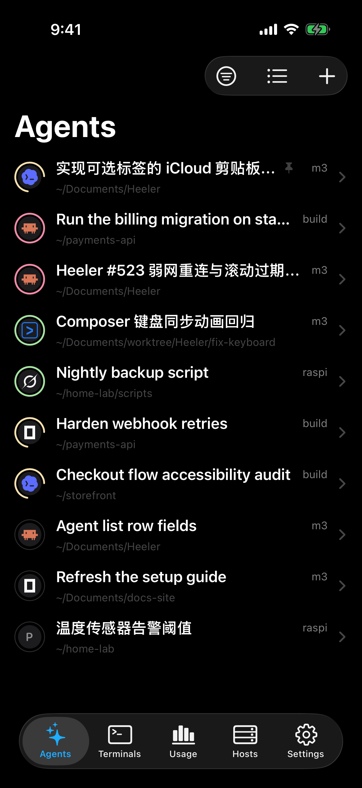 | 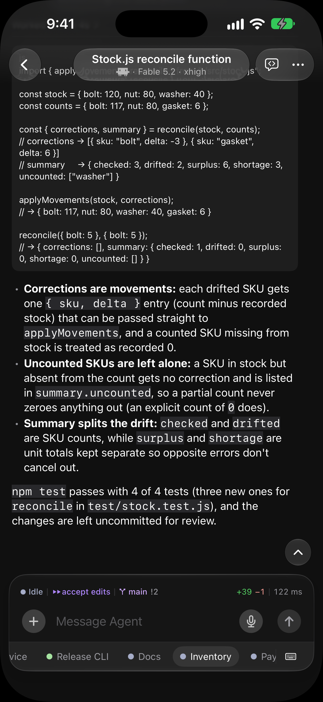 | 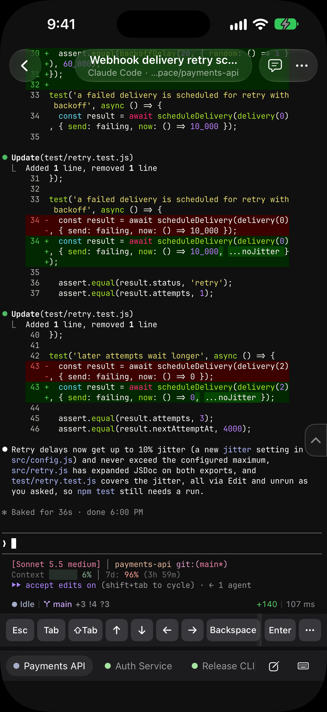 |

| ライブアクティビティ | Usage | ウィジェット |
| --- | --- | --- |
| 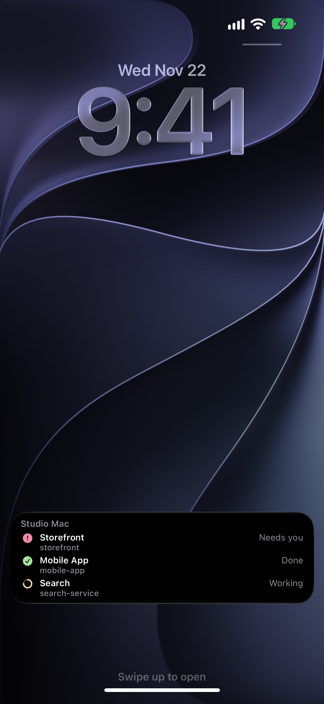 | 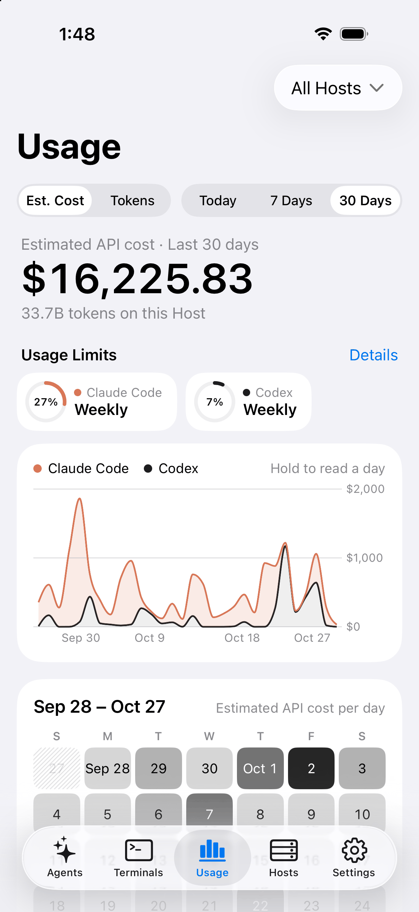 | 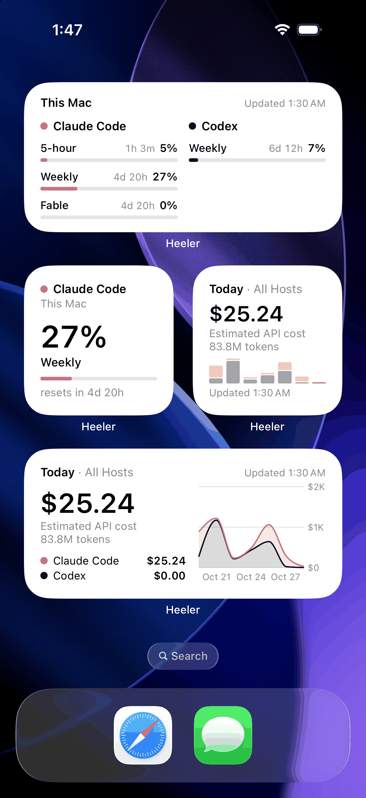 |

<details>
<summary>その他のスクリーンショット</summary>

| キーボード | Changes | Terminals |
| --- | --- | --- |
| 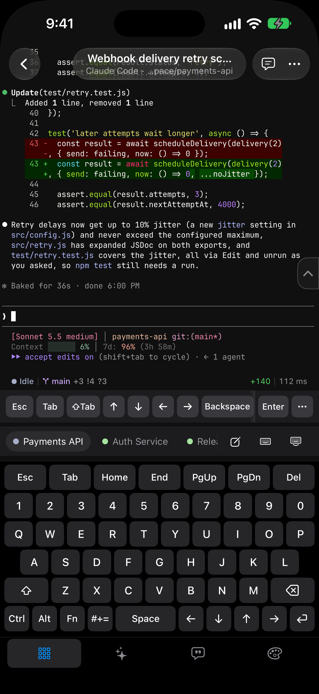 | 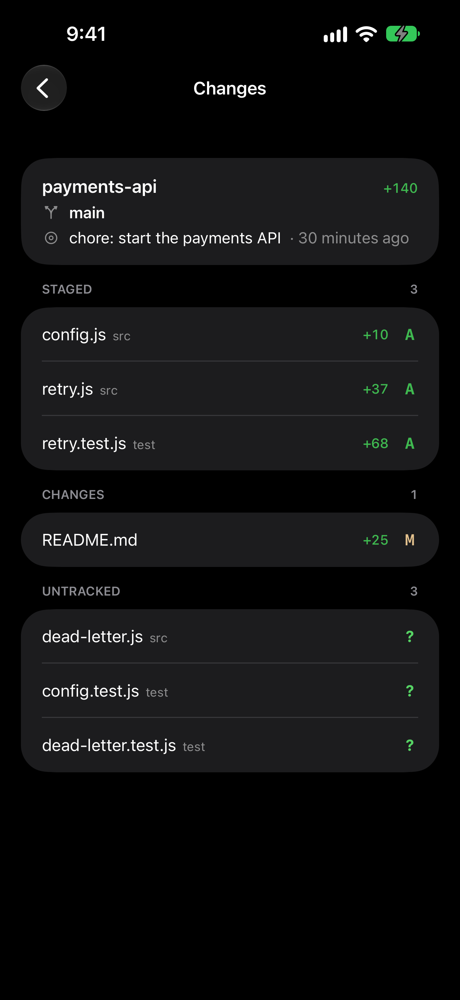 | 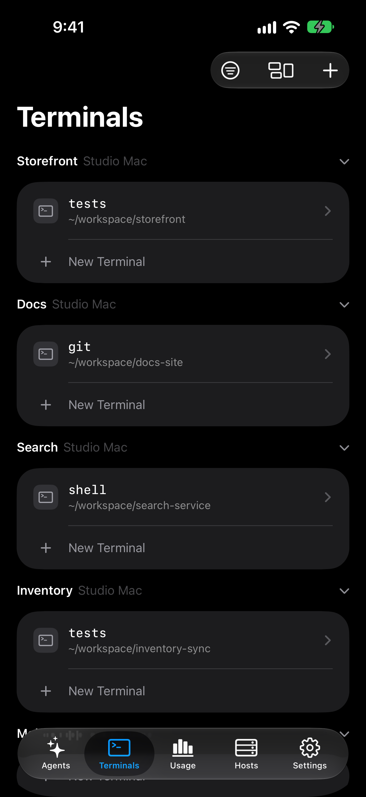 |

| Skills | Hosts | ロック画面のウィジェット |
| --- | --- | --- |
| 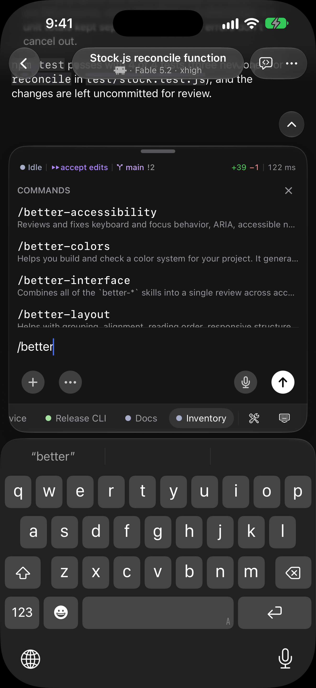 | 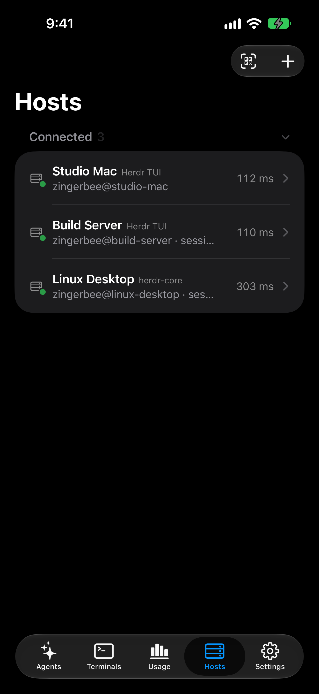 | 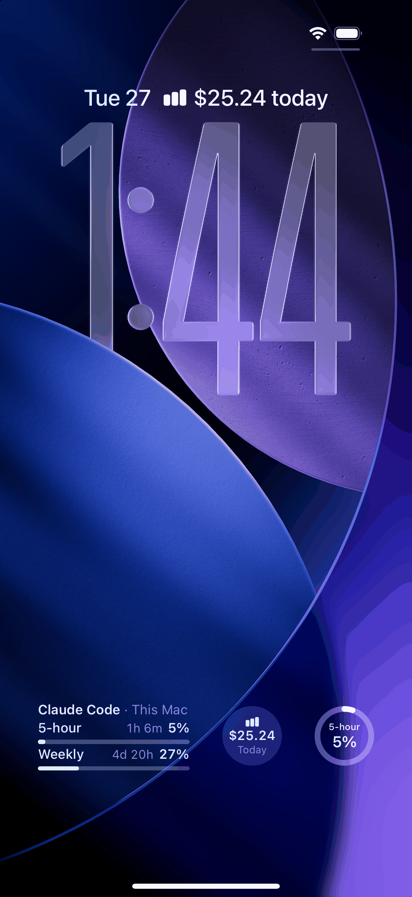 |

</details>

<a href="docs/ipad-screenshots.md">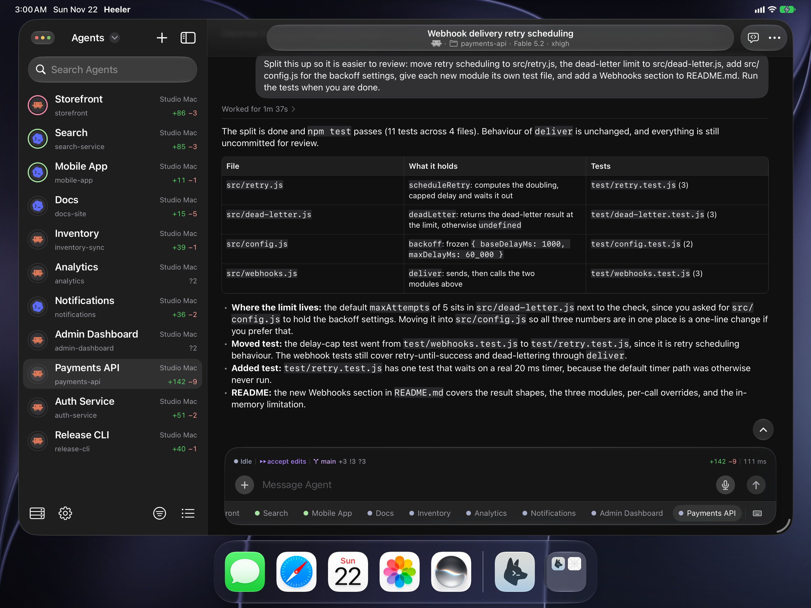</a>

[iPad のスクリーンショットを見る](docs/ipad-screenshots.md)

## 機能

- **Console**：すべてのマシン上の Agent を 1 つのリストにまとめ、Blocked を先頭にリアルタイムで表示します。Host で絞り込めます。
- **Chat**：Agent の会話をネイティブのメッセージとして読み、Blocked の Agent にはボタンで回答できます。Claude Code、Codex、Pi、Oh My Pi、Grok Build、OpenCode、Antigravity CLI に対応しています。[Chat ガイド](https://docs.heeler.bybee.dev/chat)
- **ライブターミナル**：libghostty で描画される Agent の実際のターミナルで、ネイティブのスクロールバックと選択に対応します。Agent のディレクトリで通常のシェルを開くこともできます。
- **通知とライブアクティビティ**：Agent が Blocked または Done になるとエンドツーエンド暗号化されたプッシュ通知が届き、ロック画面と Dynamic Island に Agent が表示されます。リレーが内容を読むことはできません。[プライバシー](PRIVACY.md)
- **Usage**：Claude Code と Codex の Usage Limits とリセット時刻、最大 30 日分の Token Usage と推定 API コスト、ホーム画面とロック画面のウィジェットを利用できます。[Usage ガイド](https://docs.heeler.bybee.dev/usage)
- **Composer**：iOS の完全なキーボードまたは音声で下書きし、一度の Send で送信します。ツールキーボードには Agent の制御キー、Skills、Snippets があり、写真や 64 MiB までのファイルも添付できます。[Voice Input ガイド](https://docs.heeler.bybee.dev/voice-input)
- **どこからでも接続**：Tailscale、ZeroTier、EasyTier をアプリに内蔵しているため、VPN アプリは必要ありません。直接到達できないマシンには Jump Host を使え、1 つの Host に複数のルートを設定できます。[Overlay Network](https://docs.heeler.bybee.dev/overlay-networks) · [Jump Host](https://docs.heeler.bybee.dev/vps-jump-host-setup) · [複数のルート](https://docs.heeler.bybee.dev/host-routes)
- **そのほか**：QR ペアリング、Worktrees、ステージ済みと未ステージのファイルを確認できる Changes、30 種類のテーマ、Magic Keyboard のショートカット、マルチウィンドウ、ドラッグ＆ドロップに対応した iPad 版があります。

## インストール

[App Store](https://apps.apple.com/us/app/heeler-for-herdr/id6797263135) または [TestFlight](https://testflight.apple.com/join/aXSxRn4r) から Heeler をインストールしてください。マシン側では SSH を有効にし、次のいずれかのバックエンドを実行します。

| バックエンド | 対応環境 | ガイド |
| --- | --- | --- |
| [Herdr TUI](https://herdr.dev/docs/install/) | macOS、Linux | [スキャンでペアリング](https://docs.heeler.bybee.dev/pairing) |
| Herdr TUI 0.9.3 以降 | ネイティブの Windows | [Windows のセットアップ](https://docs.heeler.bybee.dev/windows-setup) |
| Herdr デスクトップアプリまたは herdr-core | macOS、Linux、ネイティブの Windows | [herdr-core に接続する](https://docs.heeler.bybee.dev/herdr-core) |
| tmux 3.3 以降 | macOS、Linux | [tmux に接続する](https://docs.heeler.bybee.dev/tmux) |
| Rex（実験的、0.1.20 より後の Heeler が必要） | macOS、Linux | [Rex に接続する](https://docs.heeler.bybee.dev/rex) |

## マシンの追加

まずマシンの OpenSSH サーバーを有効にしてください（macOS では **システム設定 > 一般 > 共有 > リモートログイン**）。

**Pairing Code をスキャンする。** Herdr TUI を実行している macOS または Linux のマシン上で（herdr 0.7.5 以降、Node 20 以降）、次を実行します。

```bash
herdr plugin install ZingerLittleBee/Heeler --ref plugin --yes
herdr plugin action invoke heeler.pair
```

表示された Pairing Code をスキャンすると、そのマシンが Host として追加され、アドレス、ホスト鍵のフィンガープリント、SSH 鍵の登録まで完了します。herdr がなく herdr-core や tmux だけを実行しているマシンでは、`npx -y heeler-pair@latest` で同じ Pairing Code を表示できます（Node 20 以降、0.1.20 より後の Heeler が必要です）。[ペアリングガイド](https://docs.heeler.bybee.dev/pairing)

**またはアドレスを入力する。** すべてのバックエンドで使えます。**Hosts** で **+** をタップし、アドレスと SSH ユーザーを入力すると、Heeler がそのマシンで実行中の Herdr TUI、herdr-core、各 tmux サーバー、Rex を一覧表示します。1 つの Host でこれらを複数同時に使えます。[herdr-core に接続する](https://docs.heeler.bybee.dev/herdr-core) · [tmux に接続する](https://docs.heeler.bybee.dev/tmux) · [Rex に接続する](https://docs.heeler.bybee.dev/rex) · [Windows のセットアップ](https://docs.heeler.bybee.dev/windows-setup)

**外出先から接続する。** 内蔵の [Overlay Network](https://docs.heeler.bybee.dev/overlay-networks)（[Tailscale](https://docs.heeler.bybee.dev/tailscale)、[ZeroTier](https://docs.heeler.bybee.dev/zerotier)、[EasyTier](https://docs.heeler.bybee.dev/easytier)）、[Jump Host](https://docs.heeler.bybee.dev/vps-jump-host-setup)、または [Cloudflare Tunnel](https://docs.heeler.bybee.dev/cloudflare-tunnel) を使い、Host に[複数のルート](https://docs.heeler.bybee.dev/host-routes)を設定すると、自宅でも外出先でも接続できます。

## 接続のしくみ

Heeler に必要なのは SSH でのアクセスと動作中のバックエンドだけです。サーバー側の変更も、接続のための追加パッケージも必要ありません。

- **Herdr TUI**：stream-local フォワーディングで `herdr.sock` に接続して herdr の JSON API を使い、ターミナルは SSH PTY 上で動作します。このフォワーディングは OpenSSH のデフォルトで許可されていますが、[Fedora または RHEL の SELinux](https://docs.heeler.bybee.dev/selinux) が拒否する場合があります。
- **herdr-core**：core のソケットとの間に 1 本のフレーム化されたリンクを使います。
- **tmux**：制御モードでペインごとに接続し、デスクトップクライアントと共存します。Agent のステータスは Claude Code のフックが報告します。
- **Rex**（実験的）：すでに動作している Rex サーバーのソケットとの間に 1 本の WebSocket リンクを使い、開いているターミナルごとにチャネルを 1 本追加します。Heeler が Rex を起動することはなく、Rex には通知、ライブアクティビティ、Usage はありません。

macOS と Linux の Host では、通知、ライブアクティビティ、Usage を [Heeler プラグイン](plugin/README.md)（Herdr TUI）またはオプションの Host Helper（herdr-core、tmux）が提供します。[プラグインと Host Helper を更新する](https://docs.heeler.bybee.dev/updates)

秘密鍵はデバイス上で生成され、Keychain から出ることはありません。Host の鍵は Pairing Code で固定されるか、初回接続時にフィンガープリントを確認して信頼します。トランスポートの設計判断は [`docs/adr/`](docs/adr) に記録されています。

## 別のアプリから Agent を開く

```text
heeler://agent?host=my-mac&session=work&pane=w1%3Ap1
```

`host` は保存済みの Host のアドレスまたは名前（大文字と小文字は区別しません）、`session` は herdr のセッション（省略するとデフォルトのセッション）、`pane` はペイン ID（省略すると Console が開きます）です。各値はパーセントエンコードし、スペースは `+` ではなく `%20` にしてください。一致する保存済みの Host がない場合や、複数の Host が一致する場合は、Console が開きます。

## コントリビュート

Heeler は SwiftUI で作られ、iOS 18+ に対応しています。SSH にはリポジトリ内の `Packages/HeelerSSH`（libssh2 と OpenSSL）、ターミナルの描画には [libghostty-spm](https://github.com/lakr233/libghostty-spm) を使っています。Issue と PR を歓迎します。構成、ビルド、テスト、規約については [CONTRIBUTING.md](CONTRIBUTING.md) をご覧ください。

## ステータス

[App Store](https://apps.apple.com/us/app/heeler-for-herdr/id6797263135) で公開されています。まだすべての国や地域で入手できるわけではありません。入手できない地域では、[TestFlight](https://testflight.apple.com/join/aXSxRn4r) のビルドを引き続き利用できます。まず個人で使うために作られ、日々の利用を通じて形づくられてきたため、粗削りな部分や頻繁な変更があることをご承知おきください。herdr プロジェクトとは提携していません。
