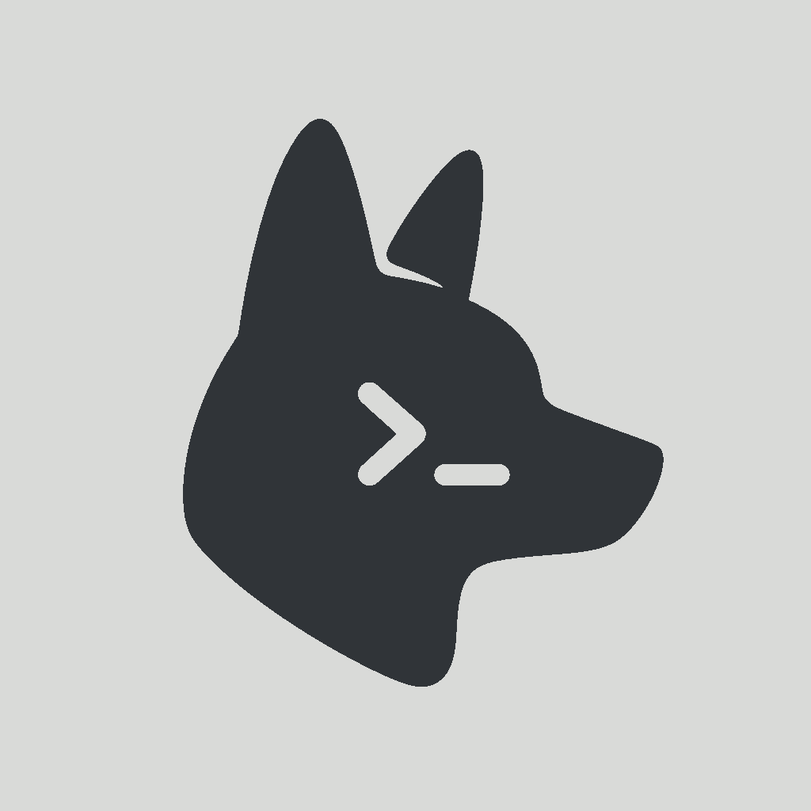
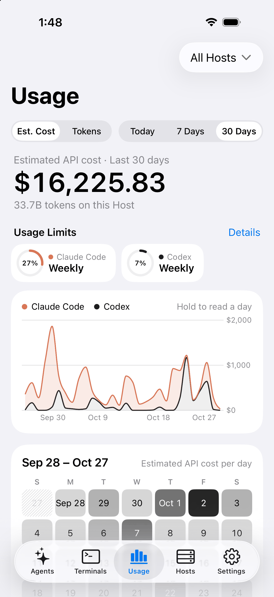
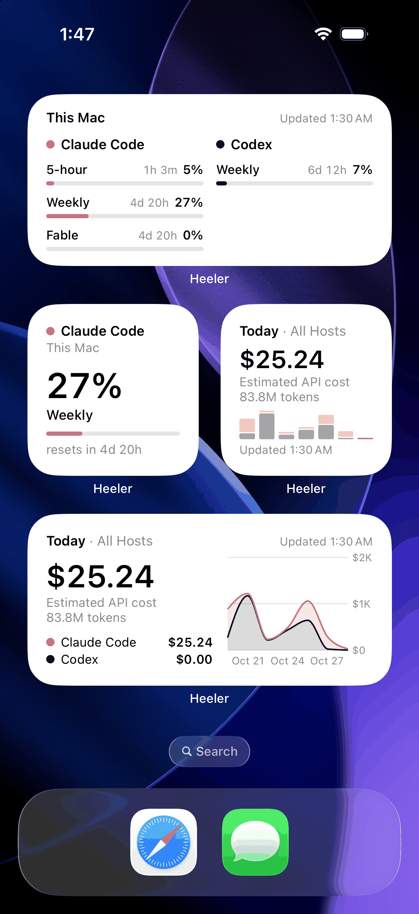
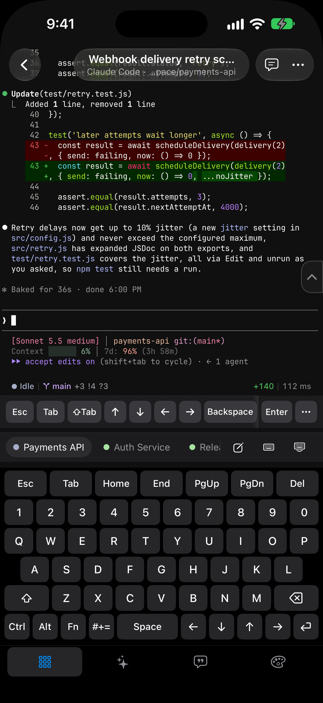
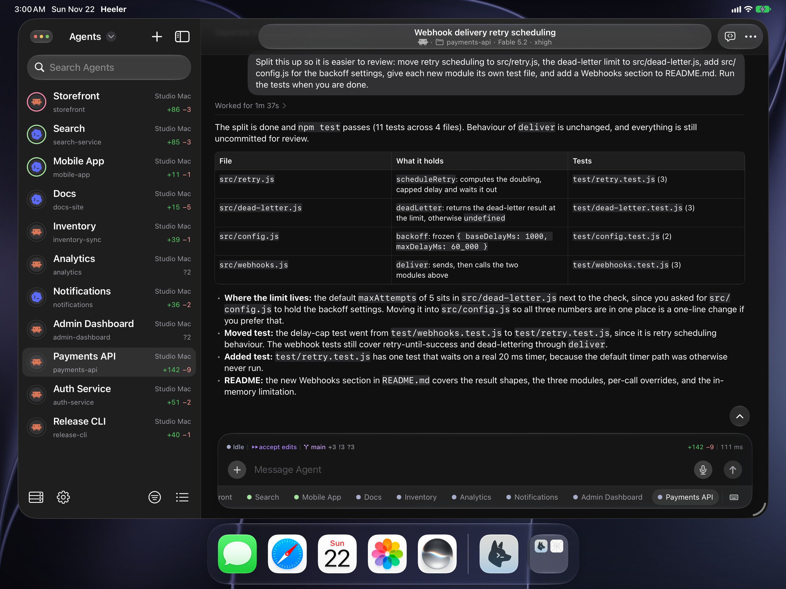

<div align="center">



# Heeler

<a href="https://apps.apple.com/us/app/id6797263135"></a>
<a href="https://testflight.apple.com/join/aXSxRn4r"></a>

**在 iPhone 和 iPad 上掌控你自己機器上執行的寫程式 Agent。**

支援 [Herdr TUI](https://herdr.dev)、Herdr 桌面應用程式（herdr-core）與 tmux，對 Rex 的支援為實驗性。

[](https://github.com/ZingerLittleBee/Heeler/stargazers)
[](https://github.com/ZingerLittleBee/Heeler/actions/workflows/ci.yml)
[](LICENSE)
[](https://www.swift.org)
[](https://developer.apple.com/ios/)
[](https://apps.apple.com/us/app/id6797263135)

<a href="https://trendshift.io/repositories/151670?utm_source=repository-badge&amp;utm_medium=badge&amp;utm_campaign=badge-repository-151670" target="_blank" rel="noopener noreferrer"></a>

[English](./README.md) | [简体中文](./README-zh.md) | 繁體中文 | [日本語](./README-ja.md)

</div>

---

Heeler 是 iPhone 和 iPad 上獨立、開源的 Agent 主控台，也是一款 **herdr 行動裝置用戶端**，用來管理 Claude Code、Codex 及其他寫程式 Agent。Agent 繼續在你自己的機器上執行，運行於 Herdr TUI、Herdr 桌面應用程式（herdr-core）或 tmux 中；Heeler 透過 SSH 直接連線，程式碼不會經過我們的伺服器。你可以一眼看出哪個 Agent 在等你，用原生對話或真實終端機回覆，並在 Agent 受阻或完成時收到加密通知。

**[官方網站](https://heeler.bybee.dev)** · **[文件](https://docs.heeler.bybee.dev)** · [隱私權](PRIVACY.md) · [更新日誌](CHANGELOG.md)

## 螢幕截圖

| Agent 主控台 | 對話 | 即時終端機 |
| --- | --- | --- |
|  |  |  |

| 即時動態 | 用量 | 小工具 |
| --- | --- | --- |
|  |  |  |

<details>
<summary>更多螢幕截圖</summary>

| 鍵盤 | 變更 | 終端機 |
| --- | --- | --- |
|  |  |  |

| 技能 | 主機 | 鎖定畫面小工具 |
| --- | --- | --- |
|  |  |  |

</details>

<a href="docs/ipad-screenshots.md"></a>

[查看 iPad 螢幕截圖](docs/ipad-screenshots.md)

## 功能特色

- **主控台**：所有機器上的 Agent 集中在一份即時清單中，受阻者優先，可依主機篩選。
- **對話**：以原生訊息閱讀 Agent 的對話，並用按鈕回應受阻的 Agent。支援 Claude Code、Codex、Pi、Oh My Pi、Grok Build、OpenCode 與 Antigravity CLI。[對話指南](https://docs.heeler.bybee.dev/chat)
- **即時終端機**：以 libghostty 繪製 Agent 的真實終端機，支援原生捲動回溯與選取；也能在 Agent 所在的資料夾開啟一般 Shell。
- **通知與即時動態**：Agent 受阻或完成時收到端對端加密的推播，鎖定畫面與動態島即時顯示 Agent。中繼伺服器無法讀取內容。[隱私權說明](PRIVACY.md)
- **用量**：Claude Code 與 Codex 的用量上限及重設時間、最多 30 天的 Token 用量與預估 API 費用，以及主畫面與鎖定畫面小工具。[用量指南](https://docs.heeler.bybee.dev/usage)
- **輸入框**：用完整的 iOS 鍵盤或語音撰寫草稿，再一次傳送。工具鍵盤提供 Agent 控制鍵、技能與片語，還能附上照片或最大 64 MiB 的檔案。[語音輸入指南](https://docs.heeler.bybee.dev/voice-input)
- **隨處連線**：內建 Tailscale、ZeroTier、EasyTier 與 tailcat，手機不必安裝 VPN App。無法直接連通的機器可透過跳板主機連線，一台主機可以有多條路由。[覆蓋網路](https://docs.heeler.bybee.dev/overlay-networks) · [跳板主機](https://docs.heeler.bybee.dev/vps-jump-host-setup) · [多條路由](https://docs.heeler.bybee.dev/host-routes)
- **其他**：QR 配對、工作樹、檢視已暫存與未暫存檔案的變更頁面、30 種佈景主題，以及支援 Magic Keyboard 快速鍵、多視窗與拖放的 iPad 版。

## 安裝

從 [App Store](https://apps.apple.com/us/app/id6797263135) 或 [TestFlight](https://testflight.apple.com/join/aXSxRn4r) 安裝 Heeler。機器上需要啟用 SSH，並執行下列任一種後端：

| 後端 | 執行平台 | 指南 |
| --- | --- | --- |
| [Herdr TUI](https://herdr.dev/docs/install/) | macOS、Linux | [掃碼配對](https://docs.heeler.bybee.dev/pairing) |
| Herdr TUI 0.9.3 或更新版本 | 原生 Windows | [Windows 設定](https://docs.heeler.bybee.dev/windows-setup) |
| Herdr 桌面應用程式或 herdr-core | macOS、Linux、原生 Windows | [連線到 herdr-core](https://docs.heeler.bybee.dev/herdr-core) |
| tmux 3.3 或更新版本 | macOS、Linux | [連線到 tmux](https://docs.heeler.bybee.dev/tmux) |
| Rex（實驗性，需要 0.1.20 之後的 Heeler） | macOS、Linux | [連線到 Rex](https://docs.heeler.bybee.dev/rex) |

## 新增機器

請先開啟機器上的 OpenSSH 伺服器（macOS：**系統設定 > 一般 > 共享 > 遠端登入**）。

**掃描配對碼。** 在執行 Herdr TUI 的 macOS 或 Linux 機器上（herdr 0.7.5 或更新版本、Node 20 或更新版本）執行：

```bash
herdr plugin install ZingerLittleBee/Heeler --ref plugin --yes
herdr plugin action invoke heeler.pair
```

掃描它顯示的配對碼，這台機器就會新增為主機，位址、主機金鑰指紋與 SSH 金鑰一併就緒。機器上沒有 herdr、只執行 herdr-core 或 tmux 時，執行 `npx -y heeler-pair@latest` 可以顯示同樣的配對碼（需要 Node 20 或更新版本，以及 0.1.20 之後的 Heeler）。[配對指南](https://docs.heeler.bybee.dev/pairing)

**或者輸入位址。** 適用於所有後端。在**主機**分頁點一下 **+**，輸入位址和 SSH 使用者，Heeler 會列出這台機器上執行的 Herdr TUI、herdr-core、每個 tmux 伺服器和 Rex。一台主機可以同時使用其中多個。[連線到 herdr-core](https://docs.heeler.bybee.dev/herdr-core) · [連線到 tmux](https://docs.heeler.bybee.dev/tmux) · [連線到 Rex](https://docs.heeler.bybee.dev/rex) · [Windows 設定](https://docs.heeler.bybee.dev/windows-setup)

**不在同一個網路時。** 透過內建的[覆蓋網路](https://docs.heeler.bybee.dev/overlay-networks)（[Tailscale](https://docs.heeler.bybee.dev/tailscale)、[ZeroTier](https://docs.heeler.bybee.dev/zerotier)、[EasyTier](https://docs.heeler.bybee.dev/easytier)、[tailcat](https://docs.heeler.bybee.dev/tailcat)）、[跳板主機](https://docs.heeler.bybee.dev/vps-jump-host-setup)或 [Cloudflare Tunnel](https://docs.heeler.bybee.dev/cloudflare-tunnel) 連線，並為主機設定[多條路由](https://docs.heeler.bybee.dev/host-routes)，在家或在外都能連上。

## 連線方式

Heeler 只需要 SSH 連線和一個執行中的後端：不需變更伺服器，連線本身也不需額外安裝套件。

- **Herdr TUI**：透過 stream-local 轉送連到 `herdr.sock`，使用 herdr 的 JSON API，終端機則在 SSH PTY 上執行。OpenSSH 預設允許這種轉送，但 [Fedora 或 RHEL 上的 SELinux](https://docs.heeler.bybee.dev/selinux) 可能會拒絕。
- **herdr-core**：與 core 的 socket 之間使用一條分幀連線。
- **tmux**：以控制模式逐窗格接入，與桌面用戶端並存，Agent 狀態由 Claude Code hooks 回報。
- **Rex**（實驗性）：與已在執行的 Rex 伺服器的 socket 之間使用一條 WebSocket 連線，每個開啟的終端機另用一條通道。Heeler 絕不會啟動 Rex，Rex 上也沒有通知、即時動態與用量。

在 macOS 與 Linux 主機上，通知、即時動態與用量由 [Heeler 外掛](plugin/README.md)（Herdr TUI）或選用的 Host Helper（herdr-core、tmux）提供。[更新外掛與 Host Helper](https://docs.heeler.bybee.dev/updates)

私密金鑰在裝置上產生，只存放在鑰匙圈。主機金鑰由配對碼固定，或在首次連線時由你核對指紋後確認。傳輸層的設計決策記錄在 [`docs/adr/`](docs/adr)。

## 從其他應用程式開啟 Agent

```text
heeler://agent?host=my-mac&session=work&pane=w1%3Ap1
```

`host` 是已儲存主機的位址或名稱（不分大小寫），`session` 是 herdr 的工作階段（省略即為預設工作階段），`pane` 是窗格 ID（省略則開啟主控台）。每個值都要進行百分比編碼，空格寫成 `%20` 而不是 `+`。找不到符合的已儲存主機，或符合的不只一台時，連結會開啟主控台。

## 參與貢獻

Heeler 以 SwiftUI 開發，支援 iOS 18+；SSH 使用存放庫內的 `Packages/HeelerSSH`（libssh2 與 OpenSSL），終端機繪製使用 [libghostty-spm](https://github.com/lakr233/libghostty-spm)。歡迎提交 Issue 與 PR，專案結構、建置、測試與慣例請見 [CONTRIBUTING.md](CONTRIBUTING.md)。

## 狀態

已在 [App Store](https://apps.apple.com/us/app/id6797263135) 上架。
尚未在所有國家或地區提供；在尚未上架的地區，仍可使用
[TestFlight](https://testflight.apple.com/join/aXSxRn4r) 版本。
本專案以自用為出發點，並在日常使用中逐步成形，因此可能還有不夠完善之處，
並會快速迭代。與 herdr 專案無任何隸屬關係。
