<div align="center">

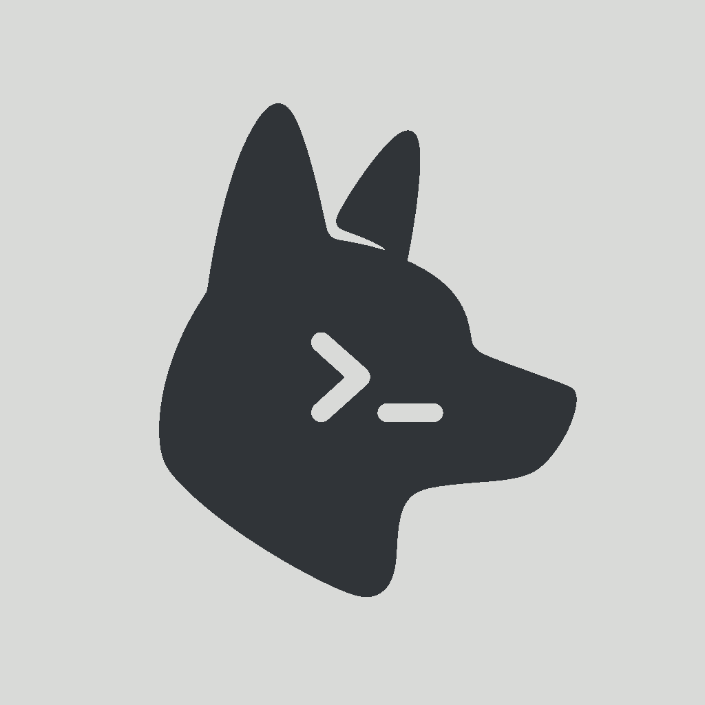

# Heeler

<a href="https://apps.apple.com/us/app/heeler-for-herdr/id6797263135"></a>
<a href="https://testflight.apple.com/join/aXSxRn4r"></a>

**[herdr](https://herdr.dev)（以 Agent 為優先的終端機執行環境）與 tmux 的原生 iOS 配套 App。**

[](https://github.com/ZingerLittleBee/Heeler/stargazers)
[](https://github.com/ZingerLittleBee/Heeler/actions/workflows/ci.yml)
[](LICENSE)
[](https://www.swift.org)
[](https://developer.apple.com/ios/)
[](https://apps.apple.com/us/app/heeler-for-herdr/id6797263135)

<a href="https://trendshift.io/repositories/151670?utm_source=repository-badge&amp;utm_medium=badge&amp;utm_campaign=badge-repository-151670" target="_blank" rel="noopener noreferrer"></a>

[English](./README.md) | [简体中文](./README-zh.md) | 繁體中文 | [日本語](./README-ja.md)

</div>

---

Heeler 是獨立的 **herdr 行動裝置用戶端**，也是在 iPhone 和 iPad 上管理 Claude Code、Codex 及其他寫程式 Agent 的 Agent 主控台。Agent 在你自己的主機上執行，運行於 Herdr TUI、Herdr 桌面應用程式（herdr-core）或 tmux 中；Heeler 透過 SSH 連線。你可以跨機器監控多個 Agent，並依誰需要你處理來排序，接著開啟即時終端機或支援的對話來傳送指令。

## 螢幕截圖

| Agent 主控台 | 即時終端機 | 對話 |
| --- | --- | --- |
| 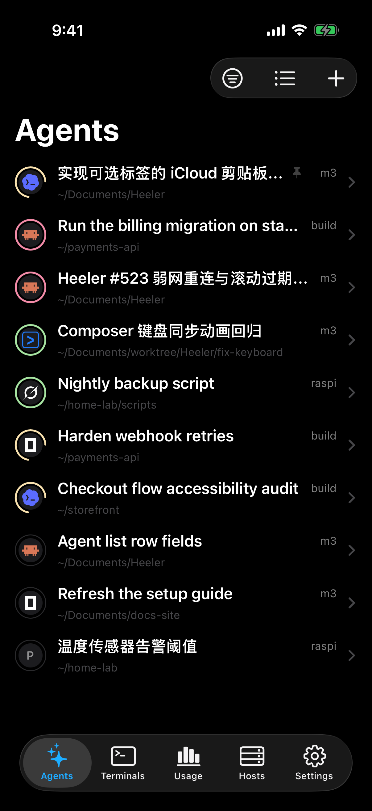 | 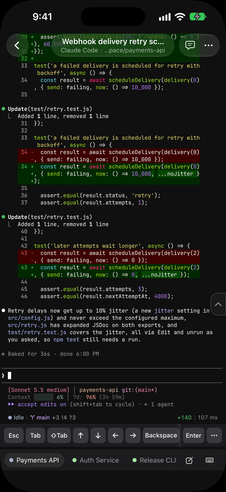 | 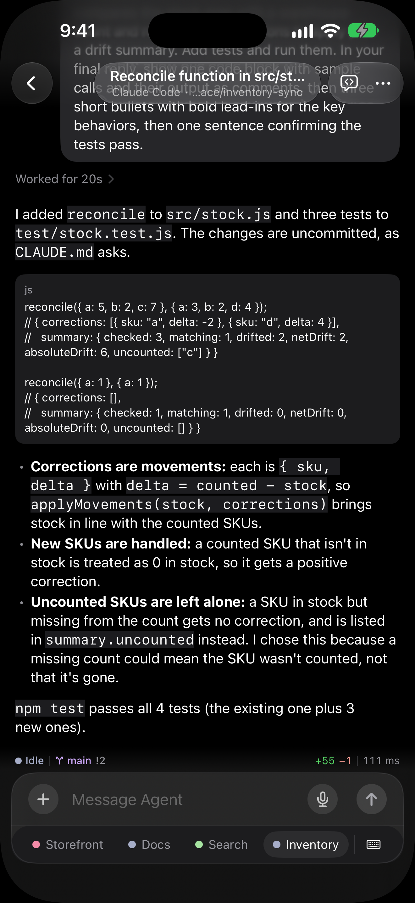 |

| 鍵盤 | 變更 | 終端機 |
| --- | --- | --- |
| 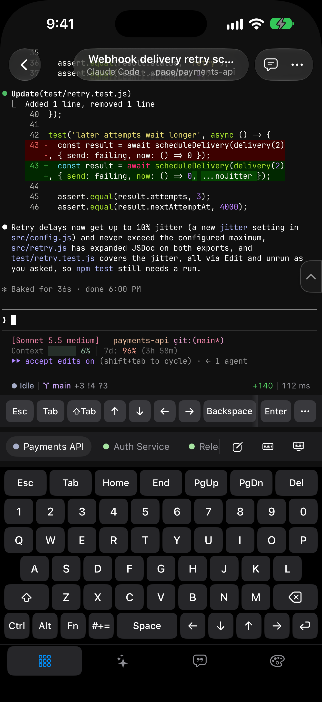 | 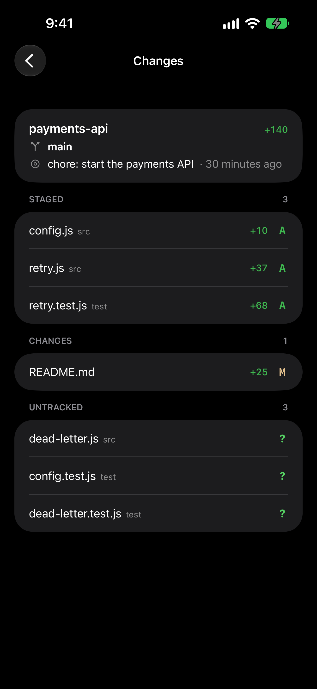 | 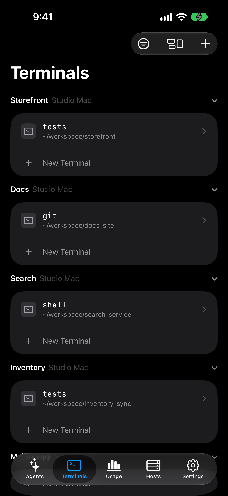 |

| 技能 | 主機 | 即時動態 |
| --- | --- | --- |
| 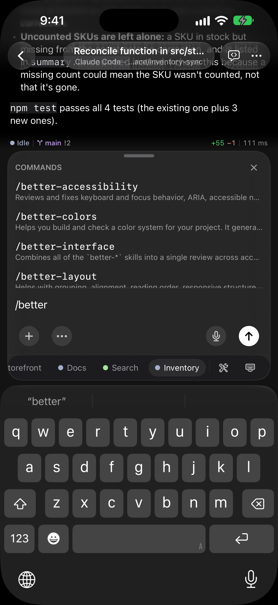 | 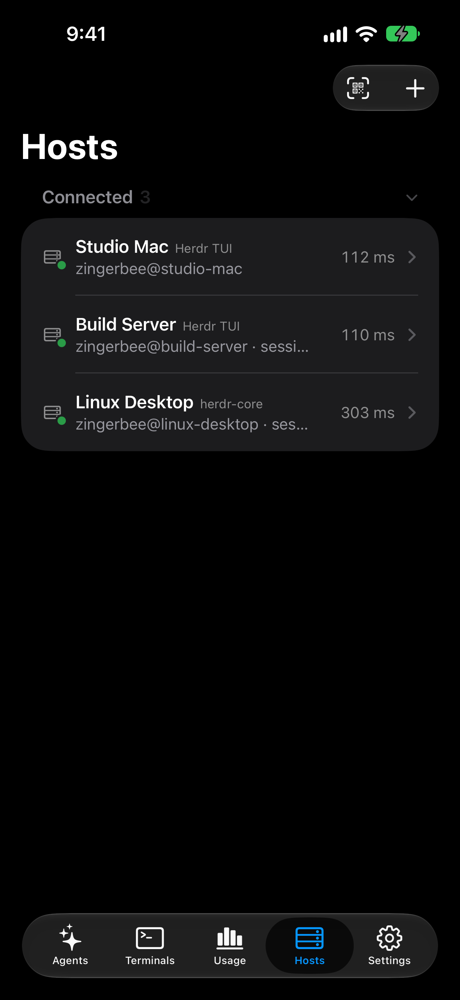 | 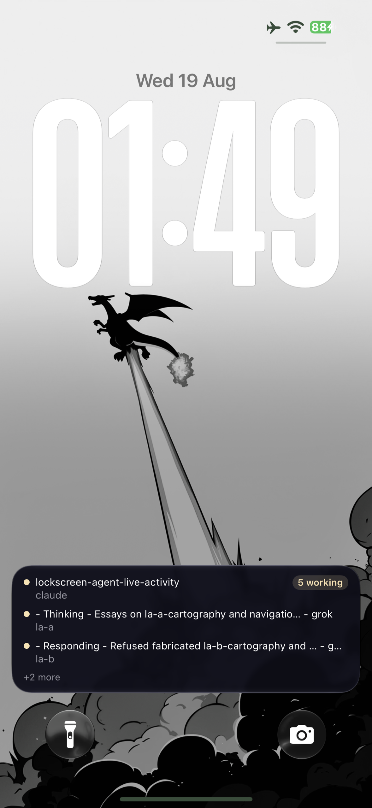 |

| 用量 | 小工具 | 鎖定畫面小工具 |
| --- | --- | --- |
| 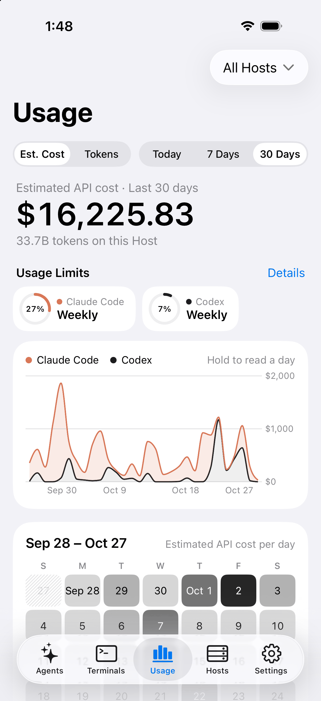 | 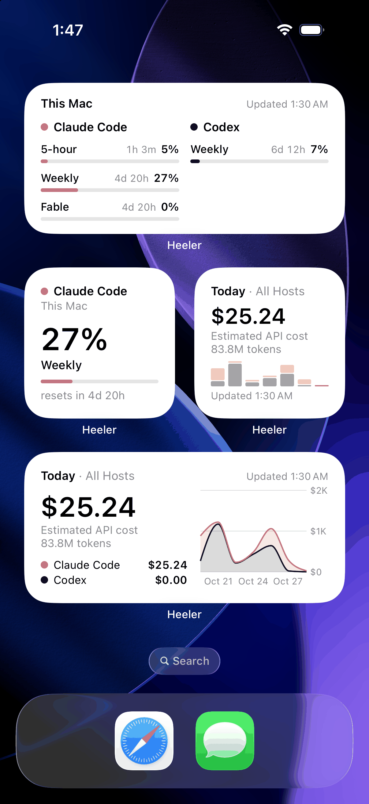 | 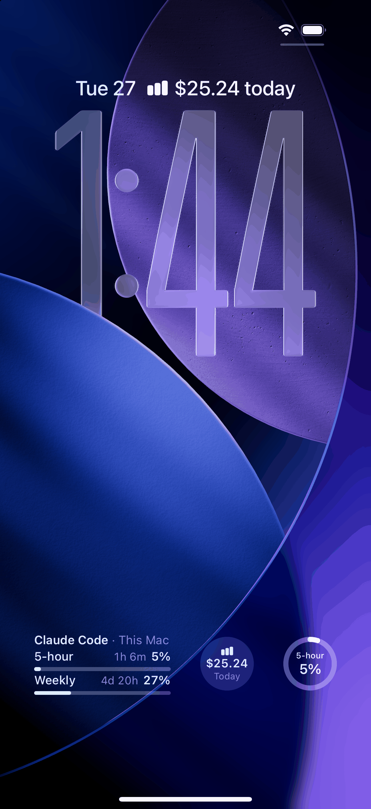 |

<a href="docs/ipad-screenshots.md">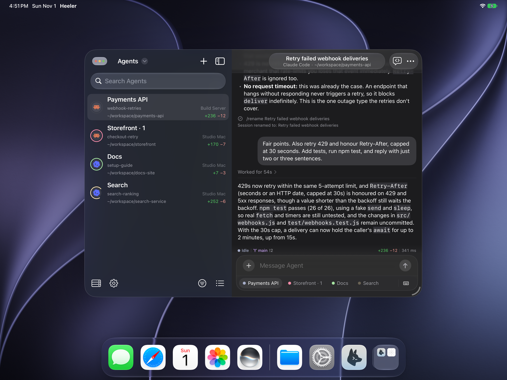</a>

[查看 iPad 螢幕截圖](docs/ipad-screenshots.md)

## 功能特色

- **主控台**——所有機器上的所有 Agent 集中在一份依狀態排序的清單中
  （受阻者優先），可依主機篩選，即時更新。
- **Herdr 桌面應用程式與 herdr-core**——可連線到 macOS、Linux 與原生
  Windows 上的 Herdr 桌面應用程式或無介面的 herdr-core。主控台會跟隨
  桌面應用程式的空間與分頁，即時終端機、對話、輸入框、新增 Agent
  與新增 Workspace 在那裡也都能使用
  （[了解更多](https://docs.heeler.bybee.dev/herdr-core)）。
- **tmux**——可連線到 macOS 或 Linux 上的 tmux 3.3+ 伺服器。工作階段、
  視窗與窗格會出現在主控台中，即時終端機會配合你的螢幕調整大小並保持在同一
  視窗已開啟的桌面終端機範圍內，對話、輸入框、新增 Agent、新增 Workspace
  與工作樹同樣可用，並透過 Claude Code hooks 與選用的 Host Helper 加入
  Agent 狀態、通知、即時動態與用量
  （[了解更多](https://docs.heeler.bybee.dev/tmux)）。
- **接入**——以 libghostty 繪製 Agent 的真實終端機：原生捲動回溯、
  同樣能操作全螢幕 TUI 的慣性觸控捲動、長按選取、接管已失效的
  終端機擁有者，以及默默收集、稍後再開啟的網頁連結。
- **對話**——以原生訊息閱讀 Agent 的對話，而不是看終端機畫面；從
  輸入框回覆，並用按鈕回應受阻的 Agent；支援 Claude Code、Codex、
  Pi、Oh My Pi、Grok Build 與 OpenCode
  （[了解更多](https://docs.heeler.bybee.dev/chat)）。
- **輸入框**——用完整的 iOS 鍵盤（自動修正、輸入法、聽寫）在本機撰寫
  草稿，再一次傳送；工具鍵盤另外提供 Agent 控制鍵、Agent 技能、
  可重複使用的片語與終端機外觀。語音輸入讓你能使用自己的語音
  服務 API 金鑰對輸入框說話
  （[了解更多](https://docs.heeler.bybee.dev/voice-input)）。
- **終端機**——在 Agent 所在的資料夾開啟一般 Shell，提供文字與按鍵
  模式，每個 Workspace 重複使用同一個分頁。
- **附件**——透過 SFTP 將照片或最大 64 MiB 的檔案暫存到主機，並把
  檔案路徑插入草稿。
- **QR 配對**——掃描配對碼即可新增機器；金鑰在裝置上產生，私密金鑰
  只存放在鑰匙圈，配對碼還會固定主機金鑰指紋。
- **通知與即時動態**——Agent 受阻或完成時發送端對端加密的推播，並以
  鎖定畫面／動態島橫幅即時追蹤 Agent；中繼伺服器永遠無法讀取內容
  （[PRIVACY.md](PRIVACY.md)）。
- **用量**——顯示 Claude Code 與 Codex 的用量上限及重設時間，以及最多
  30 天的 Token 用量與預估 API 費用，可彙整所有主機或只看單一主機；
  主畫面與鎖定畫面小工具讓你隨時一覽
  （[了解更多](https://docs.heeler.bybee.dev/usage)）。
- **工作樹**——在 Workspace 存放庫的乾淨 checkout 上啟動 Agent。
- **外觀**——跟隨系統、淺色或深色；30 種佈景主題，淺色與深色可分別指定，
  終端機、對話與整個 App 都會套用；內建 JetBrains Mono 與 IBM Plex Mono
  字體；可雙指縮放。
- **跳板主機**——透過 SSH 跳板連到無法直接連通的機器，兩段跳轉的
  金鑰都會驗證。

## 連線方式

在 macOS 與 Linux 主機上，Heeler 透過 SSH 使用 herdr 的 JSON API：每個請求都會開啟一條通往 `herdr.sock` 的 direct-streamlocal 通道，一條長期連線的通道負責傳遞事件串流，而互動式終端機則在 SSH PTY 上執行 `herdr agent attach --takeover`。唯一的前置條件是能以 SSH 連線，且 herdr 正在執行——不需變更伺服器，也不需額外安裝套件。SSH 伺服器必須允許 stream-local 轉送（OpenSSH 預設即允許）；若被停用，新增主機的引導流程會提示。在 Fedora、RHEL 及其衍生版本上，即使允許轉送，SELinux 仍可能拒絕開啟 socket——請參閱 [Fedora 或 RHEL 主機上的 SELinux](docs/guides/selinux.md)。

原生 Windows 主機（herdr >= 0.9.3）透過 SSH 連線，需手動新增。

herdr-core 主機（包括執行 Herdr 桌面應用程式的機器）需手動新增，並確認其伺服器類型。Heeler 與 core 之間使用一條分幀連線：在 macOS 與 Linux 上是通往其 socket 的 direct-streamlocal 通道，在原生 Windows 上則是透過 SSH exec 執行 `herdr-core connect`。連線時絕不會在 macOS 或 Linux 上啟動 core。選用的 Host Helper 可在 macOS 與 Linux 上加入通知、即時動態與用量功能（[連線到 herdr-core](https://docs.heeler.bybee.dev/herdr-core)）。

tmux 主機（macOS 與 Linux 上的 tmux >= 3.3）同樣需手動新增，並確認其伺服器類型與 socket 名稱。連線時絕不會啟動 tmux 伺服器；在 Linux 上可依你的指示透過新增 Workspace 啟動。即時終端機以 tmux 控制模式與桌面用戶端並存接入，配合螢幕調整大小並保持在同一視窗已開啟的桌面終端機範圍內。Claude Code hooks 可回報受阻、完成與對話 ID，選用的 Host Helper 則加入狀態讀取、Pi 與 Oh My Pi 擴充功能、通知、即時動態與用量功能（[連線到 tmux](https://docs.heeler.bybee.dev/tmux)）。

若要透過 Tailscale、ZeroTier 或 EasyTier 連線，請參考[覆蓋網路設定指南](docs/guides/overlay-networks.md)。內容涵蓋 macOS 安裝、Mac 上不使用 VPN 的 Tailscale、Heeler 設定與連線檢查。Heeler 在應用程式內加入這些網路，不需要 iOS 的 VPN 設定；你需要含有 **設定 > 覆蓋網路** 的 Heeler 版本。

[查看 Heeler 設定螢幕截圖](docs/guides/overlay-networks.md#heeler-setup-screenshots)，涵蓋 Tailscale、ZeroTier 與兩種 EasyTier 模式。

無法直接連通的機器可以放在 SSH 跳板主機後方：

- [逐步設定遠端存取](docs/guides/vps-jump-host-setup.md)
- [架構、安全邊界與 VPS 維運手冊](docs/guides/vps-jump-host.md)

一台主機可以有多條路徑，例如在家使用的區域網路位址，以及在外使用的覆蓋網路或跳板主機：[透過多條路徑連到主機](docs/guides/host-routes.md)。

## 安裝

從 [App Store](https://apps.apple.com/us/app/heeler-for-herdr/id6797263135)
或 [TestFlight](https://testflight.apple.com/join/aXSxRn4r) 安裝 Heeler。

- **macOS / Linux**：安裝 [herdr](https://herdr.dev/docs/install/)、啟用 SSH，
  然後依照下方的配對步驟操作。
- **原生 Windows**：請參考 [Windows 設定指南](docs/guides/windows-setup.md)。
- **Herdr 桌面應用程式 / herdr-core**：啟動桌面應用程式或 herdr-core、
  啟用 SSH，然後手動新增主機：
  [連線到 herdr-core](https://docs.heeler.bybee.dev/herdr-core)。需要
  Heeler 0.1.18 或更新版本。
- **tmux（macOS / Linux）**：啟動 tmux 3.3 或更新版本（在 Linux 上也可由
  新增 Workspace 啟動）、啟用 SSH，然後手動新增主機：
  [連線到 tmux](https://docs.heeler.bybee.dev/tmux)。

## 新增機器

在執行 herdr 的 macOS 或 Linux 機器上（Node >= 20、herdr >= 0.7.5、已開啟 OpenSSH 伺服器——
macOS：**系統設定 > 一般 > 共享 > 遠端登入**）：

```bash
herdr plugin install ZingerLittleBee/Heeler --ref plugin --yes
herdr plugin action invoke heeler.pair
```

掃描它顯示的配對碼 QR Code，這台機器就會新增為主機——配對碼內含位址、
主機金鑰指紋與 SSH 金鑰註冊資訊。你在應用程式中為該主機啟用通知後，
同一個[外掛](plugin/README.md)就會傳送加密通知。每個步驟、彈出視窗中的
按鍵以及疑難排解，請參閱[配對指南](https://docs.heeler.bybee.dev/pairing)。

## 從其他應用程式開啟 Agent

其他應用程式可以透過連結在 Heeler 中開啟 Agent：

```text
heeler://agent?host=my-mac&session=work&pane=w1%3Ap1
```

- `host` 指定該工作階段上已儲存的主機：填寫其位址；若該工作階段上沒有
  主機使用該位址，則填寫其名稱。不分大小寫。
- `session` 是 herdr 的工作階段名稱。省略或傳入 `default` 即為預設
  工作階段。
- `pane` 是 herdr 的窗格 ID。省略則開啟主控台。

請對每個值進行百分比編碼，空格用 `%20`：`+` 會維持為加號，
因此表單編碼（例如 JavaScript 的 `URLSearchParams`）會對不上像
`Build Box` 這樣的名稱。若該工作階段上沒有符合的已儲存主機，
或符合的不只一台，連結會開啟主控台。

## 技術堆疊

- SwiftUI、iOS 18+、iPhone 與 iPad。0.1.8 版恢復 iPad 支援，並加入 Magic Keyboard 快速鍵、多視窗與拖放。
- SSH 使用存放庫內的 `Packages/HeelerSSH`（libssh2 + OpenSSL）
- 終端機模擬與 Metal 繪製使用 [libghostty-spm](https://github.com/lakr233/libghostty-spm)

原因請見 `docs/adr/`——尤其是傳輸層的來龍去脈並不直觀。

## 參與貢獻

歡迎提交 Issue 與 PR——專案結構、建置／測試與慣例請見
[CONTRIBUTING.md](CONTRIBUTING.md)。

## 狀態

已在 [App Store](https://apps.apple.com/us/app/heeler-for-herdr/id6797263135) 上架。
尚未在所有國家或地區提供；在尚未上架的地區，仍可使用
[TestFlight](https://testflight.apple.com/join/aXSxRn4r) 版本。
本專案以自用為出發點，並在日常使用中逐步成形，因此可能還有不夠完善之處，
並會快速迭代。與 herdr 專案無任何隸屬關係。
