<div align="center">


# Heeler

<a href="https://apps.apple.com/us/app/id6797263135"></a>
<a href="https://testflight.apple.com/join/aXSxRn4r"></a>

**在 iPhone 和 iPad 上掌控你自己机器上运行的编程 Agent。**

支持 [Herdr TUI](https://herdr.dev)、Herdr 桌面端（herdr-core）和 tmux，对 Rex 的支持为实验性。

[](https://github.com/ZingerLittleBee/Heeler/stargazers)
[](https://github.com/ZingerLittleBee/Heeler/actions/workflows/ci.yml)
[](LICENSE)
[](https://www.swift.org)
[](https://developer.apple.com/ios/)
[](https://apps.apple.com/us/app/id6797263135)

<a href="https://trendshift.io/repositories/151670?utm_source=repository-badge&amp;utm_medium=badge&amp;utm_campaign=badge-repository-151670" target="_blank" rel="noopener noreferrer"></a>

[English](./README.md) | 简体中文 | [繁體中文](./README-zh-TW.md) | [日本語](./README-ja.md)

</div>

---

Heeler 是 iPhone 和 iPad 上独立、开源的 Agent 控制台，也是一款 **herdr 移动客户端**，用于操作 Claude Code、Codex 和其他编程 Agent。Agent 继续在你自己的机器上通过 Herdr TUI、Herdr 桌面端（herdr-core）或 tmux 运行，Heeler 通过 SSH 直连，代码不经过我们的服务器。一眼看出哪个 Agent 在等你，用原生 Chat 或真实终端回复，Agent 进入 Blocked 或 Done 时收到加密通知。

**[官网](https://heeler.bybee.dev)** · **[文档](https://docs.heeler.bybee.dev/zh)** · [隐私](PRIVACY.md) · [更新日志](CHANGELOG.md)

## 截图

| Agent Console | Chat | 实时终端 |
| --- | --- | --- |
| 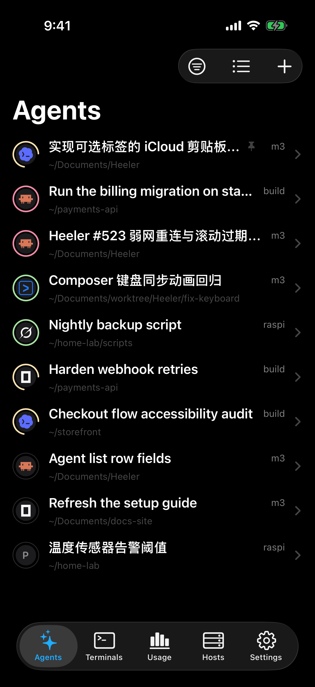 | 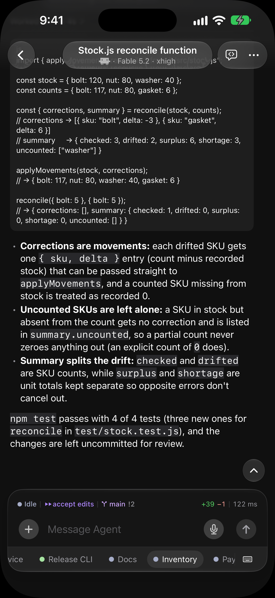 | 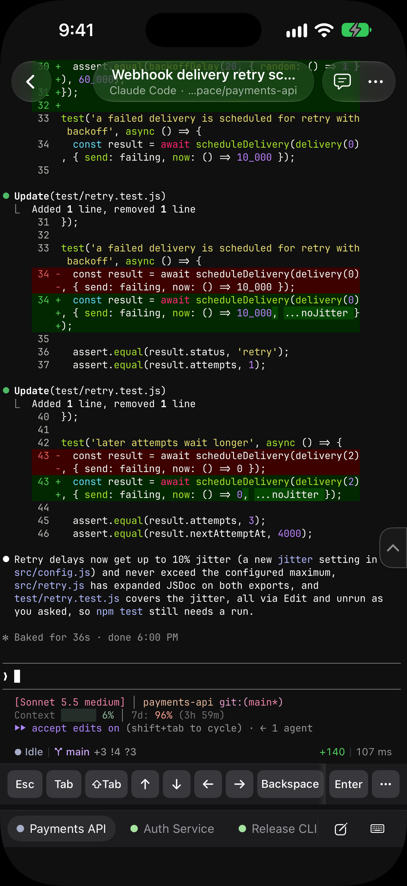 |

| 实时活动 | Usage | 小组件 |
| --- | --- | --- |
| 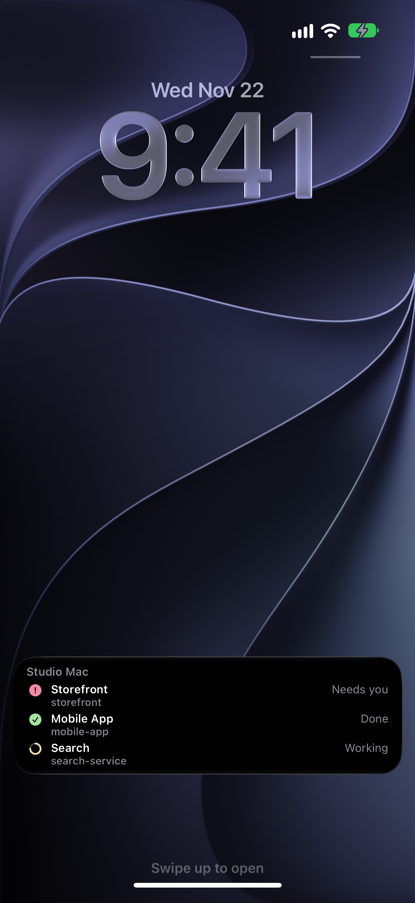 | 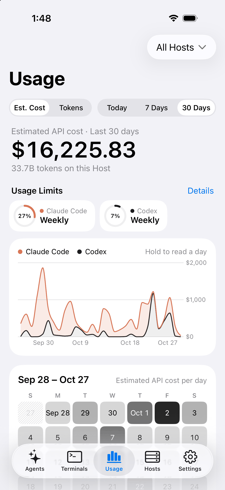 | 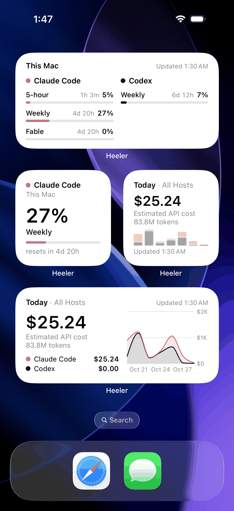 |

<details>
<summary>更多截图</summary>

| Keyboard | Changes | Terminals |
| --- | --- | --- |
| 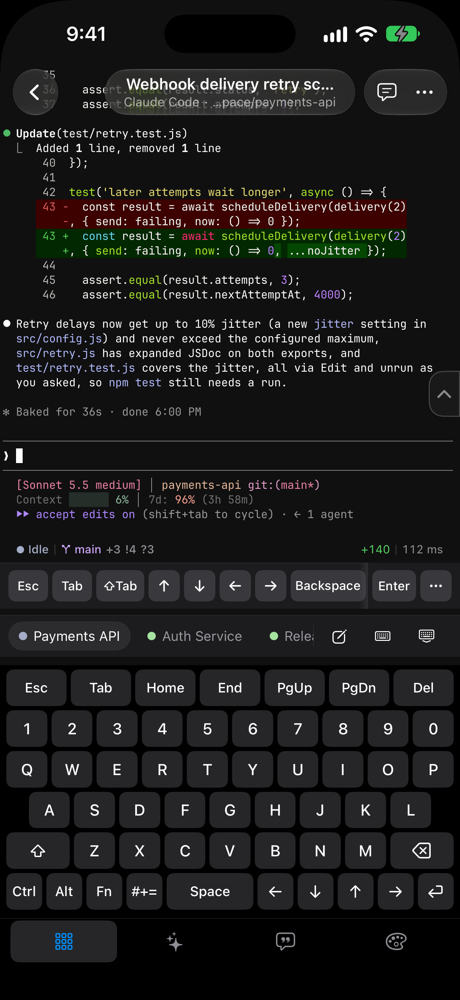 | 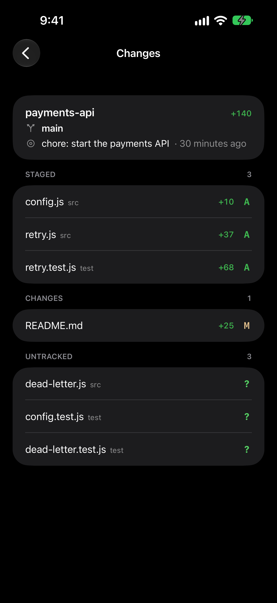 | 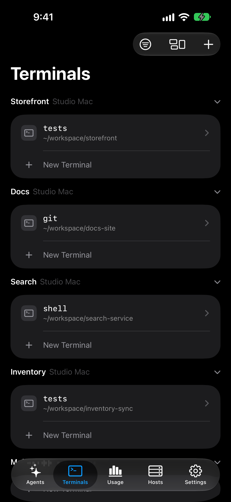 |

| Skills | Hosts | 锁屏小组件 |
| --- | --- | --- |
| 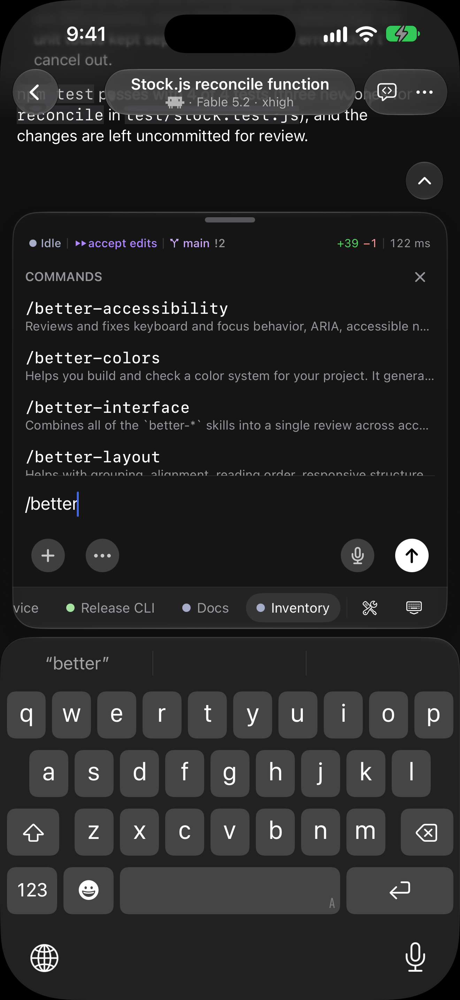 | 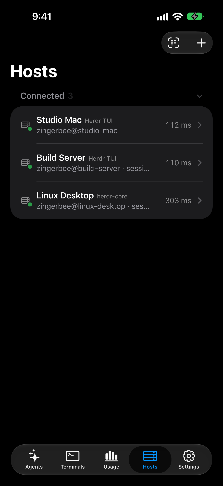 | 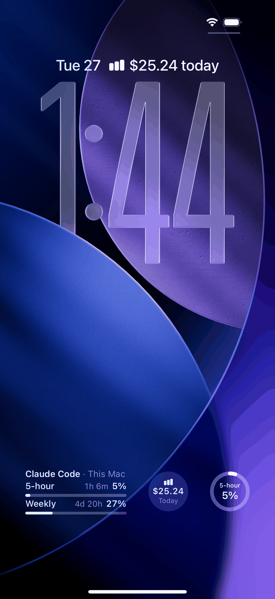 |

</details>

<a href="docs/ipad-screenshots.md">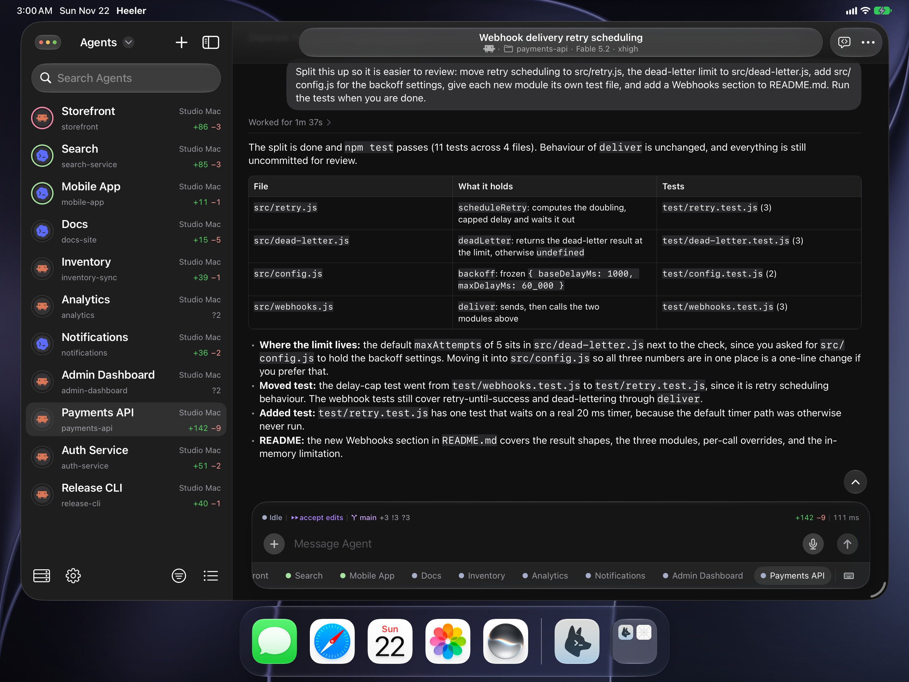</a>

[查看 iPad 截图](docs/ipad-screenshots.md)

## 功能

- **Console**：所有机器上的 Agent 汇成一个实时列表，Blocked 排最前，可按 Host 过滤。
- **Chat**：以原生消息阅读 Agent 的对话，用按钮回答 Blocked 的 Agent。支持 Claude Code、Codex、Pi、Oh My Pi、Grok Build、OpenCode 和 Antigravity CLI。[Chat 教程](https://docs.heeler.bybee.dev/zh/chat)
- **实时终端**：libghostty 渲染的 Agent 真实终端，支持原生历史回看和选择；也可以在 Agent 的目录打开普通 shell。
- **通知与实时活动**：Agent 进入 Blocked 或 Done 时收到端到端加密的推送，锁屏和灵动岛上实时显示 Agent。中继读不到内容。[隐私说明](PRIVACY.md)
- **Usage**：Claude Code 与 Codex 的 Usage Limits 及重置时间，最多 30 天的 Token Usage 和估算 API 费用，以及主屏和锁屏小组件。[Usage 教程](https://docs.heeler.bybee.dev/zh/usage)
- **Composer**：用完整的 iOS 键盘或语音起草，一次 Send 投递。工具键盘提供 Agent 控制键、Skills 和 Snippets，还可以附上照片或最大 64 MiB 的文件。[Voice Input 教程](https://docs.heeler.bybee.dev/zh/voice-input)
- **随处可连**：内置 Tailscale、ZeroTier、EasyTier 和 tailcat，手机无需安装 VPN 应用。不可直连的机器可以走跳板机，一台 Host 可以有多条路由。[Overlay Network](https://docs.heeler.bybee.dev/zh/overlay-networks) · [跳板机](https://docs.heeler.bybee.dev/zh/vps-jump-host-setup) · [多条路由](https://docs.heeler.bybee.dev/zh/host-routes)
- **其他**：扫码配对、Worktrees、查看已暂存和未暂存文件的 Changes、30 个主题，以及支持 Magic Keyboard 快捷键、多窗口和拖放的 iPad 版。

## 安装

从 [App Store](https://apps.apple.com/us/app/id6797263135) 或 [TestFlight](https://testflight.apple.com/join/aXSxRn4r) 安装 Heeler。机器上需要开启 SSH，并运行下面任意一种后端：

| 后端 | 运行平台 | 教程 |
| --- | --- | --- |
| [Herdr TUI](https://herdr.dev/docs/install/) | macOS、Linux | [扫码配对](https://docs.heeler.bybee.dev/zh/pairing) |
| Herdr TUI 0.9.3 及以上 | Windows 原生环境 | [Windows 配置](https://docs.heeler.bybee.dev/zh/windows-setup) |
| Herdr 桌面端或 herdr-core | macOS、Linux、Windows 原生环境 | [连接 herdr-core](https://docs.heeler.bybee.dev/zh/herdr-core) |
| tmux 3.3 及以上 | macOS、Linux | [连接 tmux](https://docs.heeler.bybee.dev/zh/tmux) |
| Rex（实验性，需要 0.1.20 之后的 Heeler） | macOS、Linux | [连接 Rex](https://docs.heeler.bybee.dev/zh/rex) |

## 添加机器

先开启机器上的 OpenSSH 服务器（macOS 上是 **系统设置 > 通用 > 共享 > 远程登录**）。

**扫码配对。** 在运行 Herdr TUI 的 macOS 或 Linux 机器上（herdr 0.7.5 及以上、Node 20 及以上）执行：

```bash
herdr plugin install ZingerLittleBee/Heeler --ref plugin --yes
herdr plugin action invoke heeler.pair
```

用应用扫描弹出的 Pairing Code，机器即被添加为 Host，地址、host key 指纹和 SSH 密钥一并就绪。机器上没有 herdr、只运行 herdr-core 或 tmux 时，执行 `npx -y heeler-pair@latest` 可以显示同样的 Pairing Code（需要 Node 20 及以上，以及 0.1.20 之后的 Heeler）。[扫码配对教程](https://docs.heeler.bybee.dev/zh/pairing)

**或者输入地址。** 适用于所有后端。在 **Hosts** 中轻点 **+**，输入地址和 SSH 用户，Heeler 会列出这台机器上运行的 Herdr TUI、herdr-core、每个 tmux 服务器和 Rex。一个 Host 可以同时带其中的多个。[连接 herdr-core](https://docs.heeler.bybee.dev/zh/herdr-core) · [连接 tmux](https://docs.heeler.bybee.dev/zh/tmux) · [连接 Rex](https://docs.heeler.bybee.dev/zh/rex) · [Windows 配置](https://docs.heeler.bybee.dev/zh/windows-setup)

**不在同一网络时。** 通过内置的 [Overlay Network](https://docs.heeler.bybee.dev/zh/overlay-networks)（[Tailscale](https://docs.heeler.bybee.dev/zh/tailscale)、[ZeroTier](https://docs.heeler.bybee.dev/zh/zerotier)、[EasyTier](https://docs.heeler.bybee.dev/zh/easytier)、[tailcat](https://docs.heeler.bybee.dev/zh/tailcat)）、[跳板机](https://docs.heeler.bybee.dev/zh/vps-jump-host-setup)或 [Cloudflare Tunnel](https://docs.heeler.bybee.dev/zh/cloudflare-tunnel) 连接，并给 Host 配置[多条路由](https://docs.heeler.bybee.dev/zh/host-routes)，在家和在外都能连上。

## 连接原理

Heeler 只需要 SSH 访问和一个运行中的后端：不改服务器，连接本身也不需要额外安装软件包。

- **Herdr TUI**：经 stream-local 转发直连 `herdr.sock`，使用 herdr 的 JSON API，终端运行在 SSH PTY 上。OpenSSH 默认允许这种转发，但 [Fedora 或 RHEL 上的 SELinux](https://docs.heeler.bybee.dev/zh/selinux) 可能会拦截。
- **herdr-core**：与 core 的套接字之间只有一条分帧链路。
- **tmux**：通过控制模式按 Pane 接入，与桌面客户端并存，Agent 状态由 Claude Code 钩子上报。
- **Rex**（实验性）：与已在运行的 Rex 服务器的套接字之间有一条 WebSocket 链路，每个打开的终端另用一条通道。Heeler 绝不会启动 Rex，Rex 上也没有通知、实时活动和 Usage。

在 macOS 和 Linux Host 上，通知、实时活动和 Usage 由 [Heeler 插件](plugin/README.md)（Herdr TUI）或可选的 Host Helper（herdr-core、tmux）提供。[更新插件与 Host Helper](https://docs.heeler.bybee.dev/zh/updates)

私钥在设备上生成，不离开 Keychain。Host 的密钥由 Pairing Code 固定，或在首次连接时由你核对指纹后确认。传输层的选型依据记录在 [`docs/adr/`](docs/adr)。

## 从其他应用打开 Agent

```text
heeler://agent?host=my-mac&session=work&pane=w1%3Ap1
```

`host` 是已保存 Host 的地址或名称（忽略大小写），`session` 是 herdr 会话（省略即默认会话），`pane` 是窗格 ID（省略则打开 Console）。每个值都要做百分号编码，空格写成 `%20` 而不是 `+`。匹配不到已保存的 Host，或匹配到多个时，链接会打开 Console。

## 参与贡献

Heeler 使用 SwiftUI，面向 iOS 18+，SSH 由仓库内的 `Packages/HeelerSSH`（libssh2 和 OpenSSL）提供，终端渲染使用 [libghostty-spm](https://github.com/lakr233/libghostty-spm)。欢迎 Issue 和 PR，仓库结构、构建、测试和约定见 [CONTRIBUTING.md](CONTRIBUTING.md)。

## 状态

已在 [App Store](https://apps.apple.com/us/app/id6797263135) 上发布；部分国家和地区尚未上架，可以继续使用 [TestFlight](https://testflight.apple.com/join/aXSxRn4r)。以个人日常使用打磨为先，仍有粗糙之处，迭代较快。与 herdr 项目无隶属关系。
