<div align="center">


# Heeler

<a href="https://apps.apple.com/us/app/heeler-for-herdr/id6797263135"></a>
<a href="https://testflight.apple.com/join/aXSxRn4r"></a>

**The iPhone and iPad console for the coding agents running on your own machines.**

Works with [Herdr TUI](https://herdr.dev), the Herdr desktop app (herdr-core), and tmux. Rex support is experimental.

[](https://github.com/ZingerLittleBee/Heeler/stargazers)
[](https://github.com/ZingerLittleBee/Heeler/actions/workflows/ci.yml)
[](LICENSE)
[](https://www.swift.org)
[](https://developer.apple.com/ios/)
[](https://apps.apple.com/us/app/heeler-for-herdr/id6797263135)

<a href="https://trendshift.io/repositories/151670?utm_source=repository-badge&amp;utm_medium=badge&amp;utm_campaign=badge-repository-151670" target="_blank" rel="noopener noreferrer"></a>

English | [简体中文](./README-zh.md) | [繁體中文](./README-zh-TW.md) | [日本語](./README-ja.md)

</div>

---

Heeler is an independent, open-source agent console and **herdr mobile client** for Claude Code, Codex, and other coding Agents on iPhone and iPad. Agents keep running on your own machines in Herdr TUI, the Herdr desktop app (herdr-core), or tmux, and Heeler connects to them over SSH, so your code never passes through our servers. See which Agent needs you, answer in native Chat or the real terminal, and get an encrypted notification the moment one goes Blocked or Done.

**[Website](https://heeler.bybee.dev)** · **[Documentation](https://docs.heeler.bybee.dev)** · [Privacy](PRIVACY.md) · [Changelog](CHANGELOG.md)

## Screenshots

| Agent Console | Chat | Live terminal |
| --- | --- | --- |
| 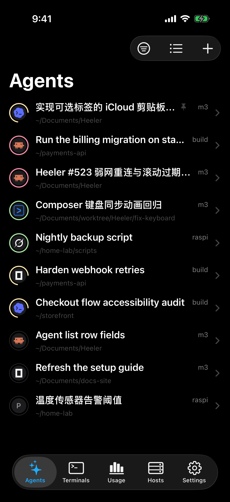 | 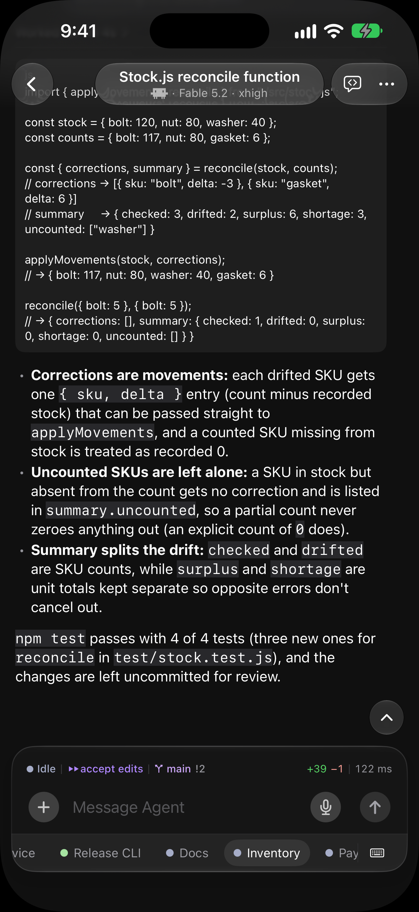 | 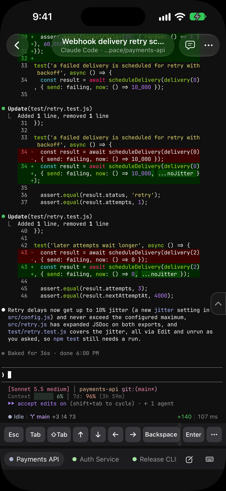 |

| Live Activity | Usage | Widgets |
| --- | --- | --- |
| 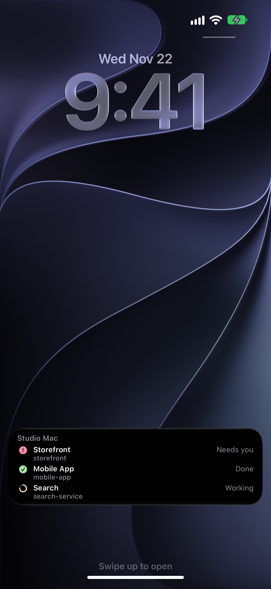 | 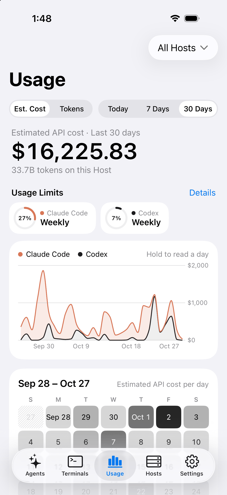 | 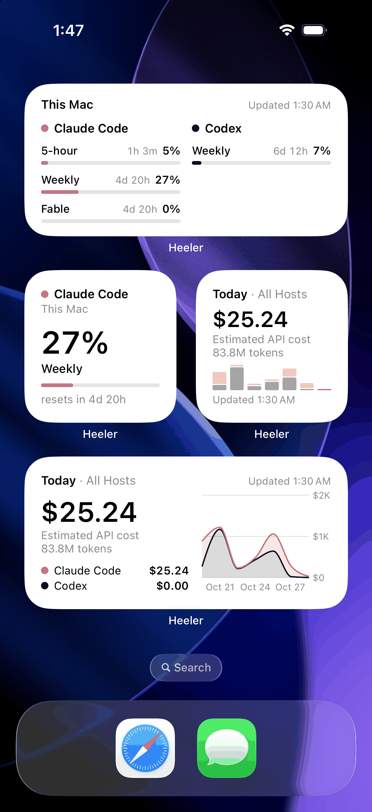 |

<details>
<summary>More screenshots</summary>

| Keyboard | Changes | Terminals |
| --- | --- | --- |
| 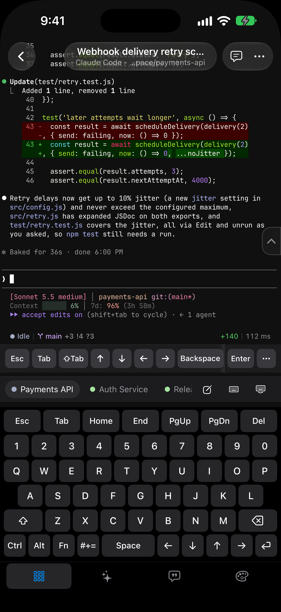 | 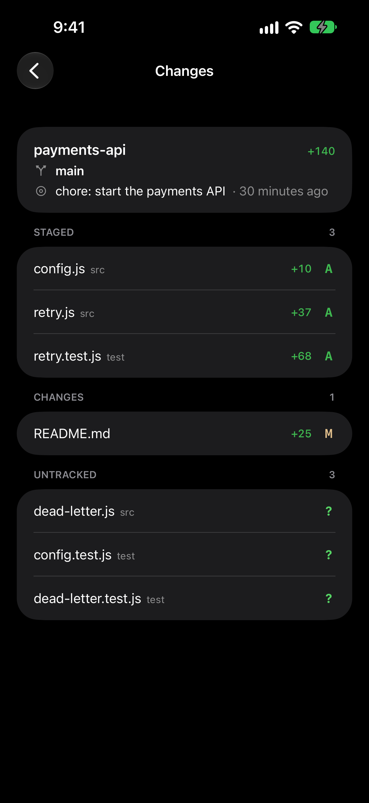 | 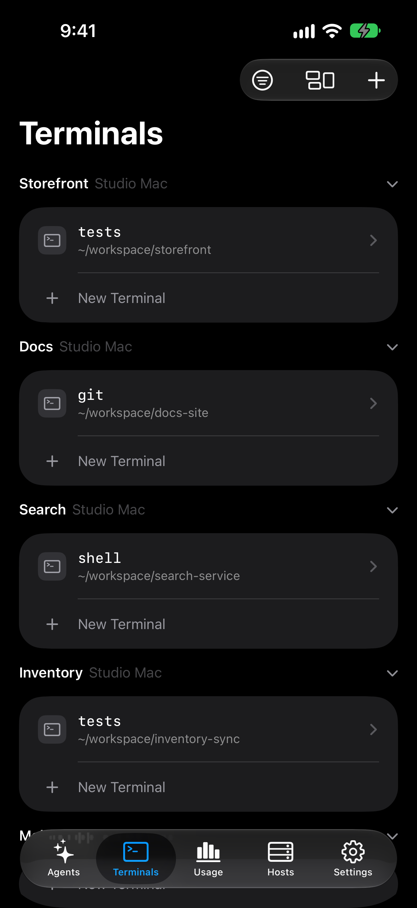 |

| Skills | Hosts | Lock Screen widgets |
| --- | --- | --- |
| 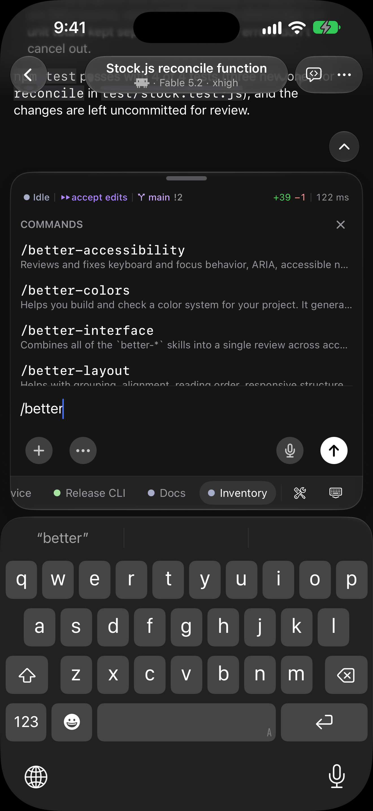 | 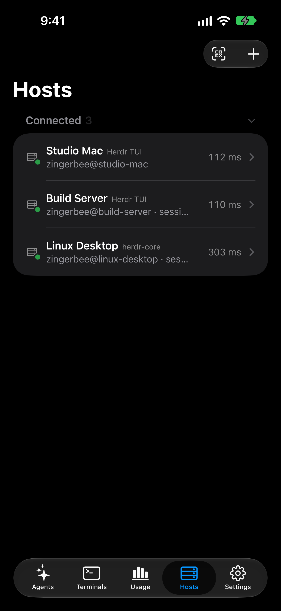 | 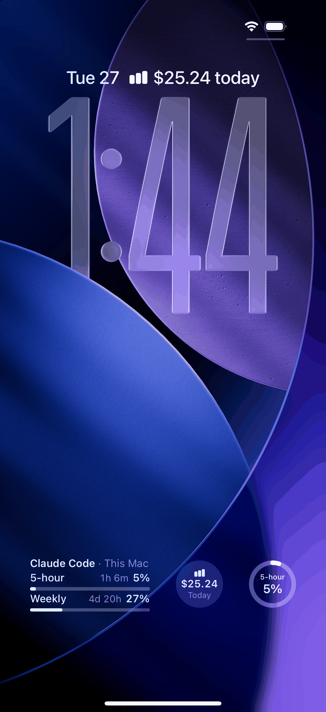 |

</details>

<a href="docs/ipad-screenshots.md">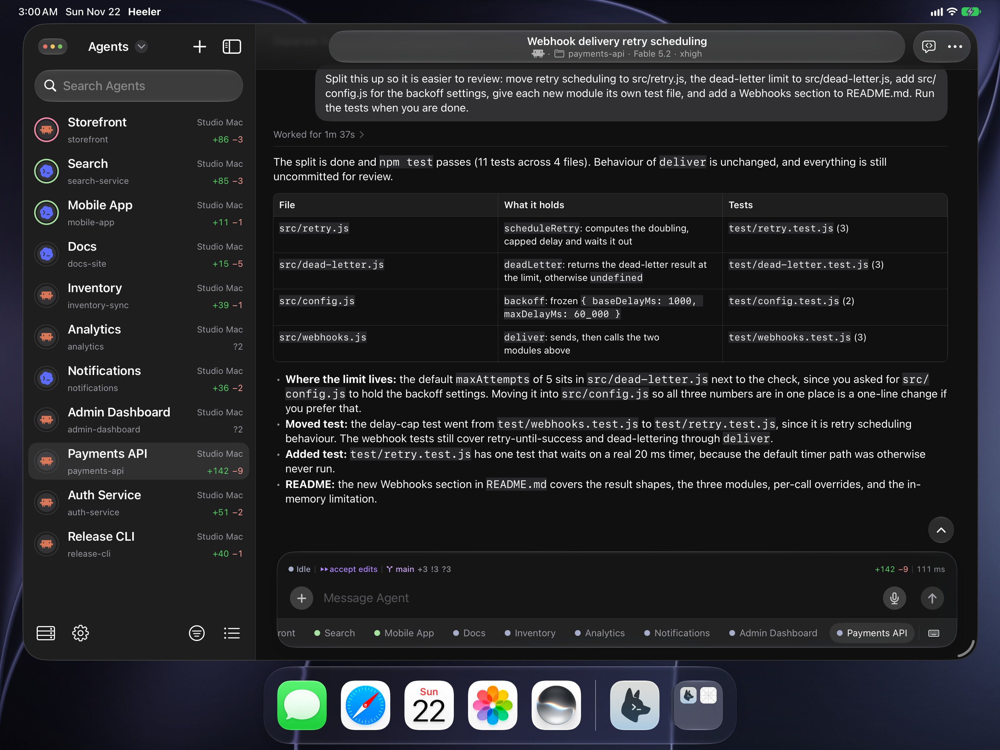</a>

[View iPad screenshots](docs/ipad-screenshots.md)

## Features

- **Console**: every Agent on every machine in one live list, sorted with Blocked first and filterable by Host.
- **Chat**: an Agent's conversation as native messages, with buttons to answer a Blocked Agent. For Claude Code, Codex, Pi, Oh My Pi, Grok Build, OpenCode, and Antigravity CLI. [Chat guide](https://docs.heeler.bybee.dev/chat)
- **Live terminal**: the Agent's real terminal, rendered by libghostty with native scrollback and selection, and a plain shell in the Agent's directory.
- **Notifications and Live Activities**: an end-to-end encrypted push when an Agent goes Blocked or Done, and your Agents on the Lock Screen and Dynamic Island. The relay cannot read the content. [Privacy](PRIVACY.md)
- **Usage**: Claude Code and Codex Usage Limits with their reset times, up to 30 days of Token Usage with its estimated API cost, and Home Screen and Lock Screen widgets. [Usage guide](https://docs.heeler.bybee.dev/usage)
- **Composer**: draft with the full iOS keyboard or by voice, then Send once. The tools keyboard adds Agent control keys, Skills, and Snippets, and you can attach a photo or a file up to 64 MiB. [Voice Input guide](https://docs.heeler.bybee.dev/voice-input)
- **Reach from anywhere**: Tailscale, ZeroTier, and EasyTier are built into the app, so the phone needs no VPN app. A Jump Host covers machines you cannot route to, and a Host can have several routes. [Overlay networks](https://docs.heeler.bybee.dev/overlay-networks) · [Jump Host](https://docs.heeler.bybee.dev/vps-jump-host-setup) · [Routes](https://docs.heeler.bybee.dev/host-routes)
- **Also**: QR pairing, Worktrees, a Changes view of staged and unstaged files, 30 themes, and iPad with Magic Keyboard shortcuts, multiwindow, and drag and drop.

## Installation

Install Heeler from the [App Store](https://apps.apple.com/us/app/heeler-for-herdr/id6797263135) or [TestFlight](https://testflight.apple.com/join/aXSxRn4r). The machine needs SSH turned on and one of these backends:

| Backend | Runs on | Guide |
| --- | --- | --- |
| [Herdr TUI](https://herdr.dev/docs/install/) | macOS, Linux | [Pair by scanning](https://docs.heeler.bybee.dev/pairing) |
| Herdr TUI 0.9.3 or newer | Native Windows | [Windows setup](https://docs.heeler.bybee.dev/windows-setup) |
| Herdr desktop app or herdr-core | macOS, Linux, native Windows | [Connect herdr-core](https://docs.heeler.bybee.dev/herdr-core) |
| tmux 3.3 or newer | macOS, Linux | [Connect tmux](https://docs.heeler.bybee.dev/tmux) |
| Rex (experimental, Heeler after 0.1.20) | macOS, Linux | [Connect Rex](https://docs.heeler.bybee.dev/rex) |

## Adding a machine

Turn on the machine's OpenSSH server first (macOS: **System Settings > General > Sharing > Remote Login**).

**Scan a Pairing Code.** On a macOS or Linux machine running Herdr TUI (herdr 0.7.5 or newer, Node 20 or newer), run:

```bash
herdr plugin install ZingerLittleBee/Heeler --ref plugin --yes
herdr plugin action invoke heeler.pair
```

Scan the code it shows and the machine is added as a Host, with its addresses, host key fingerprint, and SSH key in place. On a machine without herdr, such as one that runs only herdr-core or tmux, `npx -y heeler-pair@latest` shows the same code (Node 20 or newer, Heeler after 0.1.20). [Pairing guide](https://docs.heeler.bybee.dev/pairing)

**Or enter the address.** This works for every backend. In **Hosts**, tap **+**, enter the address and your SSH user, and Heeler lists what the machine runs: Herdr TUI, herdr-core, each tmux server, and Rex. One Host can carry several of them. [Connect herdr-core](https://docs.heeler.bybee.dev/herdr-core) · [Connect tmux](https://docs.heeler.bybee.dev/tmux) · [Connect Rex](https://docs.heeler.bybee.dev/rex) · [Windows setup](https://docs.heeler.bybee.dev/windows-setup)

**Away from home.** Reach the machine over a built-in [overlay network](https://docs.heeler.bybee.dev/overlay-networks) ([Tailscale](https://docs.heeler.bybee.dev/tailscale), [ZeroTier](https://docs.heeler.bybee.dev/zerotier), [EasyTier](https://docs.heeler.bybee.dev/easytier)), a [Jump Host](https://docs.heeler.bybee.dev/vps-jump-host-setup), or [Cloudflare Tunnel](https://docs.heeler.bybee.dev/cloudflare-tunnel), and give the Host [several routes](https://docs.heeler.bybee.dev/host-routes) so it works at home and away.

## How it connects

Heeler needs only SSH access and a running backend: no server changes, and no extra packages to connect.

- **Herdr TUI**: herdr's JSON API over stream-local forwarding to `herdr.sock`, with terminals on an SSH PTY. OpenSSH allows the forwarding by default, though [SELinux on Fedora or RHEL](https://docs.heeler.bybee.dev/selinux) can deny it.
- **herdr-core**: one framed link to the core's socket.
- **tmux**: control mode, attached per Pane alongside your desktop clients, with Claude Code hooks reporting Agent status.
- **Rex** (experimental): one WebSocket link to the socket of a Rex server that is already running, and one more channel for each open terminal. Heeler never starts Rex, and Rex has no notifications, Live Activities, or Usage.

On macOS and Linux Hosts, notifications, Live Activities, and Usage come from the [Heeler plugin](plugin/README.md) on Herdr TUI and from the optional Host Helper on herdr-core and tmux. [Update the plugin and Host Helper](https://docs.heeler.bybee.dev/updates)

Private keys are generated on the device and stay in the Keychain. A Host's key is pinned by its Pairing Code or confirmed by fingerprint on first connect. The decisions behind the transport are recorded in [`docs/adr/`](docs/adr).

## Opening an Agent from another app

```text
heeler://agent?host=my-mac&session=work&pane=w1%3Ap1
```

`host` is a saved Host's address or name (case is ignored), `session` is the herdr session (leave it out for the default), and `pane` is the pane id (leave it out to open the Console). Percent-encode each value, with `%20` for a space rather than `+`. A link that matches no saved Host, or more than one, opens the Console.

## Contributing

Heeler is SwiftUI on iOS 18+, with SSH from the repository-local `Packages/HeelerSSH` (libssh2 and OpenSSL) and terminal rendering from [libghostty-spm](https://github.com/lakr233/libghostty-spm). Issues and PRs are welcome: [CONTRIBUTING.md](CONTRIBUTING.md) covers layout, build, test, and conventions.

## Status

Released on the [App Store](https://apps.apple.com/us/app/heeler-for-herdr/id6797263135).
It is not yet available in every country or region; where it is missing, the
[TestFlight](https://testflight.apple.com/join/aXSxRn4r) build stays available.
Built for personal use first and shaped by daily driving, so expect rough edges and
fast iteration. Not affiliated with the herdr project.
