<div align="center">

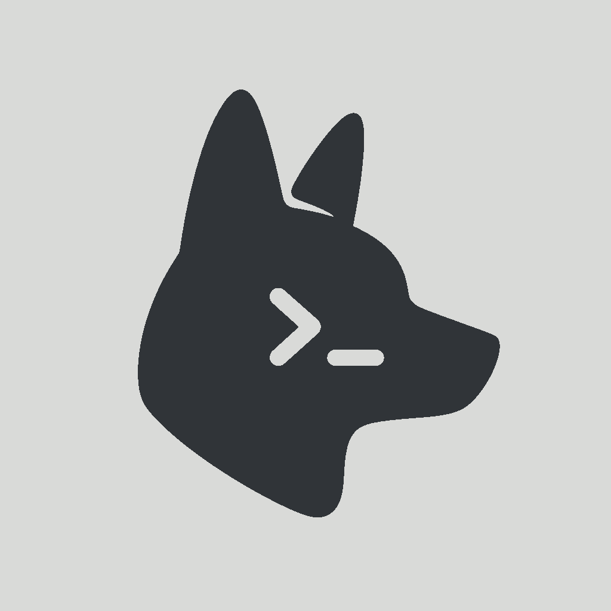

# Heeler

<a href="https://apps.apple.com/us/app/heeler-for-herdr/id6797263135"></a>
<a href="https://testflight.apple.com/join/aXSxRn4r"></a>

**A native iOS companion app for [herdr](https://herdr.dev) — an agent-first terminal runtime.**

[](https://github.com/ZingerLittleBee/Heeler/stargazers)
[](https://github.com/ZingerLittleBee/Heeler/actions/workflows/ci.yml)
[](LICENSE)
[](https://www.swift.org)
[](https://developer.apple.com/ios/)
[](https://apps.apple.com/us/app/heeler-for-herdr/id6797263135)

<a href="https://trendshift.io/repositories/151670?utm_source=repository-badge&amp;utm_medium=badge&amp;utm_campaign=badge-repository-151670" target="_blank" rel="noopener noreferrer"></a>

English | [简体中文](./README-zh.md) | [日本語](./README-ja.md)

</div>

---

Heeler is an independent **herdr mobile client** and agent console for Claude Code, Codex, and other coding Agents on iPhone and iPad. Agents run on your own Hosts in Herdr TUI or the Herdr desktop app (herdr-core); Heeler connects over SSH. Monitor multiple Agents across machines, sorted by who needs you, then open a live terminal or supported Chat conversation to send instructions.

## Screenshots

| Agent Console | Live terminal | Chat |
| --- | --- | --- |
| 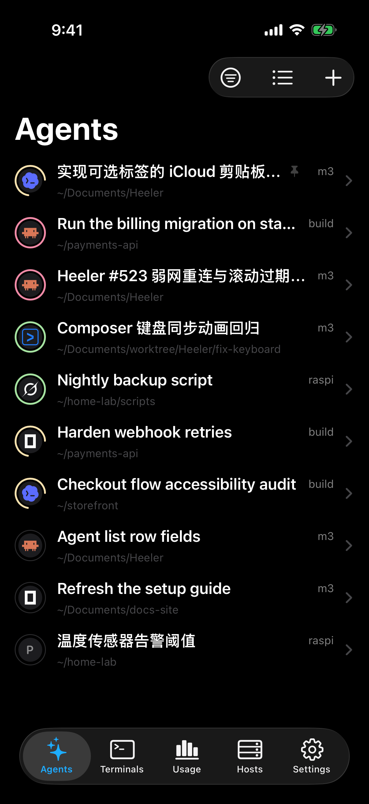 | 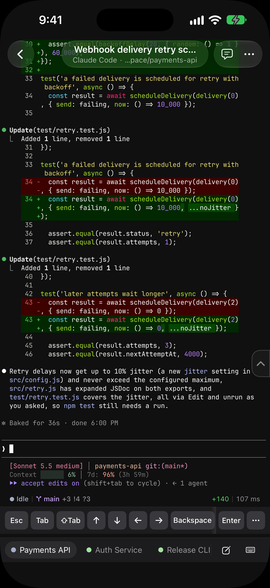 | 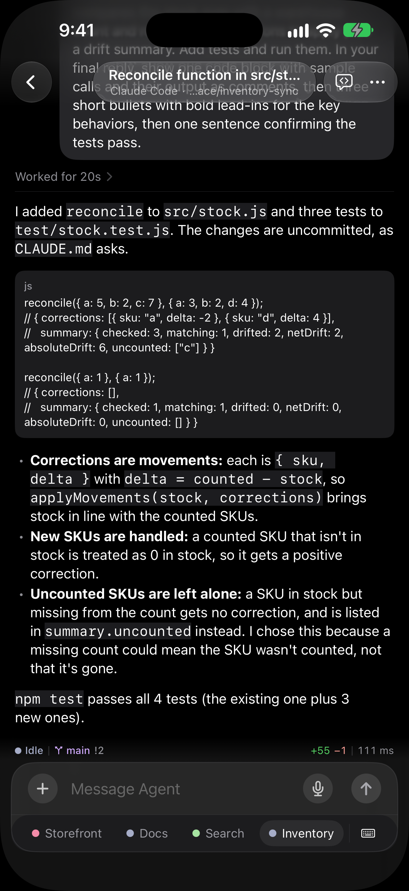 |

| Keyboard | Changes | Terminals |
| --- | --- | --- |
| 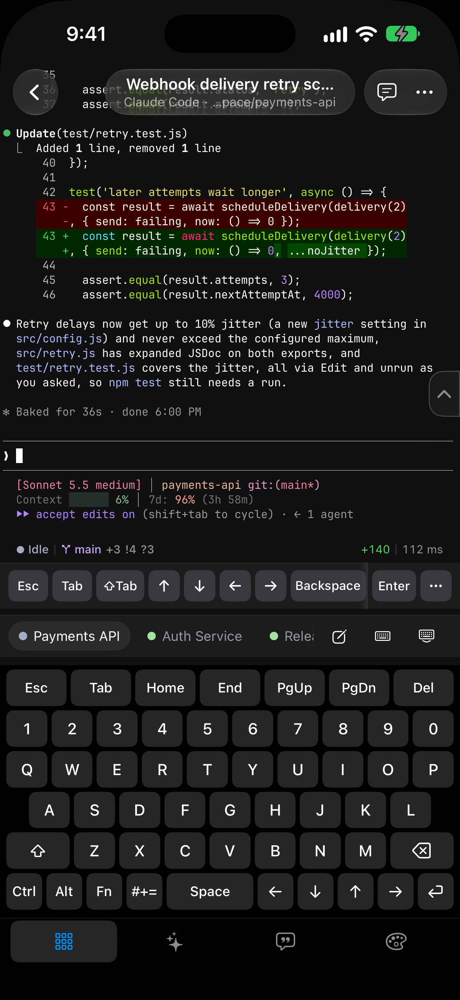 | 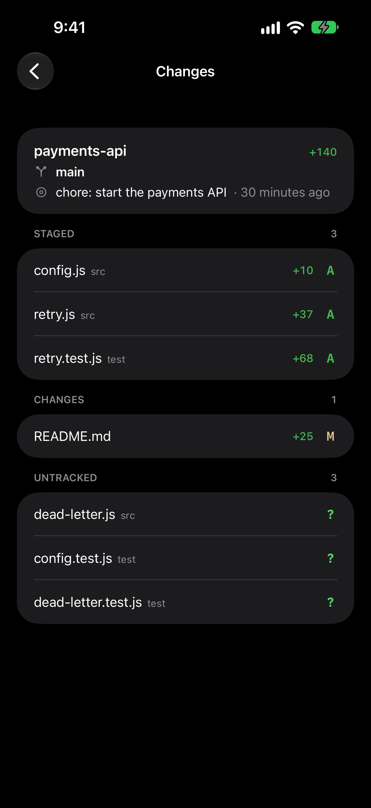 | 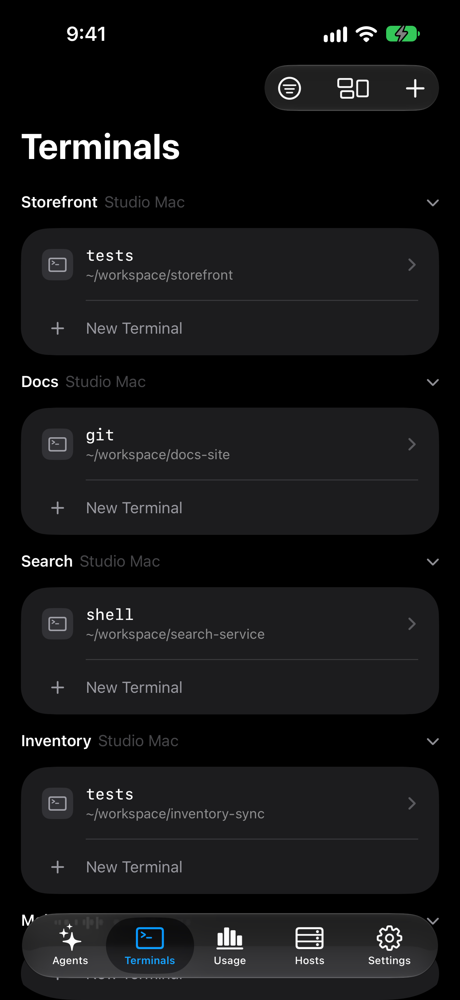 |

| Skills | Hosts | Live Activity |
| --- | --- | --- |
| 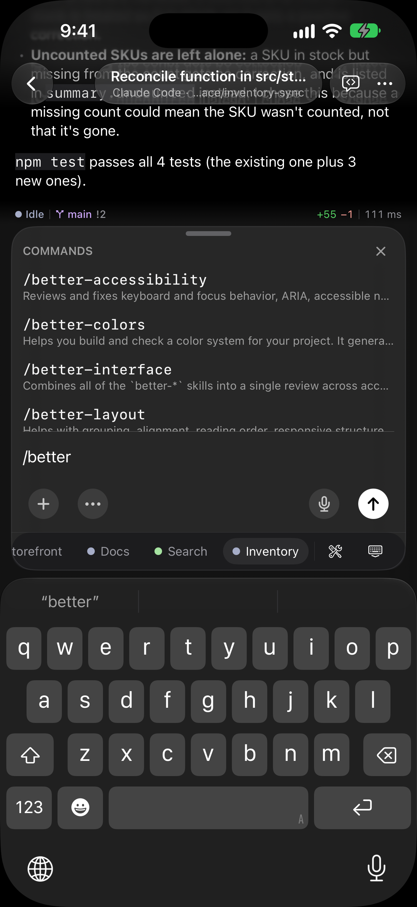 | 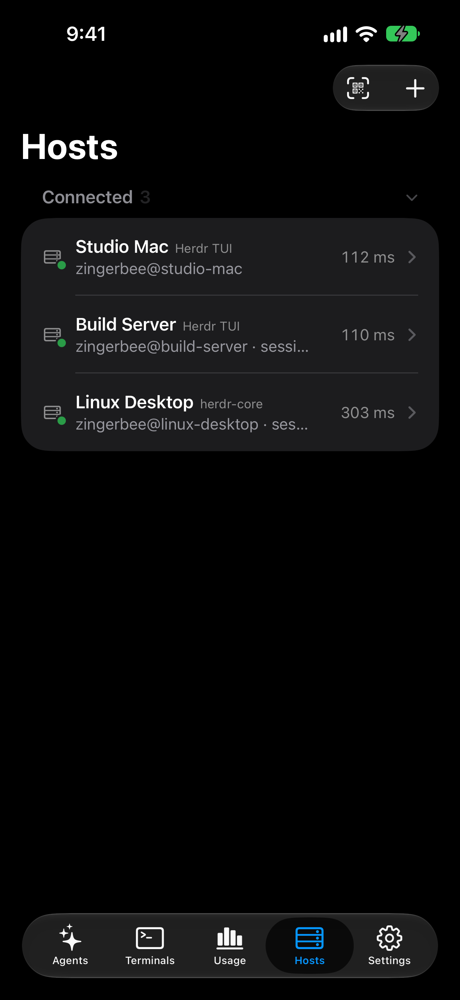 | 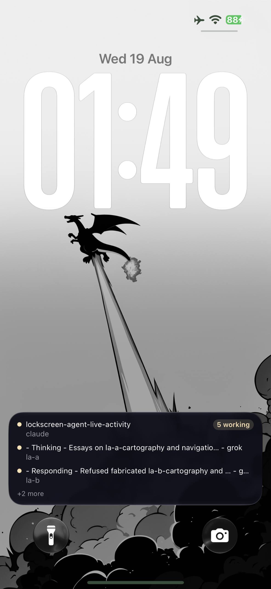 |

| Usage | Widgets | Lock Screen widgets |
| --- | --- | --- |
| 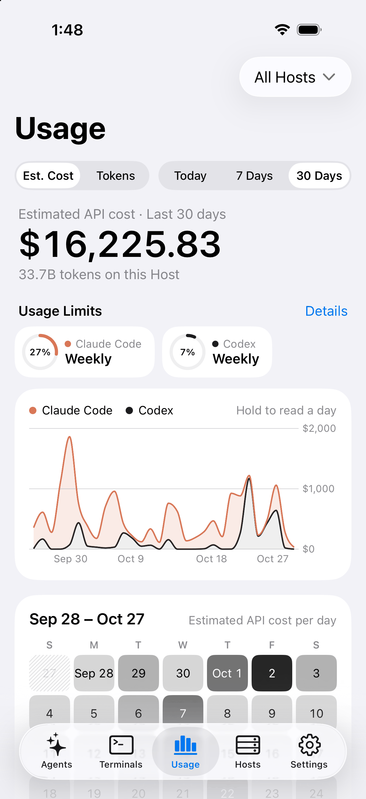 | 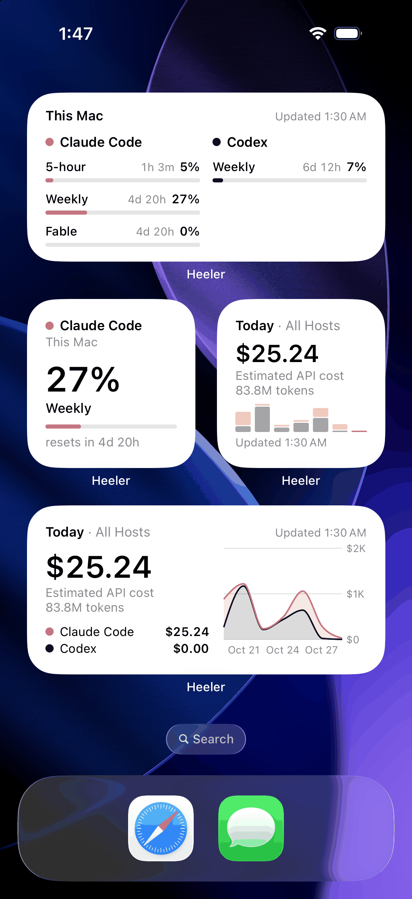 | 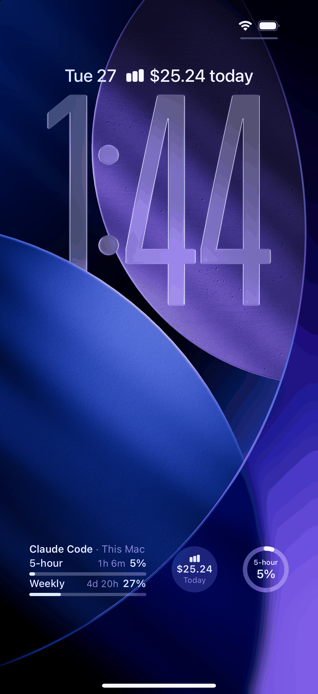 |

<a href="docs/ipad-screenshots.md">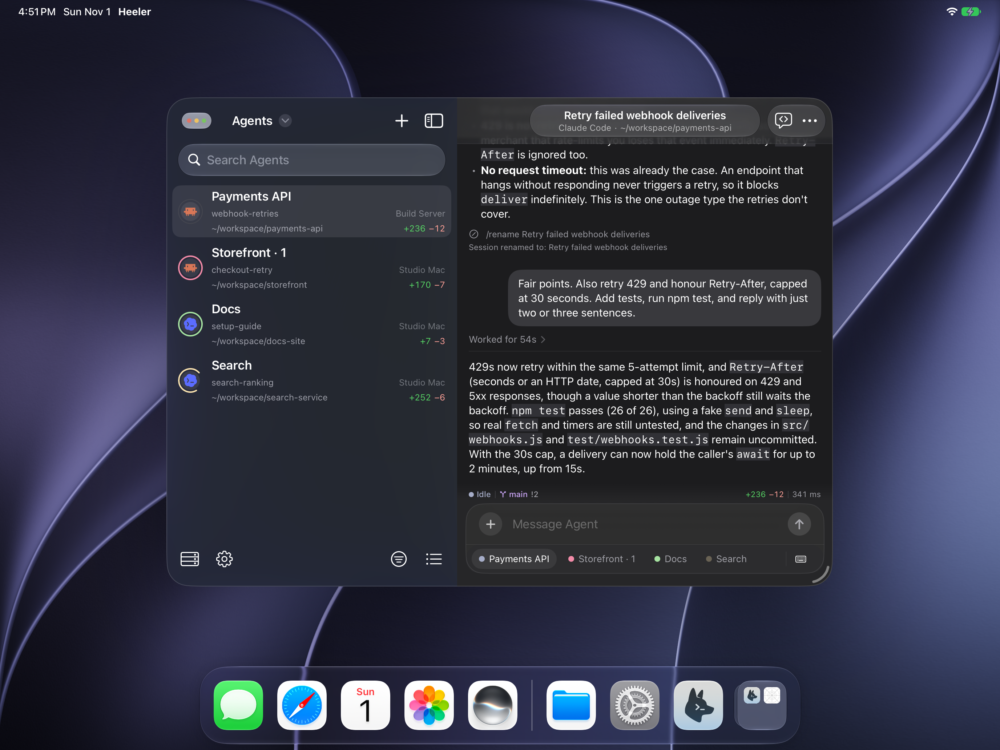</a>

[View iPad screenshots](docs/ipad-screenshots.md)

## Features

- **Console** — every Agent on every machine in one status-sorted list
  (Blocked first), filterable by Host, updated live.
- **Herdr desktop and herdr-core** — connect to the Herdr desktop app or
  headless herdr-core on macOS, Linux, and native Windows. The Console
  follows the desktop app's spaces and tabs, and live terminals, Chat, the
  Composer, New Agent, and New Workspace work there too
  ([Read more](https://docs.heeler.bybee.dev/herdr-core)).
- **Attach** — the Agent's real terminal rendered by libghostty: native
  scrollback, momentum touch scrolling that also drives full-screen TUIs,
  long-press selection, takeover of a stale terminal owner, and quietly
  collected web links to open later.
- **Chat** — read an Agent's conversation as native messages instead of a
  terminal screen, reply from the Composer, and answer a Blocked Agent with
  buttons; for Claude Code, Codex, Pi, Oh My Pi, Grok Build, and OpenCode
  ([Read more](https://docs.heeler.bybee.dev/chat)).
- **Composer** — draft locally with the full iOS keyboard (autocorrect, IME,
  dictation), then Send once; the tools keyboard adds Agent control keys,
  Agent Skills, reusable Snippets, and terminal appearance. Voice Input lets
  you speak to the Composer with your own speech service API key
  ([Read more](https://docs.heeler.bybee.dev/voice-input)).
- **Terminal** — open a plain shell in the Agent's directory, with Text and
  Keys modes and one reused tab per Workspace.
- **Attachments** — stage a photo or a file up to 64 MiB onto the Host over
  SFTP and insert its path into the draft.
- **QR pairing** — scan a Pairing Code to add a machine; keys are generated
  on device, private keys stay in the Keychain, and the code pins the host
  key fingerprint.
- **Notifications + Live Activities** — end-to-end encrypted pushes when an
  Agent goes Blocked or Done, and a lock-screen / Dynamic Island banner
  tracking Agents in real time; the relay can never read the content
  ([PRIVACY.md](PRIVACY.md)).
- **Usage** — Claude Code and Codex Usage Limits with their reset times, and
  up to 30 days of Token Usage with its estimated API cost, across all Hosts
  or one; Home Screen and Lock Screen widgets keep them in view
  ([Read more](https://docs.heeler.bybee.dev/usage)).
- **Worktrees** — start an Agent on a clean checkout of the workspace's repo.
- **Appearance** — System, Light, or Dark; 30 terminal themes with separate
  Light and Dark slots; bundled JetBrains Mono and IBM Plex Mono; pinch to
  zoom.
- **Jump Host** — reach unroutable machines through an SSH jump, with keys
  verified at both hops.

## How it connects

On macOS and Linux Hosts, Heeler speaks herdr's JSON API over SSH: each request opens a
direct-streamlocal channel onto `herdr.sock`, one long-lived channel carries
the event stream, and interactive terminals run `herdr agent attach
--takeover` on an SSH PTY. The only prerequisites are SSH access and a
running herdr — no server changes, no extra packages. The SSH server must
allow stream-local forwarding (the OpenSSH default); onboarding calls it out
when it's disabled. On Fedora, RHEL, and their derivatives, SELinux can deny the
socket open even when forwarding is allowed — see [SELinux on a Fedora or RHEL
Host](docs/guides/selinux.md).

Native Windows Hosts (herdr >= 0.9.3) connect over SSH and are added manually.

herdr-core Hosts, including machines running the Herdr desktop app, are added manually with their Server Kind confirmed. Heeler carries one framed link to the core: a direct-streamlocal channel onto its socket on macOS and Linux, or `herdr-core connect` over SSH exec on native Windows. Connecting never starts a core on macOS or Linux. The optional Host Helper adds notifications, Live Activities, and Usage on macOS and Linux ([Connect herdr-core](https://docs.heeler.bybee.dev/herdr-core)).

For Tailscale, ZeroTier, or EasyTier access, follow the [Overlay Network setup guides](docs/guides/overlay-networks.md). They cover macOS installation, Tailscale without a VPN on the Mac, Heeler configuration, and connection checks. Heeler joins these networks inside the app without an iOS VPN configuration; you need a Heeler version with **Settings > Overlay Networks**.

[View the Heeler setup screenshots](docs/guides/overlay-networks.md#heeler-setup-screenshots) for Tailscale, ZeroTier, and both EasyTier modes.

Unroutable machines can sit behind an SSH Jump Host:

- [Set up remote access step by step](docs/guides/vps-jump-host-setup.md)
- [Architecture, security boundaries, and the VPS runbook](docs/guides/vps-jump-host.md)

A Host can have several routes, such as its LAN address at home and an overlay network or Jump Host elsewhere: [Reach a Host on several routes](docs/guides/host-routes.md).

## Installation

Install Heeler from the [App Store](https://apps.apple.com/us/app/heeler-for-herdr/id6797263135)
or [TestFlight](https://testflight.apple.com/join/aXSxRn4r).

- **macOS / Linux:** Install [herdr](https://herdr.dev/docs/install/), enable SSH,
  then follow the pairing steps below.
- **Native Windows:** Follow the [Windows setup guide](docs/guides/windows-setup.md).
- **Herdr desktop app / herdr-core:** Start the desktop app or herdr-core,
  enable SSH, then add the Host manually:
  [Connect herdr-core](https://docs.heeler.bybee.dev/herdr-core). Needs
  Heeler 0.1.18 or later.

## Adding a machine

On a macOS or Linux machine running herdr (Node >= 20, herdr >= 0.7.5, OpenSSH server on —
macOS: **System Settings > General > Sharing > Remote Login**):

```bash
herdr plugin install ZingerLittleBee/Heeler --ref plugin --yes
herdr plugin action invoke heeler.pair
```

Scan the Pairing Code QR it shows and the machine is added as a Host — the
code carries the addresses, the host key fingerprint, and SSH key enrollment.
The same [plugin](plugin/README.md) delivers the encrypted notifications once
you enable them for the Host in the app. For every step, the popup's keys, and
troubleshooting, see the [pairing guide](https://docs.heeler.bybee.dev/pairing).

## Opening an Agent from another app

Another app can open an Agent in Heeler with a link:

```text
heeler://agent?host=my-mac&session=work&pane=w1%3Ap1
```

- `host` names a saved Host on that session: its address, or its name when
  no Host on the session has that address. Case is ignored.
- `session` is the herdr session name. Leave it out, or pass `default`, for
  the default session.
- `pane` is herdr's pane id. Leave it out to open the Console.

Percent-encode each value, with `%20` for a space: a `+` stays a plus sign,
so form encoding (such as JavaScript's `URLSearchParams`) misses a name like
`Build Box`. When no saved Host on that session matches, or more than one
does, the link opens the Console.

## Stack

- SwiftUI, iOS 18+, iPhone and iPad. iPad support is restored in 0.1.8 with Magic Keyboard shortcuts, multiwindow, and drag and drop.
- The repository-local `Packages/HeelerSSH` (libssh2 + OpenSSL) for SSH
- [libghostty-spm](https://github.com/lakr233/libghostty-spm) for terminal emulation and Metal rendering

See `docs/adr/` for why — the transport story in particular is not obvious.

## Contributing

Issues and PRs are welcome — see [CONTRIBUTING.md](CONTRIBUTING.md) for
layout, build/test, and conventions.

## Status

Released on the [App Store](https://apps.apple.com/us/app/heeler-for-herdr/id6797263135).
It is not yet available in every country or region; where it is missing, the
[TestFlight](https://testflight.apple.com/join/aXSxRn4r) build stays available.
Built for personal use first and shaped by daily driving, so expect rough edges and
fast iteration. Not affiliated with the herdr project.
