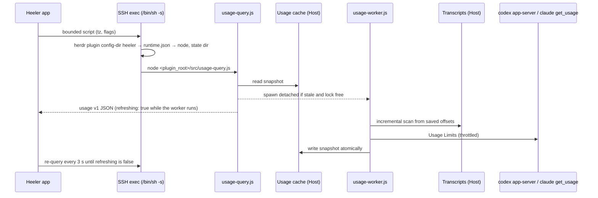

# Agent Usage

Status: Implemented (#494; PR #506; tickets #495–#503). Decisions are
recorded in [ADR 0028](../adr/0028-plugin-collects-agent-usage-on-the-host.md);
terms are defined in [CONTEXT.md](../../CONTEXT.md) (**Usage Limits**,
**Token Usage**, **Transcript**).

Implementation status does not close the real-Host and terms checks under
[Open questions](#open-questions); those remain pre-release work.

## Summary

Heeler shows, per Host, how much of each Claude Code and Codex account's
Usage Limits is used and when each window resets, beside the Token Usage those
programs recorded on the Host over the last 30 days with an estimated API cost.

All collection happens on the Host inside the Heeler herdr plugin. The plugin
reads Transcripts locally, asks Codex and Claude Code themselves for their
Usage Limits, and answers the app with a small, filtered JSON document. The
app reaches the plugin with one bounded SSH exec per query. No SFTP, no new
port, the plugin never reads a credential, and the user installs nothing
beyond the plugin.

## Goals

- Usage Limits for Claude Code and Codex: each window's used percentage and
  reset time, with the source and age of the reading.
- Token Usage for Claude Code and Codex: today, the last 7 days and the last
  30 days; a 30-day daily series; a per-model split; the top 10 working
  directories over 30 days. Each with an estimated API cost where the model is
  priced.
- Correct counting: no double counting of repeated, copied, replayed or
  cumulative records.
- Fast queries over SSH: a query never waits for a log scan or a network call.

## Non-goals

- Usage per Agent or per session (later).
- Usage across Hosts, on the Console, or on Agent detail (later).
- History beyond 30 days. The plugin keeps no history of its own; what it
  shows is bounded by the Transcripts still on the Host.
- A local estimate of a rolling 5-hour window. Windows come only from Usage
  Limits, so a local guess is never mistaken for the account's real limit.
- Billing. The estimated cost is what the tokens would cost at API list
  prices; it is not a subscription invoice or a credit balance.
- Native Windows Hosts. The plugin supports Linux and macOS only.
- Agent programs other than Claude Code and Codex.
- Codex limit groups other than the default one. Codex can report several
  limit groups (`rateLimitsByLimitId`); the first version shows only the
  default group's windows and says so on the Usage page.

## Architecture



### Components on the Host

| Component | Runs in | Role |
| --- | --- | --- |
| Runtime recorder (in the startup hook `src/sidebar-hook.js` and the `pane.agent_status_changed` hook `src/activity-hook.js`) | herdr's environment | Writes `runtime.json` and `runtime-node` to the plugin config directory |
| Agent directory recorder (in `src/activity-hook.js`) | herdr's environment | Records running Claude Code Agents' `CLAUDE_CONFIG_DIR` as Account suggestions |
| `src/usage-query.js` | the app's SSH exec | Reads the cache, spawns the worker when needed, prints the contract |
| `src/usage-worker.js` | detached from the query | Scans Transcripts, reads Usage Limits, writes the cache |
| `src/usage/claude-*.js`, `src/usage/codex-*.js` | worker | Per-program Transcript scanners and limit readers |
| `src/usage/pricing.json` | worker | Bundled, versioned price table |

### Why the runtime file exists

herdr runs the plugin with its own environment; the app's SSH exec has a
different, non-login one. Agents read `HOME`, `CLAUDE_CONFIG_DIR`,
`CODEX_HOME` and `XDG_CONFIG_HOME` from herdr's environment, and `node` may
only be on herdr's `PATH` (nvm, fnm, volta, or a Herdr Endpoint launcher with
no `PATH` at all). Plugin hooks run in herdr's environment, so they record:

```json
{
  "version": 1,
  "recordedAt": "2026-10-23T12:00:00Z",
  "node": "/Users/u/.nvm/versions/node/v22.11.0/bin/node",
  "codex": "/Users/u/.nvm/versions/node/v22.11.0/bin/codex",
  "claude": "/Users/u/.local/bin/claude",
  "env": {
    "PATH": "/Users/u/.nvm/versions/node/v22.11.0/bin:/opt/homebrew/bin:/usr/bin:/bin",
    "HOME": "/Users/u",
    "USER": "u",
    "CLAUDE_CONFIG_DIR": null,
    "CODEX_HOME": null,
    "XDG_CONFIG_HOME": null,
    "HTTPS_PROXY": "http://proxy.example:3128",
    "https_proxy": null,
    "HTTP_PROXY": null,
    "http_proxy": null,
    "ALL_PROXY": null,
    "all_proxy": null,
    "NO_PROXY": "localhost",
    "no_proxy": null,
    "NODE_EXTRA_CA_CERTS": null,
    "SSL_CERT_FILE": null,
    "SSL_CERT_DIR": null,
    "CODEX_CA_CERTIFICATE": null
  },
  "stateDir": "/Users/u/.local/state/herdr/plugins/heeler"
}
```

- `node` is `process.execPath`; `codex` and `claude` are the first
  executables of those names on herdr's `PATH`, or `null`.
- `env` is herdr's environment for these names. The worker runs `codex` and
  `claude` with it: an npm-installed `codex` is a `#!/usr/bin/env node`
  script, which exits 127 under sshd's minimal `PATH`, and a `codex` started
  without the recorded `CODEX_HOME` reads another account. Claude Code uses
  `USER` to locate its macOS keychain account; omitting it can make an
  authenticated subscription appear unavailable. Record herdr's value, not
  the SSH exec's user, and leave it `null` when absent.
- `env` also holds herdr's proxy and CA variables (`HTTPS_PROXY`,
  `HTTP_PROXY`, `ALL_PROXY`, `NO_PROXY`, each in upper and lower case,
  `NODE_EXTRA_CA_CERTS`, `SSL_CERT_FILE`, `SSL_CERT_DIR` and
  `CODEX_CA_CERTIFICATE`). Usage Limits requests go through `codex` and
  `claude`, which need them on networks that require a proxy or a private CA;
  without them the requests fail there.
- `stateDir` is `HERDR_PLUGIN_STATE_DIR`, which herdr gives every plugin
  command, startup hooks included, since 0.7.5. herdr derives it only from
  `XDG_STATE_HOME`, so named sessions share it, and a Herdr Endpoint shares it
  unless its launcher also sets `XDG_STATE_HOME` (ADR 0023 isolates only
  `XDG_CONFIG_HOME`). The usage cache therefore lives in
  `<stateDir>/usage/<rootsKey>/`, where `rootsKey` is a short hash of the
  Transcript roots this environment names (below). The cache is a function of
  those roots, so two instances share a cache when they read the same
  Transcripts.
- The startup hook (`src/sidebar-hook.js`) writes the file at server start
  and live handoff. herdr does not run startup hooks when a plugin is
  installed, linked, enabled or updated, so the `pane.agent_status_changed`
  hook `src/activity-hook.js` also computes the record and rewrites the file
  when it is missing or a field other than `recordedAt` differs. Named
  sessions on one config home share the file; if their environments differ,
  the most recent writer wins.
- Beside it the hooks write `runtime-node`, one line holding `node`'s absolute
  path, because the app's `/bin/sh` script cannot parse JSON. It is written
  after `runtime.json`, with the same rules.
- Both files are written atomically (temp file and rename), mode 0600. They
  hold no credential of the programs, but a proxy URL may embed the proxy's
  user name and password, so `runtime.json` stays private to the user.
- When the files are missing (plugin just installed, no Agent has changed
  status since), the query cannot know the state directory or the right
  roots, so it does not guess: it reports `runtime: "missing"`, no worker
  runs, and the app asks the user to use any Agent on the computer once, or
  to restart herdr.

## App to plugin channel

One query is one `runBoundedScript` exec (`/bin/sh -s`, remote watchdog,
ordinary-session channel, never cancelled once dispatched), with a 10-second
deadline and a 1 MiB `head -c` cap on output. The script, fixed text from the
app with only validated arguments interpolated:

1. Exports `HerdrHostPath.pathExport` (or uses the Host's Herdr Endpoint
   launcher) and runs `herdr plugin config-dir heeler`.
2. Reads the `node` path from `runtime-node` in that directory with
   `IFS= read -r`, and requires an absolute path. When the file is missing,
   prints the `runtime: "missing"` result and stops.
3. Runs `<node> <plugin_root>/src/usage-query.js --tz <IANA>
   [--claude-limits]` and prints its stdout between nonce markers. The query
   reads `runtime.json` itself and reports `runtime: "missing"` without it.

`plugin_root` comes from `plugin.list`; the app's `PluginListResult` decoder
gains `plugin_root`. Before interpolation the time zone must resolve with
`TimeZone(identifier:)` and match the plugin's identifier grammar; the
listed `knownTimeZoneIdentifiers` omit names iOS reports, such as
`Asia/Kolkata` and `US/Pacific`. A recorded `node` that no longer runs
(exit 126 or 127) maps to the same state as a missing file, since the next
hook run records the current one.

`plugin.action.invoke` was rejected: it is asynchronous (stdout only via
polling `plugin.log.list`), its log output is capped, and every action is
visible in the user's herdr command palette.

## Token Usage

### Sources

- **Claude Code**: every `*.jsonl` under `projects/` of each Account's
  roots ([Accounts](#accounts)). The Default Account's roots are the
  directory Claude Code uses in the recorded environment, `CLAUDE_CONFIG_DIR`
  as one path (Claude Code does not split it; the comma-separated list is a
  ccusage convention) or else `~/.claude`, and the legacy
  `${XDG_CONFIG_HOME:-~/.config}/claude` when it exists, deduplicated by real
  path. This includes subagent and workflow files under
  `<project>/<session>/subagents/`.
- **Codex**: `${CODEX_HOME:-~/.codex}/sessions/YYYY/MM/DD/rollout-*.jsonl`
  and `archived_sessions/`, plain or `.jsonl.zst`. Codex compresses cold
  rollouts in the background and keeps their mtime
  (`codex-rs/rollout/src/compression.rs`); on one development machine, 333 of
  the 399 rollouts modified in the last 30 days were `.jsonl.zst`
  (2026-10-23). Before appending to a compressed rollout (a resumed thread),
  Codex decompresses it to a new plain file with the old mtime and deletes
  the `.zst`. A rollout and its `.zst` are one logical file, keyed by the
  path without `.zst`, and the plain file wins while both exist; `sessions/`
  wins over `archived_sessions/`. `.zst` files are streamed through
  `zlib.createZstdDecompress` (Node 22.15.0 and 23.8.0, experimental), else
  through `zstd -dc` found on the recorded `PATH`, else counted in
  `scan.skippedArchives` and the app says so. Node's decoder ends quietly on
  a truncated archive, so the worker walks the zstd frame and block headers
  and treats an archive whose last frame is incomplete as a read error, as
  `zstd -dc` does. A cut exactly between two frames cannot be detected.

The roots of one Account are merged into one total for that Account.
`rootsKey` hashes the Default Account's candidate roots and the Codex home as
derived from `runtime.json`'s `env` (`HOME`, `CLAUDE_CONFIG_DIR`,
`XDG_CONFIG_HOME`, `CODEX_HOME`), made absolute but not resolved, whether or
not they exist yet. Installing a program, creating a legacy directory, or
adding or removing an Account later therefore does not move the cache. Each worker run deletes sibling `<stateDir>/usage/*`
directories that no live worker holds and whose `buckets.json` has not been
written for 31 days; a sibling without one is dated by its directory and
files instead.

### Counting rules: Claude Code

The record shapes are documented in
[Claude Code transcripts](../research/claude-code-transcript-format.md).

- Count `type: "assistant"` records with `message.usage`; skip
  `message.model == "<synthetic>"`.
- One API response is written as several records that share `message.id`
  and `requestId` and repeat `usage`. Claude Code also copies responses into
  other transcripts. Deduplicate globally (across files and sessions) on
  `message.id + requestId`; without `requestId`, on
  `message.id + sessionId + timestamp`.
- On collision keep the non-sidechain record, then the larger token total
  (streamed snapshots of one response can undercount output). `speed` is no
  tie-breaker: 2.1.309 writes it on nearly every record (`standard` or
  `fast`).
- Drop sidechain replays that re-copy a parent message: same `message.id` in
  the same session with a different `requestId` (subagent logs such as
  `/btw` replay the parent this way). Sidechain records were 84% of the
  assistant records in a three-day sample on one development machine, so
  these rules decide most of the total.
- The winner may arrive after the loser was counted: in a later run (the
  file grew), or earlier in the newest-first order (a replay read before its
  original). The cache keeps each counted record's contribution in
  `keys.log`, indexed by its key and by `message.id + sessionId`, so the
  later winner subtracts the loser's contribution from its buckets and adds
  its own. Order of reading never changes the result.
- `usage.speed == "fast"` selects Fast pricing.
- Advisor iterations (`usage.iterations[type == "advisor_message"]`) are not
  added in this version. Whether the parent `usage` already includes them is
  undocumented, and Claude Code itself does not add them; a fixture from a
  real advisor run settles it first.
- Cache writes are `cache_creation.ephemeral_5m_input_tokens` and
  `ephemeral_1h_input_tokens`; when the split is missing, all of
  `cache_creation_input_tokens` is treated as 5-minute writes.
- Directory: the record's own `cwd`; without one, the latest `cwd` an
  earlier record of the same file carried; else the decoded project
  directory name. A session that changes directory is split across its
  directories.

### Counting rules: Codex

The record shapes are documented in
[Codex rollouts](../research/codex-rollout-format.md). The rules below were
checked against Codex source at `2839ed76` (2026-10-23, CLI 0.164.0). A
file's own thread id is `session_meta.payload.id`.

- **Per-response records (Codex 0.153.0 and later).** Every completed or
  incomplete response of a turn or a foreground compaction writes one
  top-level `token_usage_record`, whose fields include `thread_id`,
  `response_id` and `usage` (`record_response_token_usage` in
  `codex-rs/core/src/session/mod.rs`, its only writer). Count `usage` once
  per `response_id`, globally across files. A record whose `thread_id` is not
  the file's own id was copied from another thread (a copied fork keeps the
  parent's records verbatim) and is not counted from this file. Foreground
  compaction needs no rule of its own.
- **Background compaction is not counted.** Codex reports the usage of a
  background remote compaction only to its rollout budget
  (`record_rollout_budget_usage` in `codex-rs/core/src/compact_remote_v2.rs`)
  and writes neither a record nor a `token_count` for it, so no Transcript
  holds it.
- **`token_count` (all versions).** Usage also appears as `event_msg`
  `token_count` with `info`. An event whose `total_token_usage` equals the
  last advancing event's is a repeat (Codex re-sends the total with every
  rate-limit update): it adds nothing and leaves the counting state alone.
  Otherwise the delta is `last_token_usage`, or the total minus the previous
  total when `last_token_usage` is absent. Drop all-zero deltas. An advance
  adds its delta only when the file has read no own-thread
  `token_usage_record` since the last advancing `token_count`; otherwise the
  records already counted it. Codex persists each record before the
  `token_count` that reports it. Files from before 0.153.0 count by
  `token_count`, newer ones by records, and a file resumed across the
  upgrade switches at its first record.
- **Inherited prefixes.** A copied fork (`forked_from_id` without
  `history_base`) and a subagent (`session_id` differs from `id`) can start
  with the parent's events, `token_count` included. Subagents inherit no
  `token_usage_record` (`codex-rs/core/src/agent/control/spawn.rs`). Since
  0.152.0, Codex writes the copied prefix and a `thread_settings_applied`
  naming the child's own thread in one append
  (`codex-rs/core/src/session/mod.rs`), while copied snapshots keep their
  original owner's `thread_id` (`ThreadSettingsAppliedEvent` in
  `codex-rs/protocol/src/protocol.rs`). Codex stamps each line when it writes
  it, so that append is the file's leading burst: its first events, each no
  more than 1000 ms after the one before.
  - If the leading burst holds an own-thread `thread_settings_applied`, the
    `token_count` events before it are inherited and not counted.
  - Otherwise the file predates the marker. Match a fork against its parent
    file when present, else treat the leading burst as inherited; count
    multi-agent children only after the `inter_agent_communication_metadata`
    (or `inter_agent_communication`) marker with `trigger_turn: true`.
  - An own-thread marker after the burst never moves the boundary. A newer
    Codex writes one when it resumes an old fork, after the child's own
    usage.
  - Subagents written by Codex 0.142.0 to 0.152 without a trigger marker
    (reviews, v1 subagents, the guardian) never end their inherited
    prefix, so their `token_count` usage counts as zero: with neither an
    own-thread `thread_settings_applied` nor a trigger, their own events
    cannot be told from a copied prefix, and counting them would count the
    parent's usage again. From 0.153.0 their own `token_usage_record`s are
    counted, since records are never inherited, so this affects only older
    files and leaves the window as they age out.
  - Decide by markers and timestamps, never by `cli_version`. A read that
    ends inside the leading burst keeps its pending `token_count` events in
    `carry` until a later event, or the clock, is more than 1000 ms past the
    burst's last event.
- **Referenced history.** A file whose `session_meta` carries `history_base`
  (a referenced fork or a revert) holds only its own events, so nothing is
  excluded. The base file keeps counting its own usage, including turns that
  were later rolled back, because they were used.
- The model is the latest `turn_context.model` or
  `thread_settings_applied.thread_settings.model` before the usage. The
  service tier is the latest `thread_settings_applied`'s
  `thread_settings.service_tier`: absent or `default` is standard,
  `priority` or `fast` means Fast pricing, `flex` means Flex pricing, and any
  other tier is unpriced. This is the tier the thread requested; Codex may
  filter or override it for a turn (a model or account that does not offer
  it), and neither `token_usage_record` nor `token_count` records the tier a
  response actually used, so the estimate follows the request.
- Directory: `session_meta.cwd`.

### Normalized tokens

Both programs map to one shape:

| Field | Claude Code | Codex |
| --- | --- | --- |
| `input` | `input_tokens` | `input_tokens - cached_input_tokens - cache_write_input_tokens` |
| `cacheRead` | `cache_read_input_tokens` | `cached_input_tokens` |
| `cacheWrite` | 5m + 1h cache creation | `cache_write_input_tokens` (0 when absent) |
| `output` | `output_tokens` | `output_tokens` (includes reasoning) |
| `reasoning` | 0 | `reasoning_output_tokens`, informative, not added to `total` |
| `total` | input + cacheRead + cacheWrite + output | same |

Codex's `input_tokens` already includes its cached and cache-write tokens
(input 100 with 40 cached and 60 written in Codex's own parser test), so its
`total` equals `input_tokens + output_tokens`.

### Estimated cost

`src/usage/pricing.json` is generated by `scripts/generate-usage-pricing.mjs`
from LiteLLM's `model_prices_and_context_window.json` (MIT; its source URL
lives in the script), trimmed to Claude and GPT model families, reviewed as a
diff, and regenerated before each plugin release. models.dev (MIT) is the
fallback source; OpenRouter's terms forbid automated copying. The table
carries a `pricingVersion` date. The plugin never fetches prices at runtime.

Each model entry carries input, output, cache read and cache write
(5-minute) rates, optional Fast and Flex rates, and an optional
`longContext` tier: an input threshold with its own full rate set. The
table, not the code, decides which models have tiers. On 2026-10-23, Claude
4.6 and later models were priced flat across their 1M window except Haiku
5.5 (a tier above 100K), and GPT models with a long-context price switched
above 272K input tokens. Cost is computed **per request** when the request is
scanned, then added to its bucket, because tiers depend on one request's
size:

- A request's context is `input + cacheRead + cacheWrite`; both providers
  measure the threshold on input that includes cached tokens. When the model
  has a `longContext` tier and the context exceeds its threshold, every token
  of that request (input, cache read, cache write, output) uses the tier's
  rates; otherwise every token uses the base rates. Never split one request
  across tiers.
- Claude: `input × input + cacheRead × cacheRead + write5m × cacheWrite +
  write1h × (input × 2) + output × output`, with the rates of the chosen tier.
  A `speed: "fast"` request uses the model's Fast rates, which apply to the
  whole context and stack with the cache multipliers.
- Codex: `input × input + cacheRead × (cacheRead, else input) + cacheWrite ×
  (cacheWrite, else input) + output × output`; reasoning is already inside
  output. The Fast (`priority`) and Flex service tiers use the model's Fast
  or Flex rates; a tier without rates, or one the table does not know, is
  unpriced.
- Regional price uplifts are ignored.
- A model with no price adds its tokens to `unpricedTokens` and nothing to
  cost; it is reported with `priced: false` and `estimatedCostUSD: null`,
  never 0.

### Buckets, window and cache

- Usage is aggregated into 15-minute UTC buckets per program × Account ×
  model, plus per program × Account × directory, each holding normalized
  tokens, estimated cost and unpriced tokens. 15 minutes makes any IANA
  offset (+5:30, +5:45) exact when the query folds buckets into the device's
  calendar days.
- The window is the last 30 days of the device's calendar. The worker does
  not know the device's time zone, so it prunes buckets and dedupe keys older
  than 31 days, which keeps the 30th day complete for any offset. The plugin
  keeps no history of its own: when a Transcript is deleted its usage leaves
  the cache (by age, or with a rebuild, below), and `scan.coveredFrom`
  reports the earliest day actually covered.
- The cache directory (`<stateDir>/usage/<rootsKey>/`) holds:
  - `files.json`: per logical file `{dev, ino, size, mtimeMs, offset,
    firstAt, carry}`, where `offset` counts decompressed bytes, `firstAt` is
    the time of its first record (for `scan.coveredFrom`) and `carry` is per-file
    parser state (previous Codex total, current model and tier, own thread
    id, whether the inherited prefix has ended and the `token_count` events
    still pending on it, whether a record arrived since the last advancing
    `token_count`).
  - `buckets.json`: the 31-day buckets and the checkpoint: the cache format
    version, the scanner version, the price table's fingerprint, and the
    `files.json` hash and `keys.log` generation and length it commits. This
    is the only file the query reads, so it stays small.
  - `keys.log`: one line per counted record: its dedupe key, its
    contribution (bucket, model, directory, normalized tokens, cost, unpriced
    tokens) and, for Claude Code, what decides a collision (`sessionId`,
    message group, sidechain flag, total). A later winner appends a
    replacing line; a Claude Code copy that loses appends an alias line so it
    keeps suppressing later replays. A run appends through one descriptor in
    1 MiB chunks and flushes before a snapshot records the log's length.
  - On a synthetic Host, Claude Code lines run about 450 bytes and Codex
    lines about 550 (longer directory paths lengthen both): 200,000 records
    in the window make a 95 MB log; one heavy Host's log measured 148 MB
    while every record still had its own alias line. Every run, an idle one
    included, replays the whole log into memory, about 0.8 KB of heap per
    live key: an idle run takes 0.6 s and 380 MB resident with the 95 MB
    log. About 300,000 live keys fit the 256 MB heap V8 gives Node on a
    1 GB Host; at 500,000 every run there runs out of memory and the
    refresh fails (see [Worker scheduling](#worker-scheduling)). Keys older
    than 31 days leave the totals at once, but the log is rewritten only when
    a rebuild starts, an Account leaves ([Account states](#account-states)),
    or a whole UTC day of its keys has expired, so at most once a day unless
    Accounts change. The rewrite streams the live keys into a temporary file and
    renames it over the log; a crash leaves either the old log, which its
    checkpoint still matches, or a new generation that no checkpoint matches
    yet, which rebuilds.
  - `limits.json`: the last Usage Limits readings (percentages, reset times,
    errors, `nextAllowedAt`); never credentials.
  - `worker.lock`: `O_EXCL` lockfile with pid, process start time and a
    heartbeat the worker refreshes at least once a second while it reads,
    with every snapshot and after every limit request. It is stale when the pid is gone or belongs to another process,
    or when the heartbeat is older than 10 minutes. A long rebuild keeps its
    lock. The start time comes from `/proc/<pid>/stat` on Linux and
    `/bin/ps` elsewhere; when either side has none, a live pid with a fresh
    heartbeat keeps the lock.
  - `worker-start.lock`: held for milliseconds while a query checks and
    replaces `worker.lock`. Another query waits up to half a second for it
    and then reads `worker.lock`. It is reclaimed when its pid is gone or
    the file is older than 10 seconds. Both lock files are created
    exclusively and written through that descriptor; a failed write (a full
    disk) removes the file, so no empty lock remains.
  - `failure.json`: the count and time of consecutive failed runs (see
    [Worker scheduling](#worker-scheduling)); a finished run deletes it.
- Appends stay incremental: a file whose `dev/ino` match and whose size grew
  (same or newer `mtimeMs`) is read from `offset` up to the last complete
  line; a partial last line is left for the next run.
- Changes that need no rebuild:
  - A file deleted when its recorded `mtimeMs` was already older than 30
    days. A device's 30-day window starts less than 30 days ago, so its
    records are outside every window, except that a daylight-saving change
    can stretch the window by one hour; records in that hour stay counted
    until pruned. With the default
    `cleanupPeriodDays` of 30, Claude Code's cleanup deletes only such files
    (a project directory whose newest file is older than the period); a user
    who sets it lower gets a rebuild after each cleanup.
  - The same `dev/ino` and file name at a new path, such as a rollout
    archived from `sessions/` to `archived_sessions/`. Its state moves with
    it. A file system may reuse a deleted file's inode for an unrelated new
    file, so a different name never inherits a state.
  - A plain rollout replaced by its `.jsonl.zst`. The logical file keeps its
    state. Codex copies the source mtime when it compresses, so an unchanged
    `mtimeMs` means the file is not read again; otherwise lines appended after
    the last read are read from `offset` in the decompressed stream.
  - A `.jsonl.zst` replaced by a plain file at its logical path, at least
    `offset` bytes long: Codex decompressed it to append. The logical file
    keeps its state and is read from `offset`.
  - A file that falls outside the window is pruned by bucket age.
  - A file the listing cannot see because its directory, or the file itself,
    cannot be read: its state and counted totals are kept until it can be.
- Anything else rebuilds the whole cache from the Transcripts: a file deleted
  while it held in-window records, a file that shrank, a new inode at the
  same path, or an `mtimeMs` change without growth. Global deduplication
  means a record skipped in one file may have been counted from another, so
  removing one file's share cannot be done locally; a rebuild is slower but
  always correct. It is also expensive: one development machine held 6.6 GB
  of Claude Code Transcripts, 766 MB of plain Codex rollouts and 393 MB of
  `.jsonl.zst` (a sample decompressed to 2.5 times its size) modified in the
  last 30 days, so rebuilds must stay rare. The rebuild runs in the
  background like a first scan, and the previous snapshot is served, marked
  `refreshing`, until it finishes.
- Deleting the cache directory is always safe: the next query starts a full
  rebuild.
- A checkpoint from another cache format, scanner version or price table
  also rebuilds. Any change to parsing, deduplication or attribution that
  changes what an existing Transcript counts bumps `SCANNER_VERSION` in
  `src/usage/checkpoint.js`, so the fix reaches existing caches even when
  the release keeps its price table.

### Worker scheduling

- The query spawns the worker (detached in its own session, `stdio:
  "ignore"`, `nice` where available) when the cache is older than 60 seconds,
  a rebuild is pending, the `ok` Accounts differ from those the last run
  counted, or Usage Limits are due, and the lock is free. The
  worker must hold no descriptor of the SSH exec, so the exec ends while the
  worker keeps running, and its own session puts it outside the bounded
  script's watchdog process group.
- One worker run is one refresh: scan (incremental or rebuild), then Usage
  Limits. The query reports `refreshing: true` from the moment it spawns the
  worker, or finds it running, until the run has written its final snapshot,
  so the app keeps polling through the limit requests too.
- A full scan processes files newest first, so the recent days fill in first;
  `scan.state` is `partial` until every file in the window is done, then
  `complete`.
- The worker commits progress atomically (`files.json`, then
  `buckets.json`) at most once a second, always at a line boundary, plus a
  final snapshot, so a query mid-scan returns partial, correctly labeled
  data. A full scan of the synthetic Host above takes 1.6 s and writes
  103 MB; committing after every file and appending through a new descriptor
  per record took 16.5 s and wrote 1.1 GB.
- Files whose `mtime` is older than the window are skipped without reading.
- A run fails when the worker throws (a full disk, an unwritable cache) or
  leaves its lock behind (killed or hung; the next query counts it when it
  reclaims the lock). After 3 consecutive failures the query reports each
  program's `tokenUsage` as `error` (keeping a program's own scan error)
  and starts no worker until 10 minutes after the last failure, so
  `refreshing` turns false. The first query after that retries; success
  clears the count.
- A query that cannot start a worker because the cache cannot be written
  (a read-only directory, a full disk) reports `refreshing: false`. When
  the snapshot is missing, incomplete or older than 60 seconds, it reports
  each program's `tokenUsage` as `error` (keeping a program's own scan
  error) rather than presenting old totals as current; a current snapshot
  is served as it is. The next query tries again.

## Usage Limits

### Codex

1. **Primary:** `codex -s read-only -a never app-server` over stdio JSON-RPC,
   using the `codex` and the environment recorded in `runtime.json` (`PATH`,
   `HOME`, `CODEX_HOME`, proxy and CA variables): `initialize` → `initialized` → `account/read` →
   `account/rateLimits/read` with no params. The method exists since
   `rust-v0.48.0`, which took no params; newer versions accept optional
   flags, so no params is the portable call. It costs Codex one extra
   reset-credit lookup. On 0.164.0 the whole exchange took 2.1 to 4.4
   seconds including startup, and Codex answered without `initialized`,
   which is still sent. The process is killed after the response or 15
   seconds. Codex owns its credentials and their refresh; the plugin never
   reads `auth.json`. `account/read` returns the account email, which the
   plugin drops. At most one reading runs per 60 seconds; the worker writes
   `nextAllowedAt` to `limits.json` before starting `codex`, so a worker
   that dies mid-read still throttles the next one, which treats the lost
   reading as `error` with `requestFailed` (subject to the fallback below).
2. **Shapes:** since 0.57.0, `account/read` answers `{account,
   requiresOpenaiAuth}`. From 0.48.0 to 0.56 it is declared but answers
   -32603 "not implemented yet"; any `account/read` error therefore still
   leads to `account/rateLimits/read`, without a plan. Since 0.56.0 each
   window is `{usedPercent, windowDurationMins, resetsAt}`, before that
   `{used_percent, window_minutes, resets_at}`; the reader accepts both.
   Codex answers a method it does not know with -32600, "Invalid request:
   unknown variant …" since 0.54.0 and a bare "Invalid request" before
   (`codex-rs/app-server/src/message_processor.rs`); either, or -32601, maps
   to `programTooOld`. Other -32600 answers are errors.
3. **Group:** only the default `rateLimits` group is used. Current Codex
   picks the group with limit id `codex`, else its first group.
4. **Windows:** `primary` and `secondary` keep those ids, but neither id
   implies a length. On 0.164.0 one account reported `primary` with
   `windowDurationMins: 10080` and no `secondary`. Either may be null, and
   the app labels each window by `durationMinutes`.
5. **Accounts without plan limits:** an account of any type other than
   `chatgpt` (an API key, Amazon Bedrock, Google Cloud), and no account while
   `requiresOpenaiAuth` is false (a third-party or local model provider), is
   reported as `unavailable` with `noPlanLimits`, with no fallback: old
   snapshots from another sign-in would not describe it.
6. **Fallback:** when the reading fails otherwise (`codex` missing or not
   runnable, the method unknown, no account signed in, an error answer, a
   timeout, or an unknown shape), use the newest `token_count.rate_limits`
   seen during the scan whose `limit_id` is `codex` or absent and that holds
   at least one window, reported with
   `source: "lastSession"` and its `observedAt`. `resets_at` is in epoch
   seconds; Codex releases from 2025-09-24 to 2025-10-17 wrote
   `resets_in_seconds`, relative to the record's `timestamp`; older
   snapshots carry no reset time (`resetsAt: null`).
7. **Without a snapshot:** `unavailable` with `programMissing` (`codex`
   missing or not runnable), `programTooOld` (method unknown) or
   `notSignedIn`; `error` with `reason` for an error answer, a timeout or an
   unknown shape.

A window whose `resetsAt` has passed, from either source, is reported with
`expired: true` and `usedPercent: null`. The app shows it as expired, current
usage unknown, and never infers the new window's usage.

The plugin does not call the ChatGPT web backend directly.

### Claude Code

Off unless the app passes `--claude-limits` (the per-Host toggle). The
plugin asks Claude Code itself, as it asks Codex, once for each Account
([Accounts](#accounts)); everything below describes one Account's read.

- The worker runs the `claude` recorded in `runtime.json` with the recorded
  environment and the cache directory as its working directory:
  `claude -p --input-format stream-json --output-format stream-json
  --verbose --no-session-persistence --strict-mcp-config --settings
  '{"disableAllHooks":true}'`. It sends the `control_request` `initialize`,
  then `get_usage` with `skip_behaviors: true`, and ends the process after
  the response or 15 seconds. `skip_behaviors` skips Claude Code's own
  Transcript scan; its schema describes the flag as meant for "a usage
  meter".
- No user message is sent, so no model request runs. The flags keep the
  user's hooks and MCP servers from starting and leave no session file.
  Observed with 2.1.309 on 2026-10-23: about 1.1 seconds, no hook, no
  Transcript. Without the flags, the user's `SessionStart` hooks ran.
- Claude Code reads and refreshes its own sign-in, including the keychain
  item whose service name gains a hash suffix when `CLAUDE_CONFIG_DIR` is
  set. The plugin never reads `.credentials.json` or the keychain, and no
  token passes through it.
- The answer carries `subscription_type` (the plan), `rate_limits_available`
  and `rate_limits`. `rate_limits_available: false` means plan limits do not
  apply (in its schema's words: API key, Bedrock, Vertex, or missing profile
  scope) and maps to `unavailable` with `noPlanLimits`. Claude Code 2.1.310
  also answers this way when it cannot read its keychain item.
- On macOS, Claude Code keeps its sign-in in the login keychain, which an SSH
  session cannot use: `security` exits 36 there, and Claude Code answers
  `subscription_type: null` with `rate_limits_available: false` (observed
  with 2.1.310 on 2026-10-26). A Usage query arrives over SSH, so on macOS
  the worker does not start Claude Code itself. It writes a request with a
  random token to `claude-request.json` in the cache directory and runs
  `herdr plugin action invoke usage-claude-limits --plugin heeler`, passing
  the query's `HERDR_SOCKET_PATH`. herdr's server starts the action in its
  own session, where the keychain is usable; the action consumes the
  request, runs the same `get_usage` exchange and writes the reading with
  the token to `claude-reading.json`. The worker waits up to 25 seconds
  (a `timeout` error after that). The hooks record herdr's path
  (`HERDR_BIN_PATH`) in `runtime.json`; without it, or when herdr cannot
  invoke the action, the worker reads in place.
- A `noPlanLimits` answer on macOS is checked with `security
  show-keychain-info`, which reads no item. When the session cannot use the
  default keychain (herdr's server was itself started over SSH, or the read
  ran in place), the reading is `unavailable` with `keychainUnavailable`.
- `get_usage` throttles its own endpoint: reading every 13 seconds, answers
  after about 3 minutes carried `rate_limits_available: true` without
  `rate_limits` (an `invalidResponse` error, so the last good reading is
  kept). The 60-second cadence below stays under that.
- A Claude Code without `get_usage` answers with an error whose text starts
  `Unsupported control request subtype` (2.1.309 answers unknown subtypes
  this way). That error maps to `unavailable` with `programTooOld`, not to
  the failure back-off below, so an updated Claude Code is picked up at the
  next allowed request.
- Claude Code 2.1.12 and earlier leave an unknown control request
  unanswered, so `get_usage` would only time out. The worker runs `claude
  --version` (5-second limit) before a request; a version at or before
  2.1.12 is `programTooOld` without starting the stream-json process, and an
  unreadable version starts it as usual. A newer version is remembered in
  `limits.json`, keyed by the file's device, inode, size and mtime, and asked
  again only when that file changes. A version too old or unreadable is asked
  at every allowed request: the recorded `claude` may be a shim or wrapper
  (mise, asdf, `~/.claude/local/claude`) that an update leaves unchanged.
- Windows read: `five_hour`, `seven_day`, `seven_day_opus`,
  `seven_day_sonnet`, any other non-null object with a `utilization`, a
  `resets_at` and a non-empty `label` as `claude:<key>` with that label, and
  each `model_scoped[]` entry as `claude:model:<display_name>` with its
  `display_name` as label. Other keys are code names with nothing to call
  them by; Claude Code's own `/usage` does not show them either, so they are
  left out.
  `utilization` is a percentage and `resets_at` is ISO 8601 in this answer;
  the reader also accepts epoch seconds. Both are nullable in the schema: a
  window whose `utilization` is null is left out, and a null `resets_at`
  becomes `resetsAt: null` (the window never expires). Spend and
  `extra_usage` fields are not shown.
- Throttle: at most one `get_usage` per 60 seconds, reserved in
  `limits.json` before the program starts. Claude Code backs off
  its own rate-limited requests. Any other failure (another error answer, a
  timeout, or no `rate_limits` while `rate_limits_available` is true) backs
  the plugin off for 5 minutes through `limits.json`'s `nextAllowedAt`;
  until then the state is `throttled` with the last good reading when one
  exists, else `error`. Any other answer (no plan limits, too old, missing)
  discards the last good reading, so a later failure never shows a reading
  that may belong to a previous sign-in.

The plugin does not call `api.anthropic.com` itself. Reading the stored
OAuth token and calling `/api/oauth/usage` directly was rejected (ADR 0028).

> [!WARNING]
> `get_usage` is an undocumented part of Claude Code's stream-json control
> protocol, so the plugin feature-detects it. Anthropic's terms say OAuth
> sign-in "is designed to support ordinary use of Claude Code and other
> native Anthropic applications" and that developers "may not collect,
> store, or intermediate Claude.ai credentials or session tokens". Asking
> the user's own unmodified Claude Code keeps the plugin away from the
> credentials, but it is still automated use of the subscription. Claude
> Usage Limits therefore stay opt-in per Host, and the toggle's explanation
> names the risk. Revisit before release.

## Accounts

Claude Code usage is read per Account
([ADR 0030](../adr/0030-usage-counts-the-accounts-the-user-adds.md)). Codex
has only its Default Account, `${CODEX_HOME:-~/.codex}`.

### Default Account

- The directory Claude Code uses in the recorded environment:
  `CLAUDE_CONFIG_DIR` when set, else `~/.claude`, with the legacy
  `${XDG_CONFIG_HOME:-~/.config}/claude` folded in. When
  `CLAUDE_CONFIG_DIR` is set, `~/.claude` is not part of it; it can be
  suggested instead (below).
- Its Usage Limits run Claude Code with the recorded environment unchanged.
  Claude Code adds a hash of the directory to its macOS keychain service
  name whenever `CLAUDE_CONFIG_DIR` is set, even to `~/.claude` (2.1.312), so
  setting the variable for the Default Account would look for another
  keychain item.

### Account file

`usage-accounts.json` in the plugin config directory, beside
`runtime.json`. The app writes it over SFTP (atomic replace, file 0600,
directory 0700); the query and the worker only read it.

```json
{
  "version": 1,
  "claude": {
    "defaultName": null,
    "accounts": [
      { "id": "7f3c9a2e", "directory": "/home/u/.claude-2", "name": "claude-2" }
    ],
    "ignored": ["/home/u/.claude-backup"]
  }
}
```

- `defaultName`: the Default Account's name, or null for the app's own
  label ("Default").
- `accounts`: the added Accounts in the order the user added them, at most
  3. `id` is a stable identifier the app generates (8 to 32 characters of
  `[A-Za-z0-9_-]`, never `default`). `directory` is absolute and kept as
  chosen, not resolved: Claude Code keys its keychain item by the string it
  is given. `name` is non-empty and unique in the file, `defaultName`
  included.
- `ignored`: suggested directories the user dismissed.
- A missing or unreadable file means no added Accounts. An entry that breaks
  these rules is skipped; a file with another `version` is ignored (an app
  newer than the plugin). Hosts that resolve to the same plugin config
  directory share the file, which is right: they share one home and so the
  same Claude Code directories.

### Account states

Each added Account, checked in this order, is:

- `missing`: its directory does not exist or is not a directory (an
  unmounted volume, a deleted folder);
- `duplicate`: its real path equals a Default Account root or an earlier
  Account's;
- `overLimit`: after three Accounts that are neither (a hand-edited file);
- `ok`: counted.

Only `ok` Accounts are scanned and asked for Usage Limits; the others keep
their place in the list and add nothing. An Account that stops being `ok`
(removed from the file, missing, duplicate) leaves the cache with its
counted records and limit readings, without a rebuild: the next run
subtracts its records and rewrites `keys.log` without them. One that
returns is read from the start, like new Transcripts. The query starts that
run at once, and until it ends the report already leaves the Account out.

### Counting

- Each `ok` Account's `projects/` is listed on its own. Files, dedupe keys,
  groups and buckets carry the Account's id (`default` for the Default
  Account). Deduplication runs within one Account: two directories holding
  copies of the same Transcripts count twice, as two Accounts would. A
  Transcript that two Accounts reach through a symbolic link is one file
  and counts in the first. Host totals add the Accounts up.
- An Account whose roots cannot be listed reports Token Usage `error`; the
  program's own Token Usage is `error` only when no `ok` Account's roots
  could be listed.

### Usage Limits per Account

- With `--claude-limits`, the worker reads every `ok` Account in order, each
  with its own 60-second throttle, failure back-off and last good reading,
  kept in `limits.json` by Account id. An added Account runs the recorded
  `claude` with the recorded environment and `CLAUDE_CONFIG_DIR` set to its
  `directory`. One version check of the recorded `claude` serves every
  Account in a run.
- On macOS the request in `claude-request.json` names the Account's
  directory, or none for the Default Account. The action reads only for the
  Default Account or a directory that the Account file lists as an `ok`
  Account, and answers anything else with `error` and `requestFailed`.
- A query starts a worker when any `ok` Account's next allowed read has
  come.

### Suggestions

Directories that look like an Account, offered for the user to add. None is
counted until the user adds it.

- **Running Agents.** On a `pane.agent_status_changed` event whose agent is
  `claude`, the activity hook asks herdr for the pane's processes
  (`herdr pane process-info --pane <id>`, available since herdr 0.7.0), at
  most once per pane every 10 minutes. It reads `CLAUDE_CONFIG_DIR` from the
  initial environment of the foreground process whose `argv0` base name is
  `claude`: `/proc/<pid>/environ` on Linux, `ps -E -ww -o command= -p <pid>`
  on macOS. Only that variable is kept, in
  `<stateDir>/usage/claude-agents.json` with when it was last seen; entries
  unseen for 30 days are dropped, and a read that fails records nothing.
  macOS shows no environment for Apple platform binaries, Linux none for a
  process that is not dumpable, and neither shows a `CLAUDE_CONFIG_DIR` set
  in a settings file's `env`.
- **Home listing.** Each worker run lists `$HOME` and
  `${XDG_CONFIG_HOME:-~/.config}` once, by name, without recursion. It keeps
  directories (following symbolic links) whose names start with `.claude` in
  `$HOME` or with `claude` in the config directory (case-sensitive: Claude
  Desktop uses `Claude`), and accepts one that holds a `.claude.json` file
  or a `projects/` directory. Third-party folders such as `~/.claude-squad`
  or `~/.claude-mem` hold neither. The run stores the result in its
  snapshot. On one development machine, the listing and checks took under
  half a millisecond.
- The query merges both lists and drops a directory whose real path is a
  Default Account root, an added Account's, or that of a path in `ignored`.
  Of two suggestions with one real path, the Agent's wins, since its string
  is the one Claude Code was given. At most 8 are reported, Agents' first,
  each with a name made from its base name without a leading dot
  (`.claude-work` becomes `claude-work`).

## Contract: `usage` v1

The query prints exactly one JSON object. Unknown fields are ignored by the
app; a `version` with an unknown major tells the user to update Heeler. A
shared vector at `plugin/test-vectors/usage-v1.json` is produced by the Node
tests and decoded by the Swift tests.

```json
{
  "version": 1,
  "generatedAt": "2026-10-23T12:34:56Z",
  "timeZone": "Asia/Shanghai",
  "runtime": "recorded",
  "refreshing": false,
  "pricingVersion": "2026-10-20",
  "scan": {
    "state": "complete",
    "coveredFrom": "2026-09-24",
    "coveredThrough": "2026-10-23T12:34:00Z",
    "skippedArchives": 0,
    "unreadableFiles": 0
  },
  "programs": [
    {
      "program": "claude",
      "tokenUsage": {
        "state": "ok",
        "totals": {
          "today": {
            "tokens": { "input": 1200, "cacheRead": 830000, "cacheWrite": 41000, "output": 9800, "reasoning": 0, "total": 882000 },
            "estimatedCostUSD": 1.92,
            "unpricedTokens": 0
          },
          "last7Days": { "tokens": { "...": 0 }, "estimatedCostUSD": 12.4, "unpricedTokens": 0 },
          "last30Days": { "tokens": { "...": 0 }, "estimatedCostUSD": 51.0, "unpricedTokens": 0 }
        },
        "daily": [
          { "date": "2026-10-23", "tokens": { "...": 0 }, "estimatedCostUSD": 1.92, "unpricedTokens": 0 }
        ],
        "models": [
          { "model": "claude-opus-4-5", "priced": true, "tokens": { "...": 0 }, "estimatedCostUSD": 40.1, "unpricedTokens": 0 }
        ],
        "directories": [
          { "path": "/Users/u/src/app", "tokens": { "...": 0 }, "estimatedCostUSD": 22.3, "unpricedTokens": 0 }
        ]
      },
      "usageLimits": {
        "state": "disabled"
      },
      "accounts": [
        {
          "id": "default", "isDefault": true, "name": null,
          "directory": "/Users/u/.claude", "state": "ok",
          "tokenUsage": { "state": "ok", "...": "same shape as above" },
          "usageLimits": { "state": "disabled" }
        },
        {
          "id": "7f3c9a2e", "isDefault": false, "name": "claude-2",
          "directory": "/Users/u/.claude-2", "state": "ok",
          "tokenUsage": { "state": "ok", "...": "same shape as above" },
          "usageLimits": { "state": "disabled" }
        },
        { "id": "c41d07b9", "isDefault": false, "name": "work", "directory": "/Volumes/x/.claude", "state": "missing" }
      ],
      "accountSuggestions": [
        { "directory": "/Users/u/.claude-work", "name": "claude-work", "source": "agent" }
      ]
    },
    {
      "program": "codex",
      "tokenUsage": { "state": "ok", "...": "same shape as above" },
      "usageLimits": {
        "state": "ok",
        "source": "service",
        "observedAt": "2026-10-23T12:34:50Z",
        "plan": "plus",
        "windows": [
          { "id": "primary", "durationMinutes": 10080, "usedPercent": 18, "resetsAt": "2026-10-28T00:00:00Z", "expired": false }
        ]
      }
    }
  ]
}
```

- `runtime`: `recorded`, or `missing` (no `runtime.json` or `runtime-node`;
  the result carries only `version` and `runtime`).
- `refreshing`: true while a worker run (scan and Usage Limits) is in
  progress, including the run this query just started.
- `scan.state`: `partial` (a full scan or rebuild has not reached every file
  in the window yet) or `complete`. A routine incremental run keeps the
  previous run's `state` and `coveredThrough` until it finishes, while its
  totals grow.
- `scan.coveredFrom`: the first day of the requested time zone's calendar
  that the remaining Transcripts cover, as `YYYY-MM-DD`: the day of the
  earliest record any of them holds, whether or not it carries usage, or the
  window's first day when a Transcript older than the window remains. Null
  when no Transcript has been read. `scan.coveredThrough`: the UTC time the last finished scan started,
  or null before the first one finishes; records written after it are not
  counted yet.
- `scan.skippedArchives`: `.zst` rollouts skipped for want of a decoder.
  `scan.unreadableFiles`: Transcripts, rollouts or directories under a root
  that could not be listed or read in the last run; 0 when none. They are
  skipped, retried by the next run, and keep the totals already counted from
  them. A Claude Code `projects/` root that cannot be listed is counted
  the same way while another root can be. When none can, or the Codex
  home, `sessions/` or `archived_sessions/` cannot be listed, that
  program's `tokenUsage` is `error` instead.
- `tokenUsage.state`: `ok`, `noData` (program never used on this Host),
  `error` with `reason`.
- `usageLimits.state`: `ok`, `disabled` (Claude toggle off, or this query
  did not pass `--claude-limits`; a reading another device's query cached is
  never shown then), `unavailable` with `reason` (`notReadYet` before the
  first reading of a program whose limits will be read, while a run is in
  progress, such as during the first scan or right after the Claude toggle
  turns on; `programMissing`, `programTooOld`, `noPlanLimits`,
  `keychainUnavailable` for Claude Code on macOS, or `notSignedIn` for
  Codex), `throttled` with `retryAt` and the last good
  reading (Claude Code), `error` with `reason`. A program without a
  reading while no run is in progress (failures paused the refresh, or
  none could start) is `error` with `requestFailed`.
- `source`: `service` (live reading) or `lastSession` (Codex rollout
  snapshot).
- `resetsAt` is null when the program reports no reset time; such a window
  never expires. A window with `expired: true` has `usedPercent: null`: its
  reading is from before `resetsAt`, and the current window's usage is
  unknown.
- Window `id`s: Claude `fiveHour`, `sevenDay`, `sevenDayOpus`,
  `sevenDaySonnet`, others as `claude:<key>` and
  `claude:model:<display_name>`; Codex `primary`, `secondary` of the default
  limit group only, either of which may be absent. A window may carry a
  `label` from the program (a Claude model bucket's display name, or the
  service's name for another Claude meter) and has a
  nullable `durationMinutes`. The app labels Claude's known ids by name, a
  window with a `label` by that label, and every other window, Codex's
  included, by `durationMinutes` ("5-hour", "Weekly"), never by id.
- `daily` always has one entry per day in the window, zero-filled.
- `directories` holds at most 10 entries over 30 days, by total tokens.
- `accounts` and `accountSuggestions` (plugin 0.8.0 and later, Claude Code
  only): every Account, the Default Account first and the rest in the
  Account file's order ([Accounts](#accounts)). The program's own
  `tokenUsage` adds up its `ok` Accounts and its `usageLimits` is the
  Default Account's, so an app that ignores `accounts` sees the Host total
  and the Default Account's limits. `state` is `ok`, `missing`,
  `duplicate` or `overLimit`; only `ok` carries `tokenUsage` and
  `usageLimits`, in the program-level shapes. `name` is null only for the
  Default Account without a `defaultName`. A suggestion's `source` is
  `agent` (a running Agent's environment) or `home` (the home listing).
- Never present: prompts, outputs, session titles, file contents, account
  emails, tokens or credential paths. Account directories are present: the
  user chose them, or Claude Code uses them.

## App

- **Feature gate:** `HeelerPluginFeature.usage` with the minimum version of
  the plugin release that ships it (0.7.0). Older plugins show the
  feature's requirement note; native Windows Hosts show "Not supported on
  Windows" as other plugin features do.
- **Transport:** each read lists plugins once (`readHeelerPlugin`), checks
  the feature gate, and passes the resolved `plugin_root` to
  `Transport.readAgentUsage(timeZone:claudeLimits:pluginRoot:)`, which
  returns a decoded `AgentUsageReport`; POSIX only via `requirePOSIXHost`.
- **State:** an `AgentUsageStore` per Host owns the report, its freshness, and
  the refreshing re-query loop.
- **Toggle:** "Claude Code limits" per Host, in the Usage Limits sheet and
  an iPad's Limits view, stored on the device, default off, with an explanation that the plugin asks Claude Code on the computer
  for its plan limits, that neither the plugin nor Heeler ever handles the
  sign-in, and that this use is not officially supported. It covers every
  Account on the Host.
- **Accounts:** gated by `HeelerPluginFeature.claudeAccounts` (plugin
  0.8.0); an older plugin keeps the single-Account surfaces and the Accounts
  entry asks for a plugin update.
  - A "Claude Code Accounts" sheet opens from the single-Host Usage view,
    beside the Claude Code limits toggle. It lists the Accounts (name, the
    directory with `~` for the home, and any state other than `ok`), renames
    one (names unique on the Host; the Default Account defaults to
    "Default"), removes an added one after a confirmation, lists suggestions
    with Add and Ignore, and offers "Choose Another Directory…" through the
    remote directory browser, which also shows symbolic links to
    directories. A chosen directory must hold `.claude.json` or
    `projects/`, and must not be one already listed. A Host has at most four
    Accounts, the Default Account included; at four, adding is disabled with
    the reason. Every change reads, edits and atomically replaces
    `usage-accounts.json`, serialized per Host like the Notification
    Registration file, then reads the usage again.
  - While suggestions are pending, the Host's Usage view shows a one-line
    notice that opens the sheet.
  - Accounts keep one order everywhere: the Default Account, then the order
    they were added. With one Account every surface looks as before.
  - Usage Limits: one card or row per Account, titled "Claude Code ·
    <name>". Token Usage keeps the program totals and the chart by program,
    and adds a split by Account under Claude Code for the selected range
    (an iPad table shows Account rows under Claude Code). All Hosts adds
    Accounts into their program's totals and lists Usage Limits per Host and
    Account. Host detail's short section shows the Account closest to a
    limit, with its name.
  - A `missing` Account shows "Directory not found" and a `duplicate` one
    "Same directory as another Account", each with no figures until the user
    removes it or it recovers.
- **Surfaces:**
  - A Usage tab, between Terminals and Hosts, reads All Hosts by default
    and can switch to one Host from its scope menu. Token Usage adds up
    across Hosts by the day each Host reported; Usage Limits are never
    merged and stay listed per Host. Hosts that cannot report (not
    connected, native Windows, an old plugin, a failed first read) are left
    out of the totals and listed with the reason. When Hosts report in
    different time zones, a note says days follow each Host's zone.
  - The tab shows, for today, 7 days or 30 days and in estimated cost or
    tokens: the total, a chip per Host and program for its tightest Usage
    Limits window, a 30-day daily chart that can be scrubbed, a calendar of
    the last five weeks, the Hosts and programs that make up the total, and
    a Models / Directories / Days breakdown. A day opens a sheet with its
    split by Host, program and token type. The limits sheet lists every
    window per Host, each with its percentage and time to reset, with the
    Claude Code limits toggle and the note that Codex shows its default
    limit group only. The footer carries the estimated cost note, one
    coverage line for the scope (the earliest `coveredFrom`, each Host's
    skipped archives and unreadable files), and the price table date.
  - On an iPad with a sidebar, Usage is a third list beside Agents and
    Terminals in the sidebar's list menu: All Hosts and each Host with its
    30-day figure and share in the chosen metric, then the Hosts that are
    not included. When wide enough, the detail column uses two columns and
    adds Limits to the Est. Cost / Tokens control: a Limits view with every
    window per Host in full. The chart and calendar share a selected day in
    place of the day sheet, the breakdown is a table with a Host column,
    and each Host's Usage Limits sit in a strip of cards.
  - Host detail keeps a short Usage section (30-day estimated cost, a
    30-day strip, the tightest limit and its time to reset) that opens the
    Usage tab scoped to that Host.
  - Two widgets, in small, medium and large Home Screen sizes and the
    circular, rectangular and inline Lock Screen sizes. **Usage** shows
    estimated cost or tokens for today, 7 days or 30 days, on All Hosts or
    one Host, with a 7-day bar strip (small), a split by program and a
    30-day chart (medium), or a table with each Host (large). **Usage
    Limits** shows one Host's windows: the tightest of the chosen program,
    or by default of the program closest to its limit (small), each program
    side by side (medium), or every window with its reset time and source
    (large); the Lock Screen shows the soonest window and the tightest of
    the rest. With several Claude Code Accounts, Usage Limits shows every
    Account, each on at least one line with its name, its tightest window
    and a bar: the small size lists the chosen program's Accounts without
    countdowns; the medium size keeps its two columns for up to two entries
    (Codex and each Account count as one) and otherwise gives each entry
    one line with its soonest and tightest windows; the large size keeps
    up to four windows each for up to three entries and two each beyond;
    the rectangular Lock Screen size gives each Account a line, up to
    three. The circular and inline sizes hold one reading and show the
    Account closest to a limit, named. Usage stays per program. Neither
    widget reads a Host. The app writes a snapshot of
    every Host's last report to the App Group whenever a read lands, and
    reloads the widgets when it changes. A Host without a newer report
    keeps its last one, so a launch or a dropped connection does not blank
    the widgets, and of two reports the newer one wins; a Host that cannot
    report drops its figures. A reading older than an hour shows its time
    in an "Updated" capsule.
  - While a Usage widget is installed, the app also reads for the widgets
    alone. A Host whose last reading is 15 minutes old or more is read
    again over the Console's connection when it connects or the app
    returns to the foreground. An app refresh task, which iOS runs at its
    discretion (at most every 30 minutes), reads the stale Hosts while the
    app is closed: one short-lived SSH connection per Host with the same
    credentials and trusted host keys, up to three re-reads 3 seconds
    apart while `refreshing`, then close. It skips Overlay Network routes
    and leaves the Console suspended. Background App Refresh off, Low Power
    Mode, or a force-quit app leaves the widgets to the foreground reads. Usage
    Limits countdowns step each minute while a reset is under a day away.
    A tap opens the Usage tab on the widget's scope, and Usage Limits
    opens that Host's limits.
- **Refresh:** query when the section or tab appears (the tab polls every
  Host, whatever its scope), on pull to refresh, and
  every 3 seconds while `refreshing` is true, which covers the scan and the
  Usage Limits requests; polling stops when it turns false. One "Refreshing"
  indicator covers the whole run; pull to refresh ends after its own read.
  A failed read while a report is shown keeps the report with a "Last
  refresh failed" note; a refreshing report is retried with a backoff that
  doubles from 3 to at most 30 seconds, and a Host that reconnects is
  retried at once. A first read that fails shows the failure. Link
  failures ask the user to check the connection; a timeout or an
  unreadable plugin answer does not. Limit ages and expiry re-render every
  minute while the page is open. No other timers.
- **Copy rules:** cost is always "Estimated API cost"; Token Usage never
  claims to be the account's usage; a `lastSession` reading shows "as of
  <time>"; limits not read yet (`notReadYet`, or Claude Code limits right
  after the toggle turns on) show "Reading Usage Limits…"; an expired
  window shows "Expired · current usage unknown"; calendar days are shown
  in the reader's locale without shifting the plugin's day; a program this
  build does not know is named by its id; windows
  are named by length, not by id; `runtime: "missing"` asks the user to use
  any Agent on the computer once, or to restart herdr; no other product
  names.

## Security and privacy

- The plugin never reads a credential. Codex and Claude Code read, refresh
  and send their own sign-in when the plugin asks them for Usage Limits.
- Nothing is sent anywhere for Token Usage; the plugin reads local files only.
- The app receives aggregates and directory paths, which it can already see
  through the Agent's `cwd`.
- The cache holds token counts, model names, directory paths and limit
  percentages, under the plugin's state directory with 0700 permissions.

## Failure modes

| Situation | Result |
| --- | --- |
| Plugin missing or older than the feature | Requirement note, no exec |
| Native Windows Host | "Not supported on Windows" |
| `runtime.json` or `runtime-node` missing | `runtime: "missing"`; the app asks the user to use any Agent once or restart herdr |
| Recorded `node` no longer runs | Same state as a missing `runtime.json` |
| First scan or rebuild in progress | Partial data, "Refreshing", 3-second re-query |
| Transcript deleted with in-window records, truncated or rewritten | Background rebuild; previous snapshot shown meanwhile |
| Transcript older than 30 days deleted; rollout archived, compressed, or decompressed to append | No rebuild |
| `.zst` rollout with neither Node zstd nor `zstd` on `PATH` | Counted in `skippedArchives`; coverage note |
| Transcript, rollout or directory unreadable (permissions, corrupt or truncated `.zst`) | Skipped and counted in `unreadableFiles`; known totals kept, no rebuild; retried next run |
| One of an Account's several Claude Code roots unreadable | Counted in `unreadableFiles`; its known totals kept |
| Every root of every `ok` Claude Code Account, or a Codex root, unreadable | That program's Token Usage `error`; its known files are not treated as deleted |
| Worker crashed | Stale lock reclaimed; next query restarts it |
| Cache directory not writable or disk full | `refreshing: false`, no worker; Token Usage `error` unless the snapshot is current; retried by the next query |
| Worker fails 3 runs in a row | Token Usage `error`, Usage Limits without a reading `error`, `refreshing: false`; retried after 10 minutes |
| Usage index larger than the worker's heap (about 500,000 live keys at 256 MB) | Every run fails; as above |
| Codex reading fails (too old, missing, not signed in, error, timeout) | `lastSession` fallback; without a snapshot `unavailable` or `error` |
| Codex signed in without ChatGPT, or using a provider without OpenAI sign-in | `unavailable`, `noPlanLimits` |
| Reset time of a reading has passed | Window shown expired, usage unknown |
| Claude Code too old for `get_usage` | `unavailable`, `programTooOld` |
| Claude sign-in without plan limits | `unavailable`, `noPlanLimits` |
| Claude Code on macOS cannot use the login keychain (herdr's server started over SSH, or the action unavailable) | `unavailable`, `keychainUnavailable` |
| `get_usage` fails otherwise or times out | `throttled` with last good reading, retry after 5 minutes |
| Unknown model | Tokens shown, cost marked unpriced |
| Query exceeds 10 s | Bounded-script timeout; shown as a failed request |
| Account file missing, unreadable or of another version | No added Accounts; the Default Account as before |
| Added Account's directory gone or not a directory | That Account `missing`, "Directory not found", left out of totals; read from the start if it returns |
| Added Account resolves to a directory already counted | That Account `duplicate`, left out of totals |
| One Account's `projects/` cannot be listed | That Account's Token Usage `error`; the others still add up |
| An Agent's environment cannot be read (Apple binary, not dumpable, permissions) | No suggestion from that Agent |

## Testing

- **Plugin (`npm test`):** run the hooks, the query and the worker as real
  child processes against fixture Transcripts:
  - Claude: duplicate records, a streamed snapshot with a smaller total,
    sidechain replays, a record with `speed: "fast"`, and an advisor
    iteration that adds nothing. The collision winner arriving after the
    loser was counted, both in a later run (the file grew) and in the same
    run (a replay read before its original), gives the same totals as the
    reverse order.
  - Codex: duplicate totals, missing `last_token_usage`; a response counted
    once from its `token_usage_record` while its `token_count` adds nothing,
    including a foreground compaction response; a repeated total from a
    rate-limit update between a record and its `token_count`, which must
    not count the response twice; a response with cache-write tokens, whose
    `total` equals `input_tokens + output_tokens`; a file resumed across
    0.153.0 that switches from `token_count` to records; a copied fork whose
    parent records and `token_count` prefix are excluded, with and without
    the parent file; a subagent whose inherited `token_count` prefix ends at
    its own `thread_settings_applied` in the leading burst; an old fork
    without the marker on the burst fallback, also after a newer Codex
    resumed it and wrote a late marker; a read that ends inside the leading
    burst; a `history_base` file with nothing excluded.
  - Files: incremental append and partial line; a `.zst` read through Node
    and through a stub `zstd`, and skipped with neither; rebuild on
    truncation, inode change and deletion of a file with in-window records,
    including a record duplicated in two files where the counted copy's file
    is deleted; no rebuild for deleting a file older than 30 days, archiving
    a rollout, replacing it with its `.zst`, or replacing a `.zst` with a
    longer plain file; an unreadable file or directory, or a truncated
    `.zst`, is skipped and counted without a rebuild; a lock whose heartbeat
    is fresh survives a long run; expired keys leave the totals at once and
    the log once a whole UTC day expires; a worker killed at each cache
    write of an incremental run, a pruning run and a rebuild, including a
    torn log append, recovers a fresh scan's totals, and its next run still
    matches one.
  - Roots: a root created after the first scan keeps the cache directory;
    an unused sibling cache directory is deleted after 31 days.
  - Time and price: folding into +5:45 and DST days; per-request
    long-context pricing just below and above a threshold, flat-priced,
    Fast, Flex and unpriced models; Codex cache writes priced at their own
    rate and at the input rate.
  - Codex limits: a stub `codex` (an npm-style `#!/usr/bin/env node` script,
    so it only runs with the recorded `PATH`) that replays app-server
    JSON-RPC and asserts no params and the recorded `CODEX_HOME`; a
    weekly-only `primary`; a Codex whose `account/read` is not implemented,
    with snake_case windows; unknown-method answers (-32601, and -32600 with
    and without detail); an API key account and a third-party provider
    (`noPlanLimits`, no fallback); not signed in, a missing `codex`
    and a timeout, each with and without a rollout snapshot; rollout
    snapshots with `resets_at`, `resets_in_seconds`, and another
    `limit_id`.
  - Claude limits: a stub `claude` that speaks the stream-json control
    protocol and asserts the flags, `skip_behaviors` and that no user
    message arrives, including `rate_limits_available: false`, an
    `Unsupported control request subtype` error, a version at or before
    2.1.12 (no stream-json process, asked again until an update behind an
    unchanged wrapper is found; a newer version once per executable), a
    window with null `utilization` or `resets_at`, a failure with and
    without a last good reading, a non-error answer that drops it, and
    readings past their reset time; a query without
    `--claude-limits` that hides a cached Claude reading.
  - Runtime: the event hook writes a missing `runtime.json` and
    `runtime-node`, records `HOME`, and leaves identical files alone;
    `runtime: "missing"` carrying `version`; `refreshing` staying true until
    the limit requests finish; the shared `usage-v1.json` vector.
  - Accounts: per-Account totals that add up to the program's; a record
    copied into two Accounts counted once in each; an added, removed,
    missing and returning Account changing totals without a rebuild or a
    new cache directory; `duplicate` by real path and `overLimit`; an Account
    file that is missing, malformed or of another version; the Default
    Account without `~/.claude` when `CLAUDE_CONFIG_DIR` is recorded; a stub
    `claude` that sees no `CLAUDE_CONFIG_DIR` for the Default Account and the
    Account's own `directory` otherwise, with a throttle and back-off per
    Account; the macOS action refusing a directory the file does not list;
    suggestions from the home listing (markers, third-party folders,
    `ignored`, real-path deduplication) and from a stub `herdr pane
    process-info` with a readable process environment.
- **App:** decoding the shared vector, unknown fields and window ids,
  windows labeled by length, feature gating, store re-query loop, toggle
  plumbing, and the bounded script's quoting.
- **Real Host:** no automated lane runs the query on a real Host. The
  plugin tests run the query and the worker as child processes against
  fixture roots, including queries that return while their worker still
  runs; checks on a real Host are manual before release.
- **Real data:** before release, compare Claude Code totals on a real Host
  with ccusage for the same days, since sidechain rules decide most of the
  total.

## Rollout

Tracked under #494 as vertical slices:

1. #495 — Plugin channel tracer bullet (`runtime.json`, `usage` v1 skeleton and
   shared vector, `plugin_root` decoder, `HeelerPluginFeature.usage`, bounded
   script Transport call, `AgentUsageStore`, Host detail section states).
2. #496 — Claude Code Token Usage via the background worker
   (`<stateDir>/usage/<rootsKey>` cache, lockfile, `refreshing` loop,
   15-minute UTC buckets and time-zone day folding).
3. #497 — Codex Token Usage (per-response records with a `token_count`
   fallback, inherited-prefix exclusion for forks and subagents, archives,
   `.zst` decoding and skip count).
4. #498 — Incremental Transcript scanning from saved offsets; moves,
   compression, decompression and out-of-window deletions without a rebuild,
   background rebuilds for the rest.
5. #499 — Estimated API cost from the bundled, versioned price table.
6. #500 — Full Usage page (daily chart, per-model split, top 10 directories,
   coverage and price-table notes).
7. #501 — Codex Usage Limits via `codex app-server` with rollout-snapshot
   fallback, windows labeled by length and expired-window handling.
8. #502 — Opt-in per-Host Claude Code Usage Limits (`--claude-limits`,
   Claude Code's `get_usage`, 60-second throttle and failure back-off).
9. #503 — `CHANGELOG.md` Unreleased entry, plugin README section, and
   `docs/agents/navigation.md` source map row.
10. #529 — Claude Code Accounts (plugin 0.8.0, ADR 0030).

## Open questions

- The first Claude Code version with `get_usage` and `skip_behaviors`:
  feature-detect.
- Whether Claude's parent `usage` includes advisor iterations: decide from a
  real advisor Transcript before counting them.
- Anthropic's position on automated use of a subscription through Claude
  Code: re-check the terms before shipping the Claude toggle.

Settled on 2026-10-23: herdr gives startup hooks `HERDR_PLUGIN_STATE_DIR`
since 0.7.5; `account/rateLimits/read` exists since Codex `rust-v0.48.0`, its
camelCase shapes since 0.56.0, a working `account/read` since 0.57.0, and
0.164.0 does not require `initialized`;
Codex's own-thread `thread_settings_applied` exists since 0.152.0 and
`token_usage_record` since 0.153.0; Node ships zstd in 22.15.0 and 23.8.0
(experimental) and not in 20.x.
