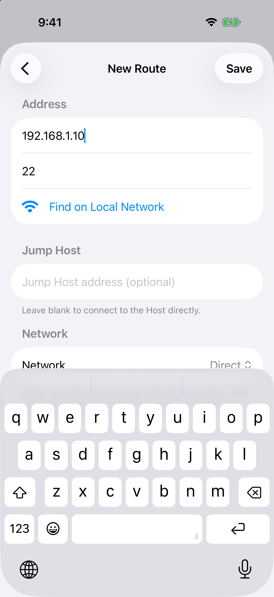
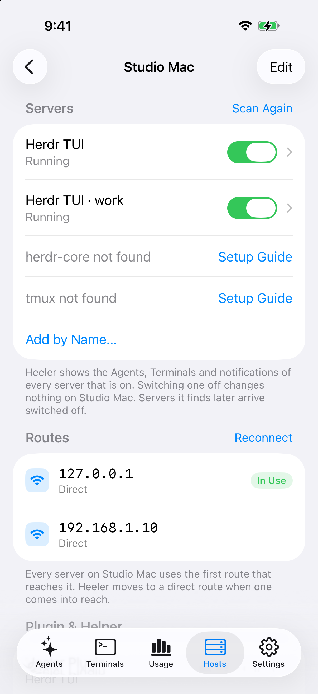

# Reach a Host on several routes

A Host can have more than one route: its LAN address for when you are at home, and an overlay network or a Jump Host for everywhere else. Heeler tries every route each time it connects and uses the first one that reaches the Host, so you never switch anything by hand.

## Add a route

1. Go to **Hosts**, open the Host, and tap **Edit**.
2. Under **Routes**, tap **Add Route**.
3. Enter the **Address** and **Port** (22 unless you changed the Mac's SSH port), or tap **Find on Local Network**.
4. To go through a Jump Host, fill in **Jump Host**. Otherwise leave it blank. See [remote access through a Jump Host](vps-jump-host-setup.md).
5. Under **Network**, choose how this route travels:
   - **Direct** for an address this iPhone or iPad can reach on its own network, such as the Mac's LAN address or a public address.
   - An overlay network from **Settings > Overlay Networks** for Tailscale, ZeroTier, or EasyTier (shown at the top once you have added a network). For Tailscale and EasyTier, tap **Choose from Tailnet…** or **Choose from Network…** and pick the Mac to fill in its address; for ZeroTier, type the Mac's address from ZeroTier Central. See the [Overlay Network guides](overlay-networks.md) to set one up.
6. Tap **Save** at the top right, then **Save** in Edit Host.

Adding a Host asks for its first address on the first step, with the port, Jump Host and network under **More Options**; add further routes here afterwards. [Scanning a Pairing Code](pairing.md) adds every address the code offers as a route of its own.

## How Heeler picks a route

- Each time it connects, Heeler races the Host's routes with staggered starts and keeps the first that reaches it. Every Server on the Host uses that one route.
- **Direct** routes without a Jump Host start first. Overlay network and Jump Host routes start a moment later, or right away once every direct route has failed. At home the LAN address can win before an overlay network ever starts.
- The order of the list does not decide which route wins. The first route is only the address shown for the Host in the Hosts list.
- The Host keeps its route for as long as it stays connected. If you move from Wi-Fi to cellular, it reconnects and picks again.
- When the Host is connected through an overlay network or a Jump Host and a **Direct** route comes into reach, such as its LAN address when you get home, Heeler moves to the direct route by itself. It checks when your iPhone or iPad changes network and when you return to Heeler. If the Mac wakes up or joins the Wi-Fi only later, tap **Reconnect** to pick again.

## See which route is in use

Open the Host from **Hosts**. **Routes** shows how Heeler reaches it, for all of its Servers at once:

- The route the Host is connected through is marked **In Use**. Tap **Reconnect** beside **Routes** to try every route again.
- While Heeler is connecting, tap **Stop** to stop trying. The Host's Servers stay paused until you tap **Reconnect**.
- When no route reached the Host, each route is marked **Failed** with its own reason, such as a timeout or an overlay network that isn't connected.

A Server's own page holds that Server's checks, plugin and Host Helper. The connection is always shown here, on the Host's page.

Here the `127.0.0.1` **Direct** route is **In Use**, and the `192.168.1.10` **Direct** route is not selected. Tap the image to enlarge it.

## Change, reorder, or remove routes

In **Edit**, tap a route to change it, or tap **Delete Route** on its page. With more than one route, tap **Edit** beside **Routes** to drag routes into a new order or delete them. A Host always keeps at least one route.

## Every route must reach the same machine

Heeler confirms a Host's key once, and every route has to reach the machine with that key. If another machine answers one of the addresses, for example the same LAN address on someone else's Wi-Fi, that route fails instead of connecting. Adding a route to the same Mac does not ask you to confirm the key again.

## If a route always fails

- Read its reason under **Routes** on the Host's page.
- **The Jump Host's key is not trusted** or **The host key is not trusted** means nobody has confirmed that key on this iPhone or iPad yet. The Host's page asks you to confirm its fingerprint, and reconnects once you trust it. If you dismissed the question, tap **Scan Again** to see it again.
- For an overlay network route, check that the network shows as connected in **Settings > Overlay Networks** and that the Mac is online in it.
- For a Jump Host route, check that you can reach the Jump Host and that it accepts the same Device Key, RSA Key, or password as the Host. See [the Jump Host guide](vps-jump-host-setup.md).
- For a LAN address, it only answers on that network. Away from home it fails, and another route connects instead.
