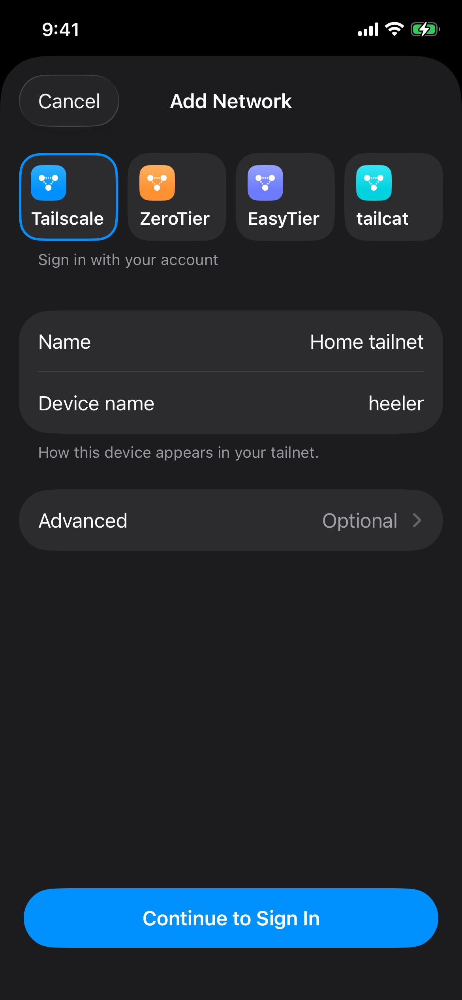
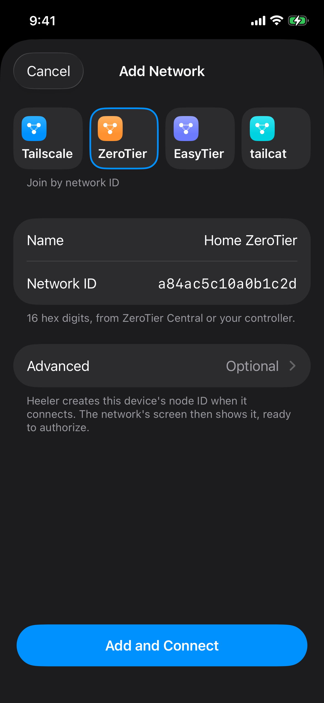
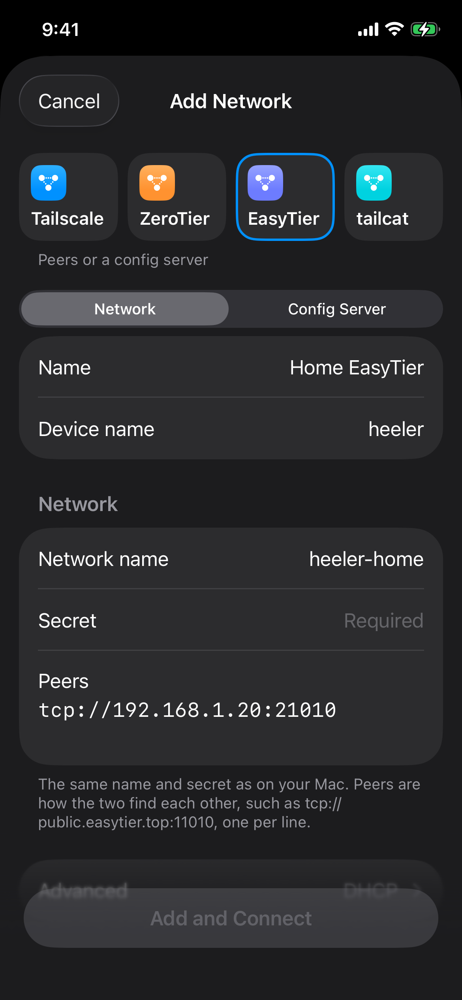
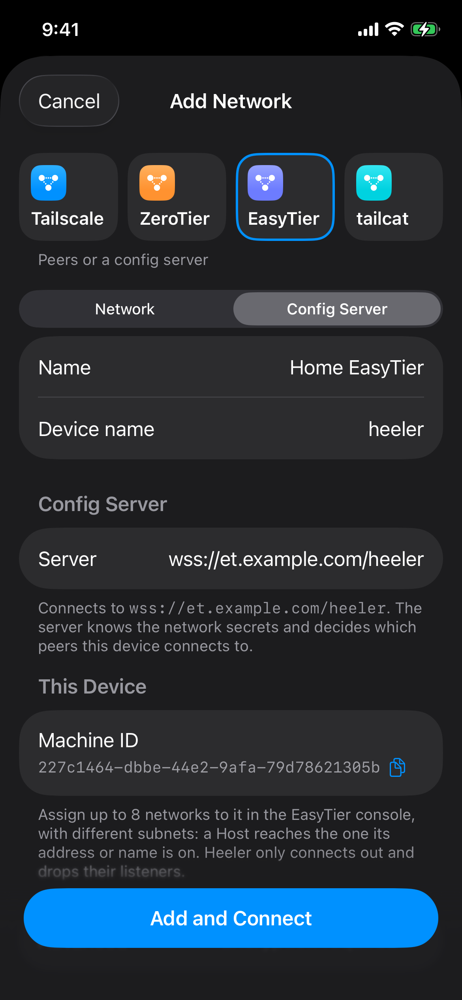
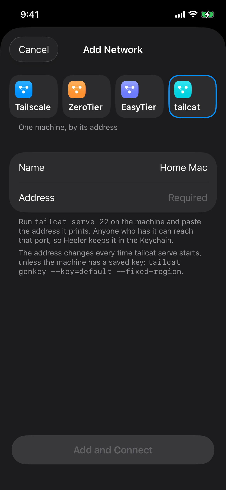
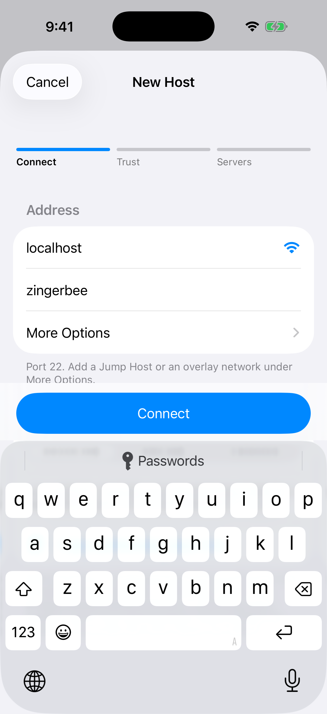
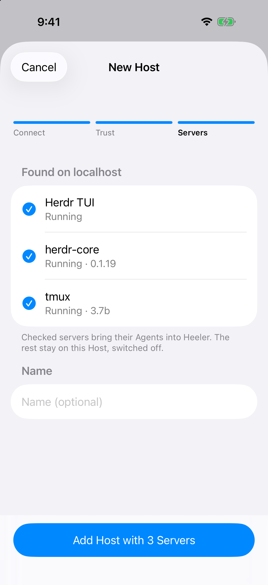
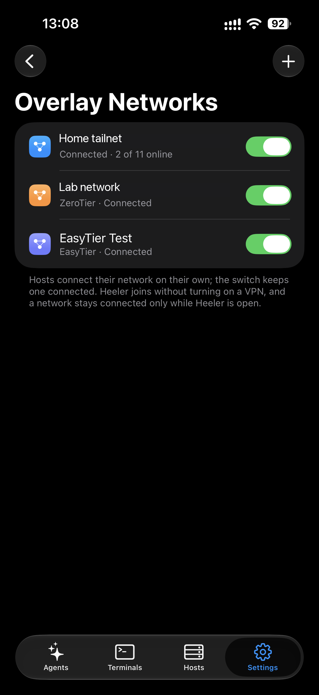

# Connect Heeler through an Overlay Network

Use Tailscale, ZeroTier, EasyTier, or tailcat to reach the Mac running herdr when you can't connect to it directly, for example from cellular. These guides cover a Mac and Heeler on iPhone or iPad.

You need a Heeler version with **Settings > Overlay Networks**.

Heeler joins the network by itself, so the phone needs no Tailscale, ZeroTier, EasyTier, or tailcat app and no VPN setting. The Mac needs the provider's software, Remote Login (SSH), and herdr. You still log in to the Mac over SSH as usual.

## Choose a setup

Prepare the Host below, then follow one provider guide. It sends you to [Connect from Heeler](#connect-from-heeler) when it is time to add the Host.

| Guide | You need | Away from home |
| --- | --- | --- |
| [Tailscale](tailscale.md) | A Tailscale account and the Tailscale app on the Mac | Works |
| [Tailscale without a VPN on the Mac (advanced)](tailscale.md#run-tailscale-without-a-vpn-on-the-mac-advanced) | A Tailscale account and Homebrew | Works |
| [ZeroTier](zerotier.md) | A ZeroTier Central account and ZeroTier One on the Mac | Works |
| [EasyTier](easytier.md) | No account; EasyTier on the Mac from Terminal | Needs a relay you run, such as a small VPS, or a Mac reachable from the internet ([how](easytier.md#reaching-a-mac-outside-the-lan)) |
| [tailcat](tailcat.md) | No account; `tailcat serve` on the Mac from Terminal. Reaches that one Mac | Works |

If you're new to this, start with Tailscale. For a Linux or Windows machine, install the provider's client from its own documentation, then follow the same Heeler steps. Windows also needs the [Windows SSH and herdr setup](windows-setup.md).

These guides all join a network from inside Heeler. If you would rather run a VPN app on the phone and open no port anywhere, [Cloudflare Tunnel](cloudflare-tunnel.md) reaches the Mac with Cloudflare's own client app. It needs a Cloudflare account, and it is not an Overlay Network under **Settings**.

## Heeler setup screenshots

Go to **Settings > Overlay Networks > Add Network**. Each provider has its own form; EasyTier has two. Tap an image to see it full size.

| Tailscale | ZeroTier |
| --- | --- |
| <a href="images/overlay-networks/tailscale-form.png"></a> | <a href="images/overlay-networks/zerotier-form.png"></a> |
| Leave **Advanced** blank and tap **Continue to Sign In**. [Tailscale setup](tailscale.md#3-join-the-same-tailnet-from-heeler) | Enter the network ID and tap **Add and Connect**. [ZeroTier setup](zerotier.md#3-heeler-and-central-join-and-authorize-the-app) |

| EasyTier Network | EasyTier Config Server |
| --- | --- |
| <a href="images/overlay-networks/easytier-manual-form.png"></a> | <a href="images/overlay-networks/easytier-config-server-form.png"></a> |
| Enter the Mac's network name and secret, and add its peer address. [Network setup](easytier.md#3-add-the-network-in-heeler) | Enter the server URL, then assign a network to the Machine ID. [Config Server setup](easytier.md#2-register-heelers-device) |

| tailcat |
| --- |
| <a href="images/overlay-networks/tailcat-form.png"></a> |
| Paste the address `tailcat serve` prints and tap **Add and Connect**. [tailcat setup](tailcat.md#3-heeler-add-the-tunnel) |

The values shown are examples.

## Prepare the Host

Do these steps on the Mac that runs herdr, signed in as the account Heeler will use.

1. Install and start [herdr](https://herdr.dev/docs/install/) and open the session you want.
2. Turn on **System Settings > General > Sharing > Remote Login** and allow your account ([Apple's guide](https://support.apple.com/guide/mac-help/allow-a-remote-computer-to-access-your-mac-mchlp1066/mac)). Keep the Mac awake.
3. In Terminal, note your username, check herdr, and read the Mac's SSH fingerprint so you can compare it in Heeler later:

   ```sh
   id -un
   herdr --version
   ssh-keygen -lf /etc/ssh/ssh_host_ed25519_key.pub
   ```

   If Heeler shows a different key type, read that type's `.pub` file in `/etc/ssh/` instead.
4. Pick how Heeler signs in. For **Device Key** (recommended), go to Heeler > **Hosts** and tap **+**, keep **Device Key**, tap **Copy authorized_keys Line**, then tap **Cancel**. Get the line onto the Mac (for example with Universal Clipboard) and run:

   ```sh
   mkdir -p ~/.ssh
   echo 'PASTE_THE_LINE_HERE' >> ~/.ssh/authorized_keys
   ```

   For **RSA Key**, do the same with **Copy RSA Public Key**. For **Password**, use your Mac password. A key from [pairing](pairing.md) also works.

## Connect from Heeler

Come here from your provider guide once the Mac and Heeler are on the same network.

1. Open **Hosts** and tap **+**. Tap **More Options**, set **Network** to your saved network, fill in **Address** and **Port**, and go back. For Tailscale, EasyTier, and tailcat, you can instead open the network in Settings and tap **Add** next to the Mac; this pre-fills the address and network. (**Direct** means Heeler does not use the overlay network.)
2. Fill in **User** and the sign-in method from the table below, and tap **Connect**.
3. Tap **Trust and Continue** only if the fingerprint matches the one from the Mac.
4. Leave the Servers you want checked, name the Host if you like, and add it. If nothing connects afterwards, open the Host, tap the Server, fix what its checks name, and tap **Run Checks Again**.

| Connect | Servers |
| --- | --- |
| <a href="images/hosts/add-host-connect.png"></a> | <a href="images/hosts/add-host-servers.png"></a> |

| Field | Value |
| --- | --- |
| Address | The Mac's IP address on the network, with no port or `/24`-style suffix |
| User | Your Mac username (from `id -un`) |
| Network (in More Options) | Your saved overlay network |
| Port (in More Options) | `22`, unless your guide says otherwise |
| Jump Host (in More Options) | Leave blank |
| Authentication | The sign-in method you picked |
| Name (last step) | Any label for this Mac |

To fill in the address under **More Options**, Tailscale offers **Choose from Tailnet…** (keep **IP Address** selected) and EasyTier offers **Choose from Network…**. For ZeroTier, copy the Mac's IP address from ZeroTier Central. For a tailcat tunnel, Heeler fills in the address when you choose the tunnel; it is a name ending in `.tailcat`, not an IP address.

## Verify the connection

<a href="images/overlay-networks/networks-connected.png"></a>

**Connected** here means Heeler has joined the network, not that a Host is using it. Follow the checks below to verify the Host's route. Network names have been anonymized; you only need the network you chose, not all three. Tap the image to enlarge it.

1. The network shows **Connected** in **Settings > Overlay Networks**.
2. Open the Host from **Hosts** and check which route is marked **In Use** under **Routes**. Confirm it uses the overlay network you are testing. If another route wins, this connection does not verify the overlay route. See [which route is in use](host-routes.md#see-which-route-is-in-use).
3. The Host checks pass and the session's Agents or Terminals load.
4. In a **New Terminal**, `pwd` prints a folder on the Mac. Use a new terminal for tests, not an Agent's terminal.
5. Turn off Wi-Fi on the phone and repeat over cellular, checking **In Use** again. Another available route, such as a Jump Host or a different overlay network, can still win.
6. Leave Heeler for more than 20 seconds, then come back. The Host and terminal reconnect; check **In Use** again to confirm which route reconnected. (Heeler disconnects from the network while you're away; it isn't an always-on VPN.)

## Troubleshooting

| What you see | What to do |
| --- | --- |
| No **Overlay Networks** in Settings | Update Heeler; your version doesn't have this feature yet. |
| **Not signed in**, **Needs sign-in**, or **Signed out** (Tailscale) | Tap **Sign In** and finish in the browser. |
| **Waiting for approval** (Tailscale) | Approve the device in the Tailscale admin console. |
| **Waiting for authorization** (ZeroTier) | Authorize Heeler's device in ZeroTier Central. |
| **Waiting for a network** (EasyTier Config Server) | Assign a network to Heeler's Machine ID in the EasyTier console. |
| Network is connected, but SSH times out | Check the route's Network, address, and port. Make sure the Mac is awake and Remote Login is on. |
| SSH login fails | Check the username, Remote Login access, and the key or password. |
| SSH works, herdr checks fail | Read the failing check. Usually herdr isn't installed for this account, or the Server that is on is not the session herdr runs. |
| Network turns back on after you switch it off | A Host route is using it. To keep it off, change that route's **Network** or remove the Host. |

Last checked on 2026-10-09 on macOS.

Maintainers: see the [guide maintenance record](../agents/overlay-network-guides.md).
