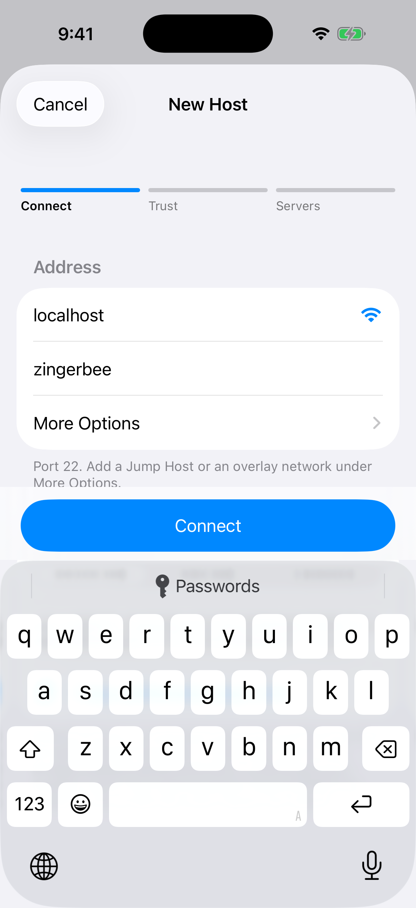
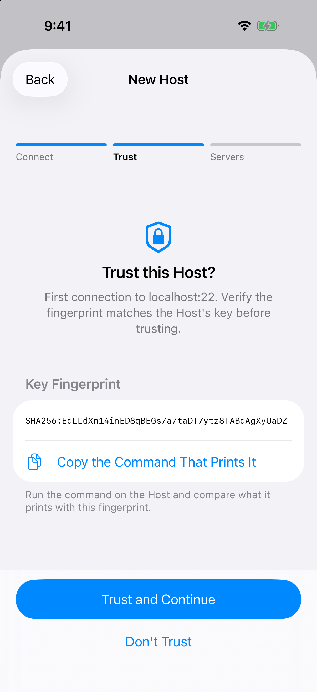

# Connect Rex

Connect Heeler over SSH to a Rex server that already runs on a Mac, Linux or Windows Host, and open its terminals on your iPhone or iPad while Rex keeps running them. A Host's Rex server is one of its Servers in Heeler, beside Herdr TUI, [herdr-core](herdr-core.md), and [tmux](tmux.md).

> [!IMPORTANT]
> Rex support is experimental. It was built and tested against Rex 0.1.0-preview.14 (Rex API revision 12) on macOS, and it opens the terminals and Agents Rex has and starts new shells: see [What Heeler does not do yet](#what-heeler-does-not-do-yet) and [Known limits](#known-limits).

## Before you start

- A Heeler version after 0.1.20.
- Rex running on the Host under the account you will sign in as over SSH. Heeler connects only to a Rex server that is already running and never starts one.
- Remote Login turned on for the Mac and its SSH fingerprint noted: [Prepare the Host](overlay-networks.md#prepare-the-host). On Linux, run OpenSSH. On Windows, run Win32-OpenSSH, with `rex.exe` on the account's PATH, as WinGet puts it; Heeler reaches the server through Rex's own stdio bridge, and [Chat](#chat) there works for Claude Code.
- On a Mac or Linux, an SSH server that allows forwarding to a Unix socket, as OpenSSH does by default. If its `sshd_config` sets `AllowStreamLocalForwarding no` or `AllowTcpForwarding no`, Heeler cannot reach Rex.
- A way for your iPhone or iPad to reach the Host: directly on the same network, over an [overlay network](overlay-networks.md), or through a [Jump Host](vps-jump-host-setup.md). A Host can have [multiple routes](host-routes.md).

## Add a Host

Heeler never starts Rex when connecting or checking, and starts nothing in it until you tap [New Terminal](#new-terminal). On a Mac or Linux it never runs the `rex` command; on Windows, where SSH cannot reach Rex's named pipe directly, each connection runs `rex __internal dial-stdio --autostart=false`, the bridge Rex's own command uses over SSH, which starts no server.

### 1. Connect

1. In **Hosts**, tap **+**, or **Add Manually** when empty. You can [scan a Pairing Code](pairing.md#pair-a-machine-without-herdr) instead, which skips this step and goes straight to [choosing the Servers](#2-choose-the-servers).
2. Enter the **Address** and the SSH **User** of the account that runs Rex. **More Options** has the port, a Jump Host and an overlay network.
3. Pick **Device Key**, **RSA Key**, or **Password**. For **Device Key**, copy the public-key line into the Host's `~/.ssh/authorized_keys`.
4. Tap **Connect**, check the Host's key fingerprint, and tap **Trust and Continue**.

| Connect | Trust |
| --- | --- |
|  |  |

### 2. Choose the Servers

Heeler looks once through your login shell without starting anything and lists what the machine runs. A Host has one Rex Server, listed as **Rex**:

| Heeler found | What to do |
| --- | --- |
| **Rex** reading **Running** | Leave **Rex** checked and tap **Add Host with 1 Server**. |
| **Rex** reading **Not running** | Rex is installed but not running, so **Rex** starts unchecked. Check **Rex** to have it connect once you start Rex. Or add the Host without it, start Rex, open the Host, tap **Scan Again**, and turn on **Rex**. |
| Rex alongside Herdr TUI, herdr-core, or tmux | Check each one you want in Heeler. They are all Servers of this one Host. |
| No **Rex** | Rex is not installed. Add the Host anyway, install and start Rex, open the Host, tap **Scan Again**, and turn on **Rex**. |

Each Server has a switch on the Host's page. Tap **Rex** while it is on to open its own page, with its checks. The connection is the Host's, under **Routes**. **Add by Name…** does not offer Rex: the Host's one Rex Server has no name to type, and Heeler lists it wherever Rex is installed.

If the Host's page reads **Rex** with **Socket found, but this account cannot use it**, Rex runs under another account. Add the machine again as another Host with that account's **User**.

**It worked if** the Host's row shows a green **Rex** tag, the Host's page lists Rex as **Running**, and the Server's page shows **SSH connection**, **Rex installed**, **Rex server running**, and **protocol compatible** passing.

## When it does not connect

| Host reads | What to do |
| --- | --- |
| **Rex is not running** | Start Rex on the Host, then tap **Run Checks Again**. |
| **The SSH server refuses socket forwarding** | Allow forwarding to a Unix socket in the Host's SSH server (see [Before you start](#before-you-start)), then tap **Run Checks Again**. |
| **Rex is not answering** | Heeler could not tell which of the two above it is. Check both, then tap **Run Checks Again**. |
| **Rex did not let this account in** | Rex runs under another account. Add the machine again as another Host with that account's **User**. |
| **This version of Rex is not supported** | Heeler works with Rex API revisions 12 to 19. Update Rex if the message says it offers an older revision; if it offers a newer one, wait for a Heeler update. |
| **Rex was not found on this Host** | Install and start Rex, then tap **Run Checks Again**. |

## The Console

Heeler shows your Rex layout as it is and changes it only when you start a [New Terminal](#new-terminal):

- **Workspaces, Tabs, and Panes:** Each Rex session is a Workspace, each window is a Tab, and each terminal is a Pane, in Rex's order. A session's terminals that are in none of its windows share a Tab named **Detached**. A session with no terminal is not listed.
- **Agents and Terminals:** A terminal whose program is Claude Code, Codex, or another coding Agent Heeler knows appears in **Agents**, with the status the Agent reports to Rex. Shells and other programs appear in **Terminals**, and a terminal moves back to **Terminals** when its Agent exits. A session whose terminals are all Agents appears in **Terminals** as a card holding only **New Terminal**. Titles, programs, and directories follow Rex as they change.

| Status | What it means |
| --- | --- |
| **Working** | Running a turn. |
| **Idle** | Waiting at its prompt. |
| **Blocked** | Waiting for your answer. |
| **Error** | Reported an error and sorts with **Blocked**. |
| **Done** | Finished a turn while closed here. Opening the Agent clears **Done** on this device only. |
| **Unknown** | The Agent has not reported a status to Rex, or the last report came from another program, such as one that has since exited. |

An Agent started as a Rex terminal's own command rather than from its shell, or started with `exec`, stays in **Terminals**. Heeler sees a terminal's program change when the terminal next prints, so an Agent can take a moment to arrive in **Agents** or to leave it.

## Working in a terminal

Tap a terminal in **Terminals** to open it. An Agent in **Agents** opens like an Agent on any other Host, with [Chat](#chat) and its terminal; when the Agent exits while it is open, it reads **Agent Gone**, and the terminal is back in **Terminals**. Other Rex clients keep showing it while you work:

- **Opening:** The terminal appears once Rex has redrawn its screen and history, so a long history can take a few seconds on a slow connection. A program that keeps writing, such as a spinner, can show a few lines twice or out of place until it pauses; Heeler then paints it again.
- **Typing and pasting:** Type in Text or Keys mode, tap **Paste**, or send a Snippet. You can type whichever device set the terminal's size. What you type reaches the terminal in order, and Heeler never sends it twice: when the connection drops before Rex answers, the terminal shows **Connection dropped** with **Reattach**, and nothing typed after that point was sent. Keys typed while Heeler reconnects are not sent either; the terminal reconnects and paints again. A paste too large to send in one piece is blocked rather than split; paste less at a time.
- **Ending:** When a terminal closes in Rex or its program exits, its view ends.
- **Rex restarting:** When Rex restarts and brings back its sessions, its terminals, your pins and Chat stay. An open terminal reconnects and shows a fresh screen, since what ran in it started again or ended.

When a terminal stops, it says why:

| Terminal reads | What to do |
| --- | --- |
| **Connection dropped** | Something you typed may not have arrived. Tap **Reattach** and check the screen before typing again. |
| **This terminal's history is too long to show** | Clear the terminal's scrollback in Rex, then tap **Reattach**. |
| **Rex stopped sending this terminal's output** | Rex stopped the terminal's output while the Host stayed connected. Tap **Reattach**. When the connection to the Host drops, the terminal reconnects and paints again by itself instead. |
| **This Terminal belongs to a Rex server that is gone** | Another Rex server answers, one that did not bring back this terminal's session. Open the terminal again from **Terminals**. |

### Fitted to your screen

A Rex terminal has one size, set by one device at a time. When you open a Rex terminal from **Terminals**, or show an Agent's terminal, Heeler fits it to your screen before it appears. Chat never resizes the terminal. Rex resizes the terminal itself, not only your view of it, so every device showing it, the Rex app on your Mac included, gets your screen's size while you have it open here. Heeler gives the size back when you leave the terminal, when Heeler goes to the background, or when the terminal ends, and the device that had it gets it back. Coming back fits it again.

### Sized for another device

When another device, such as the Rex app, takes the size while you have the terminal open, Heeler leaves it with that device instead of taking it back. The same happens when fitting does not go through. Heeler then shows the terminal at that device's size without scaling it: lines wider than your screen wrap onto the next row, so a program drawn to the full width, such as a table or an editor, can look jumbled. After a second **Sized for another device** appears over the terminal, at the bottom while the output ends in its upper half and at the top otherwise, so it stays clear of the prompt:

- **Fit to Screen** takes the size back for your screen.
- The **×** button dismisses the notice and keeps the other device's size while you stay. The notice returns when yet another device sets the size.
- If tapping **Fit to Screen** does not go through, the notice says why, and **Try Again** asks once more.

Leaving the terminal and coming back fits it to your screen again.

On iPad, one window at a time shows a Rex Host's Agent terminals. Another window that opens one reads **Live in Another Window**; tap **Take Over Here** to move it there.

## New Terminal

Heeler starts a shell in Rex, in a new window, the way Rex's own New Terminal does:

- **In a Workspace:** Tap **New Terminal** at the end of a Workspace's card in **Terminals**, or **+** in **Terminals** and pick the Workspace. Rex opens the shell in a new window of that session, in the Workspace's directory. The window opens in the background: the Rex app on your Mac keeps showing the window it had.
- **In a new Workspace:** In the **+** sheet, choose **New Workspace**, and browse to a directory or leave it empty for your home directory. Rex makes a new session with the shell in it, named as you type it, or after the directory when you leave the name empty. There is no tab name to give.
- **Opening it:** The new terminal opens here as soon as Rex lists it, fitted to your screen as any other, and gives its size back when you leave it.
- **If Rex does not answer:** Heeler never asks Rex twice. When the error says Rex did not answer, the terminal may still have been made: look in **Terminals** before trying again.

To start an Agent, open a New Terminal and start it there. It moves to **Agents** once it runs.

## Chat

**Chat** works for Claude Code, Codex, Pi, and Oh My Pi in Rex on macOS and Linux, and for Claude Code in Rex on Windows. Claude Code and Codex need nothing installed on the Host; Pi and Oh My Pi need [Heeler's extension](#pi-and-oh-my-pi), which Chat offers to add. Heeler reads the conversation over the Host's SSH connection and types into the terminal through Rex, without resizing it. You can read the conversation, **Send** a message, **Stop** a turn, and tap buttons on **Blocked** prompts:

| Program | Session notes |
| --- | --- |
| Claude Code | Binds from the running Claude Code itself, on Windows too. After `/clear` or `/resume`, Chat checks again before it sends your next message. |
| Codex | Binds once it holds its conversation file, after the first message. Start it with `--no-daemon` ([why](chat.md#set-up-the-host)); without it, Chat shows [**Codex Started Without --no-daemon**](chat-troubleshooting.md#codex-started-without---no-daemon) instead of the conversation. |
| Pi | Binds through [Heeler's extension](#pi-and-oh-my-pi), as soon as Pi starts. After `/new`, Chat checks again before it sends your next message. |
| Oh My Pi | Binds through [Heeler's extension](#pi-and-oh-my-pi), as soon as Oh My Pi starts. Without the extension, Chat follows the conversation after its first message. After `/new`, Chat checks again before it sends your next message. |
| Other Agents | No Chat on Rex Hosts yet. They open on their terminal. On Windows, so do Codex, Pi, and Oh My Pi. |

- **Can't Tell the Conversation:** When Chat cannot prove which conversation the Agent shows, it says so with **Check Again**. For Claude Code and Codex, tap **Choose a Conversation**, preview one, and tap **Use This Conversation**. Heeler keeps that choice on this device, for this terminal, until the Agent exits or Rex restarts. Nothing is written on the Host. For Pi and Oh My Pi, [add Heeler's extension](#pi-and-oh-my-pi) instead.
- **Send:** **Send** pastes your message and presses Enter once it checks that the same Agent still holds the terminal, is not **Blocked**, and accepts a paste. The Composer under the terminal sends the same way. If Rex does not answer, Heeler never sends the message again; check the terminal first.
- **Stop and Blocked prompts follow the Agent's status.** While the Agent reads **Working** and your message is empty, **Send** becomes **Stop**, which presses Esc once it checks that the same Agent still holds the terminal. A card with buttons appears while it reads **Blocked**. An Agent that reports no status to Rex reads **Unknown**: it gets no **Stop** and no card, so stop or answer it in its terminal. A Claude Code that has finished its turn while a command it put in the background still runs reads **Done** or **Idle**, so you can send its next message; **Stop** never ends that command, so end it in the terminal.
- **Commands:** `/` offers `/compact` while the Agent reports it is idle, and not the Agent's skills. Use the terminal for the rest.
- **Images and files:** In Chat or on the Agent's terminal, tap **+**, then **Add Image**, **Paste Image** or **Add File**. Heeler uploads the file over the Host's SSH connection, not through Rex, into a new folder in the temporary folder of the account you sign in with (on Windows, `AppData\Local\Temp` in its user folder), and adds its path to your message; **Send** types the path with your message, once. An image is sent as a JPEG or PNG of at most 16 MiB, and a file can be up to 64 MiB. Heeler never deletes uploaded files from the Host. If another Rex server takes over, one that did not bring back the Agent's session, an upload started afterwards stops with **This Terminal belongs to a Rex server that is gone**; one already under way finishes and its file stays on the Host, but **Send** then refuses the message with the same words. Open the Agent again from the list.

### Pi and Oh My Pi

Pi and Oh My Pi tell Chat which conversation they are in through Heeler's extension, one file named `heeler-session.js` in the Agent's own extension folder, such as `~/.pi/agent/extensions`. Rex has no Host Helper to bring it, so Chat asks you instead:

1. Open the Agent and show **Chat**. It reads **Can't Tell the Conversation**, with **Add Heeler's Extension…**.
2. Tap **Add Heeler's Extension…**. Heeler shows the one folder it will write to, found from the running Agent.
3. Tap **Add to This Folder**. Heeler writes the file over the Host's SSH connection, replacing an older copy of it, and nothing else.
4. Quit the Agent and start it again in the same terminal. It loads the extension as it starts.

**It worked if** Chat shows the Agent's conversation by itself a few seconds after the Agent starts.

- **Still Can't Tell the Conversation:** When the message says the Agent hasn't loaded the extension, the Agent was started before you added it, or with `--no-extensions`. Start it again with its extensions on.
- **What the extension does:** Pi and Oh My Pi load it for every session on the Host. In a Rex terminal it keeps one small file per running Agent in a `heeler-session` folder beside the extension folder, naming the conversation, and removes it when the Agent quits. Outside Rex, tmux, and herdr-core it does nothing.
- **Removing it:** Delete `heeler-session.js` from the extension folder, and the `heeler-session` folder beside it.

## What Heeler does not do yet

- **Status, Chat and attachments only:** no Changes, Skills, Agent Notifications, Live Activities, Usage, or widgets for Rex. A Host's other Servers keep theirs.
- **No New Agent, Rename, or Close:** Heeler starts only shells. Start an Agent in a [New Terminal](#new-terminal), and rename or close in Rex; Heeler shows the result.
- **No Worktrees, Host Helper, or Add by Name** for Rex.

## Known limits

- **Rex API revisions 12 to 19:** Heeler offers revision 19 and accepts any from 12, and Rex picks the newest both speak. A Rex that speaks none of them is refused. Heeler was built against Rex 0.1.0-preview.14 (revision 12) and checked against 0.1.0-preview.23 (revision 19).
- **Linux not yet tried:** Heeler looks where Rex keeps its socket on Linux, but no Linux Rex server has been tried yet.
- **Colors, cursor shape and history:** A Rex terminal wears its own colors, as Rex shows it, and your Heeler theme only where Rex keeps its built-in ones. Rex does not say a terminal's cursor shape, so the cursor keeps Heeler's shape until the program sets it again. While a full-screen program is open, the history behind it appears only after the program closes.
- **Another device's size does not fit:** While a terminal stays at a size another device set wider than your screen (see [Sized for another device](#sized-for-another-device)), its lines wrap at your screen's width, so a full-width program can look jumbled. While its screen holds a line wider than yours, the cursor, new output and what you type can also land on the wrong row, over earlier text, until **Fit to Screen** paints it again. Heeler does not scale it down or cut it off.
- **What has been tested so far:** Rex has been tried in the iOS Simulator against Rex 0.1.0-preview.14 on macOS, with test clients standing in for other devices. Apart from one Chat message sent from an iPhone (below), they have not been tried on a physical iPhone or iPad. They have not been tried with the Rex app showing the same terminal either.
- **Chat with real Agents tried only in the Simulator:** In the iOS Simulator, Chat was tried with a real Claude Code, Codex, Pi, and Oh My Pi running in Rex on macOS: reading the conversation, **Send**, and **Stop** for all four, and the buttons on **Blocked** prompts for Claude Code and Codex. On an iPhone, one message sent from Chat reached a real Codex 0.169.0 running in Rex, which answered it. That was an earlier build, which refused every later Send once Codex's answer drew links. Chat now reads such links, but Chat has not been tried again on an iPhone or iPad. Pi and Oh My Pi have not been tried on Linux, or with an Oh My Pi profile.
- **Uploads not yet tried on a device:** Images and files were tried in the iOS Simulator against a running Rex server: an image with a real Claude Code, Codex, Grok Build, Antigravity CLI, Pi, and Oh My Pi, and a text file with Claude Code and Codex. They have not been tried from a physical iPhone or iPad.
- **Chat on Windows checked piece by piece:** Against Rex 0.1.0-preview.23 on Windows 11, three real Claude Code 2.1.332 Agents in Rex terminals were each found by the process read Chat runs there, held to their own conversation, and their conversation files read over SFTP. Making a staging folder, writing, renaming and removing a file over SFTP in the account's `AppData\Local\Temp` worked there too. Chat and uploads on Windows have not been tried end to end in the app.

Last checked on 2026-11-18 against Rex 0.1.0-preview.14 (API revision 12) on macOS, with test programs and, in the iOS Simulator, real Agents.
