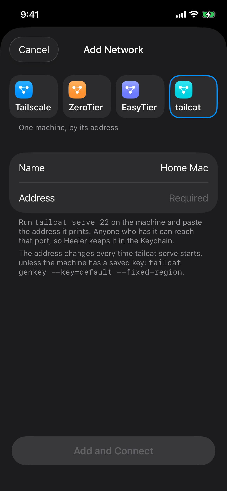

# Connect Heeler through tailcat

Use this guide to reach the Mac that runs herdr through [tailcat](https://github.com/tailscale/tailcat): a tunnel to one machine, with no account and no network to manage. The Mac runs `tailcat serve` and prints an address; Heeler connects with that address, so the phone needs no other app or VPN.

You need a Heeler version that offers **tailcat** in **Settings > Overlay Networks > Add Network**.

## Before you start

- On the Mac, finish [Prepare the Host](overlay-networks.md#prepare-the-host): Remote Login, herdr, a sign-in method, and the Mac's SSH fingerprint.
- You need [Homebrew](https://brew.sh/) on the Mac, or another way to [install tailcat](https://github.com/tailscale/tailcat/blob/main/INSTALL.md).
- Keep the Mac awake during setup.

Treat the tailcat address like a password. Anyone who has it can reach the port you serve, although SSH still asks for your key or password. Move it to the phone privately, for example with Universal Clipboard or AirDrop, and never post it.

## 1. Mac: install tailcat and save a key

```sh
brew install tailcat
tailcat genkey --key=default --fixed-region
```

`genkey` saves a key on the Mac and prints its address, one long line starting with `tc`. With a saved key the address stays the same every time `tailcat serve` starts. Without one, each start prints a new address that you would have to paste into Heeler again.

## 2. Mac: serve the SSH port

```sh
tailcat serve 22
```

Use your Mac's SSH port if it is not `22`. The command prints the address again and keeps running:

```text
# 🐈 Server listening with saved key "default": tc…
```

The tunnel exists only while this command runs, so leave it in a terminal that stays open, such as a herdr pane. Copy the whole address.

**It worked if** the line says `saved key "default"`. If it says `new address`, step 1 did not save a key.

## 3. Heeler: add the tunnel

1. In Heeler, open **Settings > Overlay Networks > Add Network** and choose **tailcat**.
2. Enter a **Name**, such as the Mac's name, and paste the address into **Address**. Heeler hides it like a password and says below the field whether it is a tailcat address.

   <a href="images/overlay-networks/tailcat-form.png"></a>

3. Tap **Add and Connect**.

**It worked if** the tunnel shows **Connected**, with **Direct** or **Relayed** and a time in milliseconds. **Relayed** means the traffic goes through one of tailcat's relays, which is slower and still encrypted end to end.

## 4. Heeler: add the Mac as a Host

Open the tunnel in **Settings > Overlay Networks** and tap **Add** next to its server, or tap **+** in **Hosts**, open **More Options**, and set **Network** to the tunnel. Then follow [Connect from Heeler](overlay-networks.md#connect-from-heeler) with these values:

| Field | Value |
| --- | --- |
| Address | Filled in by Heeler: a name ending in `.tailcat`. Leave it as it is |
| User | Your Mac username |
| Network (in More Options) | The tunnel you just added |
| Port (in More Options) | The port you served, normally `22` |
| Jump Host (in More Options) | Blank |
| Authentication | The sign-in method you picked |

A tailcat tunnel reaches only the machine running `tailcat serve`, so the address is not an IP address and you cannot type another machine's. Then tap **Connect**.

Tap **Trust and Continue** only if the fingerprint matches, add the Host with the Servers you want checked, then [verify the connection](overlay-networks.md#verify-the-connection).

## Troubleshooting

| Problem | What to do |
| --- | --- |
| No **tailcat** under **Add Network** | Update Heeler; your version does not have it yet. |
| **Add and Connect** stays grey, or "This is not a tailcat address" | Copy the whole address, from `tc` to the end of the line. |
| "The tailcat server did not answer" or **The server is not answering** | Check that `tailcat serve` is still running on the Mac and that the Mac is awake. If it printed a new address, open the tunnel, choose **…** > **Edit**, and paste it. |
| "The tailcat server answered, but not on port …" | The Host's **Port** must be one that `tailcat serve` was started with. |
| "This address has no pre-shared key" | The key was made with `--psk=false`. Delete it and run step 1 again without that flag. |
| "A tailcat tunnel only reaches the machine running tailcat serve" | Open the Host's route and tap **Use the Tunnel's Address**. To reach another machine, run `tailcat serve` there and add a tunnel for it. |
| Connected, but SSH login fails | Check the username, Remote Login access, and the key or password. |
| The tunnel stops after you leave Heeler | Expected, about 20 seconds after you leave. Hosts reconnect it when you return. |

## Stop using the tunnel

Turn off the tunnel's switch to disconnect it; its settings stay. To remove it, move or remove its Hosts first, then open the tunnel and choose **…** > **Delete Network**.

On the Mac, press **Control-C** in the terminal running `tailcat serve`. Deleting the tunnel in Heeler does not revoke the address. To make it useless, delete the saved key and make a new one:

```sh
tailcat genkey --delete --key=default
tailcat genkey --key=default --fixed-region
```

Commands were checked against tailcat v0.7.0 on 2026-11-15.

Maintainers: see the [guide maintenance record](../agents/overlay-network-guides.md).
