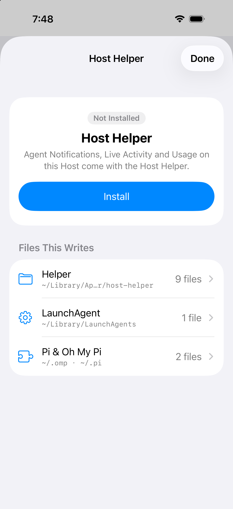
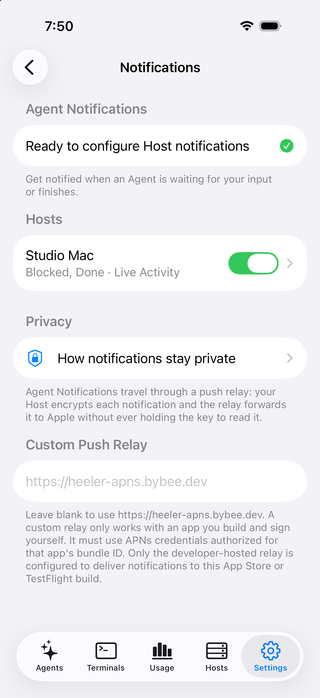
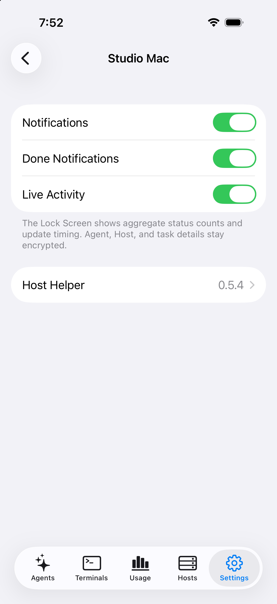

<!-- Translated from docs/guides/herdr-core.md at ad6d60ec -->
# 连接 herdr-core

Herdr 桌面端中的 Agent 归属于 herdr-core，这是一个独立于 Herdr TUI 的服务端。即使在同一个 SSH 账户下，每个服务端在 Heeler 中都是各自的 Host。大多数人在 Mac 上搭配 Herdr 桌面端运行 herdr-core，Heeler 也支持连接 Linux herdr-core 与[原生 Windows](#native-windows) `herdr-core.exe`。

## 开始之前

- 在 Mac 上开启“远程登录”并记录其 SSH 指纹：[准备 Host](overlay-networks.md#准备-host)。在 Linux 上运行 OpenSSH。在 Windows 上请按 [Windows 配置](windows-setup.md)操作。
- 在 Mac 上运行 Herdr 桌面端，或在 Linux、[原生 Windows](#native-windows) 上运行 herdr-core。
- 让手机能够连通 Mac：处于同一局域网下直连，或通过 [Overlay Network](overlay-networks.md) 连接。一个 Host 可以配置[多条路由](host-routes.md)。

## 添加 Host

Heeler 在连接或检查时绝不会启动 core。请先启动 Herdr 桌面端或 herdr-core。

### 1. 填写 SSH 设置

1. 在 **Hosts** 中轻点 **Add Host**，列表为空时轻点 **Add Manually**。Pairing Code 始终添加 Herdr TUI Host。
2. 输入 SSH **User**，添加一条 Route，并选择 **Device Key**、**RSA Key** 或 **Password**。
3. 若选择 **Device Key**，请将表单中的公钥行复制到 Host 的 `~/.ssh/authorized_keys` 中。
4. 按需填写 **Session name**，然后轻点 **Save**，并在核对 Host 的密钥指纹后轻点 **Trust**。

| 字段 | 值 |
| --- | --- |
| **Session name** | 留空表示 `default`，或填写 core 的 `HC_SESSION` 名称 |

### 2. 确认 Server Kind

Heeler 会在不启动任何服务的情况下检查一次，随后请你确认 **Server Kind**：

| Heeler 检测到 | 操作方法 |
| --- | --- |
| herdr-core | 轻点 **Use herdr-core**。 |
| 同时检测到 herdr-core 和 Herdr TUI | 先在此确认其中一种，再为同一台机器重新添加一个 Host 以使用另一种。 |
| 均未检测到 | 确认你将要运行的类型。随后它的检查项会说明如何配置。 |

确认后，**Server Kind** 即固定不变。

**成功的标志是** Host 详情将 **Server Kind** 显示为带版本号的 herdr-core，且 **herdr-core running** 检查通过。

## 无法连接时

当 core 停止运行时，Heeler 会自动重新检查，你也可以轻点 **Run Checks Again**：

| Host 显示 | 操作方法 |
| --- | --- |
| **herdr-core is not running** | 启动 Herdr 桌面端或 herdr-core，或检查 **Session name**。如果崩溃留下了套接字文件，请启动 core 或允许 stream-local 转发。 |
| **herdr-core is not installed** | 将 herdr-core 安装到 SSH `PATH`、`~/.local/bin/herdr-core`，或使用其 Windows 安装程序安装，然后轻点 **Run Checks Again**。 |
| **herdr-core needs an update** | 运行 Host 详情中显示的更新命令，然后轻点 **Run Checks Again**。 |
| **The SSH server refuses socket forwarding** | 在 `sshd_config` 中设置 `AllowStreamLocalForwarding yes`，重载 `sshd`，然后轻点 **Run Checks Again**。 |
| **The herdr-core socket path is too long** | 使用更短的 **Session name** 或套接字路径。 |

在 Linux 上当 core 停止时，轻点检查项下方的 **Start herdr-core** 并确认 **Start**，即可通过登录 shell 启动该会话并开启 systemd linger。在 macOS 和 Windows 上，Host 详情会显示需要在本机运行的命令。

## 控制台

当 core 归属于 Herdr 桌面端时，Heeler 会跟随它的空间与标签页：

- **桌面端空间与标签页：** 每个桌面端空间都按桌面端的顺序显示为一张工作区（Workspace）卡片，标签页显示为 **Tab “name”** 或 **Tab N**。
- **其他终端：** 子终端会加入其父终端所在的卡片。其余终端按 git 检出目录或启动文件夹分组。
- **Agents 与 Terminals：** 上报状态的编程 Agent 与非 shell 程序显示在 **Agents** 中。Shell 保留在 **Terminals** 中。

| 状态 | 含义 |
| --- | --- |
| **Working** | 正在运行一轮对话。 |
| **Idle** | 在提示符处等待。 |
| **Blocked** | 等待你的回答。 |
| **Error** | 上报了错误，并与 **Blocked** 一起排序。 |
| **Done** | 在当前设备未打开该 Agent 时完成了一轮对话。打开该 Agent 仅会清除当前设备上的 **Done**。 |
| **Unknown** | 尚未上报状态。轻点 **Unknown** 查看原因。 |

在 macOS 和 Linux 上，当 Grok Build 显示 **Unknown** 时，轻点 **Turn On Grok Build's Status** 和 **Apply This Change**，即可在 `$GROK_HOME/config.toml` 或 `~/.grok/config.toml` 中设置 `program_status = "on"`。可通过 **Undo** 或在 Host 详情的 **Harness Edits** 下还原。

在 macOS 和 Linux 上且桌面端正在运行时，在 Agent 的 Composer **More** 菜单中轻点 **Rename Workspace**，即可在两个应用中同步重命名该空间。

## 启动项目

- **New Agent：** 轻点 **New Agent**，选择工作区，并从登录 shell 的 `PATH` 中选择 Agent，或从 **Settings > Agents & Accounts** 中选择 **Preset**。只要你填写的参数尚未指定会话，Heeler 就会在支持时传入会话标志，并以 `--no-daemon` 启动 Codex。
- **New Terminal：** 在 core 所运行的 shell 中打开一个终端，并在桌面端空间中新增一个标签页。
- **New Workspace：** 选择 **New Workspace** 或 **Browse Directory…**。在 macOS 和 Linux 上且桌面端正在运行时，**Workspace name (optional)** 会为该空间命名。
- **Templates：** `~/.config/herdr-core/templates` 或 `$XDG_CONFIG_HOME/herdr-core/templates` 中的角色会显示在 **New Agent** 的 **Templates** 下，并直接运行其命令。
- **Worktrees：** 在 macOS 和 Linux 上，在 **New Agent** 中开启 **Start in a new worktree** 并输入 **Branch**，即可检出 `~/.herdr/worktrees/<repository>/<branch>`。要移除它，轻点 **More > Worktree Details > Remove Worktree**。Heeler 会先结束该工作区的全部终端，再移除检出目录。

> [!NOTE]
> 如果 herdr-core 继承了 `CLAUDECODE` 或 `TMUX` 等环境变量，Host 详情会显示 **Core Environment**，列出每个变量及其影响。请从干净的终端重启 core 以清除它们。

## 使用 Agent

实时终端共享 Host 的连接，任何查看者无需 Take Over 步骤即可直接输入。你可以使用 Direct Input 或 Composer：

- **Send 与 Stop：** 仅当同一个 Agent 仍持有该终端时，**Send** 才会粘贴草稿并按下回车。当状态为 **Working** 且草稿为空时，**Send** 会变为 **Stop**。对于 Grok Build，请通过 Direct Input 或工具键盘按下 **Control-C**。
- **Add：** 在 Composer 中轻点 **Add**，或在 Direct Input 的 **More** 下轻点 **Add Image** 或 **Add File**，即可上传文件并插入其路径。
- **Close：** 关闭标签页或窗格会结束其终端。

如果 Host 未响应某一步 Send，Heeler 绝不会重复发送该消息，而是提供 **Edit Draft** 以便你先检查终端。当 **Send** 或 **Stop** 无法干净地完成时，Composer 会保留草稿并显示提示：

| 提示 | 操作方法 |
| --- | --- |
| **stayed in the Agent's input unsubmitted** | 再次发送前，请先在终端中提交或清空该文本。 |
| **may still be in the terminal** | Agent 在提交前已退出。请先检查终端。 |
| **not accepting a paste** | 等待提示符出现，或使用 Direct Input 输入。 |
| **waiting on its question on screen** | 请先回答 **Blocked** 提示，然后再发送。 |
| **still shows Working** | 如果仍想停止，请再次轻点 **Stop**。 |
| **may or may not have reached the Agent** | Heeler 不会重发 **Stop**。请先查看终端。 |

## Chat

在 **Chat** 中，你可以阅读对话、发送消息、停止当前轮次，并通过按钮回答 **Blocked** 提示：

| 程序 | 会话说明 |
| --- | --- |
| Claude Code | 支持 macOS、Linux 和 Windows。在提示符处绑定，并跟随 `/clear` 与 `/resume`。 |
| Codex | 支持 macOS 和 Linux。以 `--no-daemon` 启动时在首条消息后绑定。 |
| Grok Build | 支持 macOS、Linux 和 Windows。当 Grok Build 的进程只列出一个对话时绑定。执行 `/new` 后，请重启，或在 macOS 和 Linux 上使用 **Choose a Conversation**。 |
| Pi | 支持 macOS、Linux 和 Windows。搭配 [Host Helper](#host-helper)、在 Windows 上搭配 Heeler 的扩展，或由 Heeler 启动时绑定。否则请使用 **Choose a Conversation**。 |
| Oh My Pi | 支持 macOS、Linux 和 Windows。搭配 [Host Helper](#host-helper)、在 Windows 上搭配 Heeler 的扩展，或在首条消息使其持有会话文件后绑定。否则请使用 **Choose a Conversation**。 |
| OpenCode | 在 herdr-core Host 上关闭。仅提供终端视图。 |

- **Can't Tell the Conversation：** 当 Chat 无法证实当前对话时，会显示 **Can't Tell the Conversation** 以及解决方法和 **Check Again**。在 macOS 和 Linux 上，轻点 **Choose a Conversation**，预览对话后轻点 **Use This Conversation**。
- **Windows 上的 Pi 与 Oh My Pi：** 在 Chat 中轻点 **Add Heeler's Extension…**，查看 `.pi\agent\extensions`、`.omp\agent\extensions` 以及 Oh My Pi 配置文件夹，轻点 **Add to … Folders** 写入 `heeler-session.js`，然后重启该 Agent。

## Host Helper

连接和日常使用不需要 Host Helper。如需 **Agent Notifications**、应用内横幅、**Live Activity**、**Usage**，以及准确的 **Pi** 与 **Oh My Pi** Chat，请在 macOS 或 Linux 上安装它。

Host Helper 在 Host 上的 Node.js 20 或更新版本上运行，在 Linux 上作为 `systemd` 用户服务，在 macOS 上作为 `launchd` LaunchAgent，跟随 herdr-core 而不主动启动 core。

### 1. 查看将写入的文件

1. 在 **Hosts** 中打开该 Host，轻点 **Host Helper**。
2. 在 **Files This Writes** 下依次轻点 **Helper**、**systemd Unit**（Linux）或 **LaunchAgent**（macOS）以及 **Pi & Oh My Pi**，浏览它们的文件夹：Linux 上的 `~/.local/share/heeler/host-helper` 或 macOS 上的 `~/Library/Application Support/heeler/host-helper`、服务文件，以及 Pi 和 Oh My Pi 的 `agent/extensions` 文件夹。

### 2. 安装 Helper

1. 轻点 **Install**。
2. 在 Linux 上，如果出现 **Systemd Linger**，请轻点 **Turn On Linger** 以在注销后保持 Helper 运行。该按钮会运行不带 `sudo` 的 `loginctl --no-ask-password enable-linger`。当 Host 拒绝时，面板会显示供管理员运行的 `sudo loginctl enable-linger <user>`。

**成功的标志是** **Host Helper** 行显示已安装的版本号，且面板显示 **The Host Helper is running.**

macOS 可能会提示 `node` 可在后台运行，并将其列在“登录项”下。Mac 重启后，只有当打开 Host 详情或允许通知的设备连接并由 Heeler 读取 Helper 时，Helper 才会重新运行。在 Mac 上，Claude Code 的 Usage Limits 可能会显示 **need your own login on this Mac**，而 Token Usage 仍会正常统计。

| 行显示 | 含义 |
| --- | --- |
| **Not Installed** | 轻点 **Install**。 |
| 版本号 | 正在运行。当内置了更新版本时，轻点 **Update**。 |
| **Damaged** | 文件被修改或缺失。轻点 **Repair**。 |
| **Node.js Missing** | 安装当前版本的 Node.js，然后轻点 **Run Checks Again**。该行的详情会给出最低版本要求。 |
| **Linger Off** | 注销后会停止运行。轻点 **Turn On Linger**。 |
| **Node.js Moved** | 服务所使用的 Node.js 路径已变动。轻点 **Repair**。 |
| **Service Failed** | 已停止或无法持续运行。轻点 **Repair**。 |
| **Not Available** | 原生 Windows 与无 `systemd` 的 Linux 不提供 Host Helper。 |

### 3. 开启通知

1. 前往 **Settings > Notifications**。如果出现 **Enable Notifications**，请轻点它，再轻点 **Continue**，并在 iOS 询问时允许通知。
2. 在 **Hosts** 下打开该 Host 的开关。轻点该 Host 可设置 **Done Notifications** 和 **Live Activity**。

| Notifications | 该 Host 的页面 |
| --- | --- |
|  |  |

**成功的标志是**开关保持开启，且该 Host 的行中没有 **Host Helper:** 提示。此后即使关闭 Heeler，这台设备也会收到 **Blocked**、**Error** 和 **Done** 通知，轻点通知即可打开对应的 Agent。

如果出现 **Host Helper:** 提示，请轻点该 Host，再轻点 **Host Helper**，并对照上表处理对应状态。

### 移除 Helper

打开 **Host Helper** 并轻点 **Remove**，即可停止服务并删除其文件、扩展与目录。

## Native Windows

通过 OpenSSH 添加 Windows 机器：

- **路径与启动：** Heeler 会查找 `%LOCALAPPDATA%\Programs\herdr-core\herdr-core.exe`，且仅在其命名管道存在时连接。请在桌面会话的非管理员 PowerShell 窗口中运行 Host 详情给出的命令来启动 core。
- **可用功能：** 工作区、状态、实时终端、**New Terminal**、**New Agent** 与 **New Workspace**。**New Agent** 通过 Windows PowerShell 运行并读取其配置文件，而非 PowerShell 7 的配置文件。在桌面端为工作区命名之前，**New Workspace** 会使用检出目录或文件夹名称。Composer 的 **Send**、**Stop** 与在 `%LOCALAPPDATA%\herdr-core\<session>\files\<terminal>\` 下单文件上限 8 MiB 的 **Add** 均可使用，同时支持 Claude Code、Grok Build、Pi 与 Oh My Pi 的 **Chat**。
- **Windows 上不提供的功能：** **Rename Workspace**、**Worktrees**、**Changes**、**Skills**、**Choose a Conversation**、自动修改配置，以及显示为 **Not Available** 的 **Host Helper**。

## 已知限制

- **不支持重命名 Agent：** 在 herdr-core Host 上无法重命名 Agent。工作区仅支持在 macOS 和 Linux 上通过正在运行的 Herdr 桌面端重命名。
- **OpenCode Chat 已关闭：** OpenCode Agent 仅提供终端视图。
- **使用 `/new` 开始新对话：** 在 Codex 中执行 `/new` 后，请先使用终端，直到退出并运行 `codex resume --no-daemon`。在未安装 Host Helper 的 Pi 中，只有在从 Chat 发送的消息未出现在旧对话中之后，才会察觉到 `/new`。
- **Federated Terminals：** 不显示。请将另一台机器作为单独的 Host 添加。
- **首次使用无 `~/.zshrc` 的 `zsh`：** `zsh` 会打开其配置向导，新启动的 Agent 会一直等待，直到你完成向导或创建 `~/.zshrc`。

最后核对于 2026-11-06，核对依据为 herdr-core 0.1.18 与 Herdr 桌面端 0.1.13。
