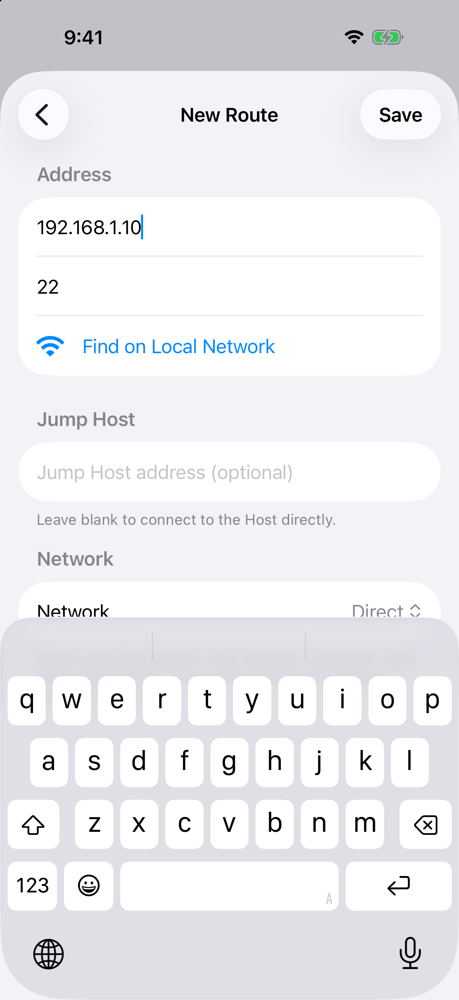
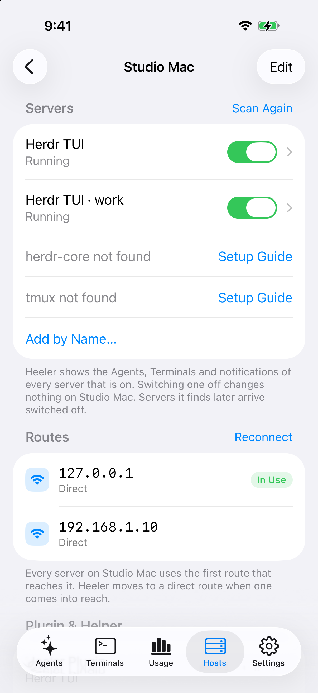

<!-- Translated from docs/guides/host-routes.md at 4732ddb2 -->
# 通过多条路由访问 Host

一台 Host 可以配置不止一条路由：在家时使用局域网地址，在外时使用 Overlay Network 或跳板机（Jump Host）。每次连接时，Heeler 都会尝试所有路由并采用最先连通 Host 的那一条，因此无需手动切换任何设置。

## 添加路由

1. 前往 **Hosts**，打开目标 Host，然后轻点 **Edit**。
2. 在 **Routes** 下方，轻点 **Add Route**。
3. 输入 **Address** 和 **Port**（除非修改过 Mac 的 SSH 端口，否则填 22），或轻点 **Find on Local Network**。
4. 如需经过跳板机，请填写 **Jump Host**；否则留空。详情参见[通过跳板机远程访问](vps-jump-host-setup.md)。
5. 在 **Network** 下选择该路由的通信方式：
   - **Direct**：当前 iPhone 或 iPad 可在自身网络上直接访问的地址，例如 Mac 的局域网地址或公网地址。
   - 来自 **Settings > Overlay Networks** 的 Overlay Network（Tailscale、ZeroTier 或 EasyTier，添加网络后会显示在顶部）。对于 Tailscale 和 EasyTier，轻点 **Choose from Tailnet…** 或 **Choose from Network…** 并选择目标 Mac 即可自动填入地址；对于 ZeroTier，请手动输入 ZeroTier Central 中显示的 Mac 地址。配置方法参见 [Overlay Network 指南](overlay-networks.md)。
6. 轻点右上角的 **Save**，然后在 Edit Host 页面再次轻点 **Save**。

添加 Host 时，第一步会要求填写它的第一个地址，端口、跳板机和网络在 **More Options** 下；之后可在这里添加更多路由。[扫描配对码（Pairing Code）](pairing.md)时，配对码提供的每个地址都会分别添加为一条独立路由。

## Heeler 如何选择路由

- 每次连接时，Heeler 会错峰启动该 Host 的路由进行竞速，并保留最先连通的一条。该 Host 上的每个 Server 都使用这一条路由。
- 不带跳板机的 **Direct** 路由会最先发起连接；Overlay Network 路由和跳板机路由会在片刻之后启动，或者在所有直连路由均告失败后立即启动。在家时，局域网地址通常会在 Overlay Network 启动前就率先连通。
- 列表顺序不会决定哪条路由胜出。排在第一位的路由仅用作 **Hosts** 列表中展示的该 Host 地址。
- Host 在保持连接期间会一直使用这条路由。如果你从 Wi-Fi 切换到蜂窝网络，它会重新连接并重新选路。
- 当 Host 经由 Overlay Network 或跳板机连接，而某条 **Direct** 路由变得可达时（例如到家后的局域网地址），Heeler 会自行切换到这条直连路由。它会在 iPhone 或 iPad 切换网络时以及你回到 Heeler 时检查。如果 Mac 是之后才唤醒或才连上 Wi-Fi，轻点 **Reconnect** 重新选路。

## 查看当前使用的路由

从 **Hosts** 打开目标 Host。**Routes** 显示 Heeler 如何连到它，对它的所有 Server 都一样：

- Host 当前连接所用的路由会标记为 **In Use**。轻点 **Routes** 旁的 **Reconnect** 可重新尝试所有路由。
- 当 Heeler 正在连接时，轻点 **Stop** 可停止尝试。该 Host 的 Server 会保持暂停状态，直到你轻点 **Reconnect**。
- 当没有任何路由能连上该 Host 时，每条路由都会标记为 **Failed** 并附上各自的原因，例如连接超时或 Overlay Network 尚未连接。

Server 自己的页面上是该 Server 的检查项、插件和 Host Helper。连接状态始终显示在这里，也就是 Host 的页面上。

图中 `127.0.0.1` **Direct** 路由标记为 **In Use**，`192.168.1.10` **Direct** 路由未被选中。轻点图片可放大查看。

## 修改、排序或删除路由

在 **Edit** 页面中，轻点某条路由即可修改，或在其详情页轻点 **Delete Route** 将其删除。当存在多条路由时，轻点 **Routes** 旁的 **Edit** 即可拖动路由调整顺序或将其删除。每台 Host 至少会保留一条路由。

## 所有路由必须指向同一台机器

Heeler 只会确认一次 Host 的主机密钥，所有路由都必须连向持有该密钥的同一台机器。如果有另一台机器响应了某个地址（例如在别人的 Wi-Fi 下遇到了相同的局域网 IP），该路由会报错失败而不会建立连接。为同一台 Mac 添加新路由时，无需再次确认主机密钥。

## 当某条路由总是失败时

- 在该 Host 的页面上的 **Routes** 下查看具体失败原因。
- **The Jump Host's key is not trusted** 或 **The host key is not trusted** 表示这台 iPhone 或 iPad 上还没有人确认过该密钥。Host 的页面会请你确认它的指纹，信任之后会重新连接。如果你关掉了这个提示，轻点 **Scan Again** 可以再次看到它。
- 对于 Overlay Network 路由，检查该网络在 **Settings > Overlay Networks** 中是否显示为已连接，并确认 Mac 在该 Overlay Network 中处于在线状态。
- 对于跳板机路由，检查跳板机本身是否可达，以及它是否接受与目标 Host 相同的设备密钥（Device Key）、RSA 密钥（RSA Key）或密码。参见[跳板机配置指南](vps-jump-host-setup.md)。
- 对于局域网地址，它仅在对应局域网内有效。离开家后该路由会自然失败，并由其他路由接管连接。
