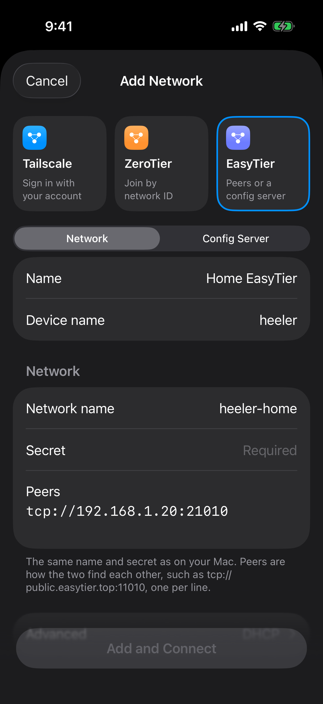
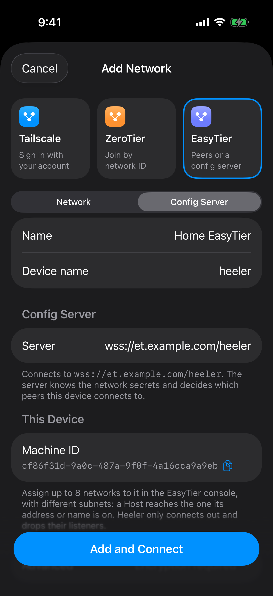

<!-- Translated from docs/guides/overlay-networks.md at ed1e9e66 -->

# 通过 Overlay Network 连接 Heeler

当无法直接连接到运行 herdr 的 Mac 时（例如在蜂窝网络下），可以使用 Tailscale、ZeroTier 或 EasyTier 建立连接。本系列指南适用于运行 herdr 的 Mac 以及运行在 iPhone 或 iPad 上的 Heeler。

你需要使用包含 **Settings > Overlay Networks** 的 Heeler 版本。

Heeler 会直接加入 Overlay Network，因此手机上无需安装 Tailscale、ZeroTier 或 EasyTier 应用，也无需配置系统 VPN。Mac 上需要安装对应服务商的客户端、开启“远程登录”（SSH）并运行 herdr。连接后仍按常规方式通过 SSH 登录 Mac。

## 选择方案

先完成下方的“准备 Host”，然后按所选服务商的指南操作。到了添加 Host 的步骤时，指南会引导你回到本页的[从 Heeler 连接](#从-heeler-连接)。

| 指南 | 前置条件 | 局域网外连接 |
| --- | --- | --- |
| [Tailscale](tailscale.md) | Tailscale 账号，以及 Mac 上的 Tailscale 应用 | 支持 |
| [不在 Mac 上配置 VPN 运行 Tailscale（进阶）](tailscale.md#不在-mac-上配置-vpn-运行-tailscale进阶) | Tailscale 账号与 Homebrew | 支持 |
| [ZeroTier](zerotier.md) | ZeroTier Central 账号，以及 Mac 上的 ZeroTier One | 支持 |
| [EasyTier](easytier.md) | 无需账号；在 Mac 终端中运行 EasyTier | 需要自建中继（如小型 VPS）或具备公网入口的 Mac（[配置方法](easytier.md#在局域网外连接-mac)） |

如果你是初次配置，建议从 Tailscale 开始。对于 Linux 或 Windows 主机，请先参考对应服务商的官方文档安装客户端，再按相同的 Heeler 步骤操作。Windows 主机还需完成 [Windows SSH 与 herdr 配置](windows-setup.md)。

以上方式都是让 Heeler 自己加入网络。如果你更愿意在手机上运行一个 VPN 应用、并且不在任何地方开放端口，可以改用 [Cloudflare Tunnel](cloudflare-tunnel.md)：连接由 Cloudflare 的官方客户端 App 承载。它需要一个 Cloudflare 账号，也不是 **Settings** 里的 Overlay Network。

## Heeler 配置界面截图

前往 **Settings > Overlay Networks > Add Network**。不同服务商对应不同的配置表单（EasyTier 提供两种模式）。轻点图片可查看大图。

| Tailscale | ZeroTier |
| --- | --- |
| <a href="../images/overlay-networks/tailscale-form.png"></a> | <a href="../images/overlay-networks/zerotier-form.png"></a> |
| **Advanced** 留空，轻点 **Continue to Sign In**。[Tailscale 配置步骤](tailscale.md#3-从-heeler-加入同一个-tailnet) | 输入 Network ID，轻点 **Add and Connect**。[ZeroTier 配置步骤](zerotier.md#3-heeler-与-central加入网络并授权应用) |

| EasyTier Network | EasyTier Config Server |
| --- | --- |
| <a href="../images/overlay-networks/easytier-manual-form.png"></a> | <a href="../images/overlay-networks/easytier-config-server-form.png"></a> |
| 输入 Mac 的网络名称和密钥，并添加对端地址。[Network 模式配置](easytier.md#3-在-heeler-中添加网络) | 输入服务器地址，然后为该 Machine ID 分配网络。[Config Server 模式配置](easytier.md#2-注册-heeler-设备) |

图中所示数值仅为示例。

## 准备 Host

请在运行 herdr 的 Mac 上，使用 Heeler 将要登录的 macOS 账户执行以下步骤。

1. 安装并启动 [herdr](https://herdr.dev/docs/install/)，打开你要使用的会话。
2. 开启 **System Settings > General > Sharing > Remote Login**（系统设置 > 通用 > 共享 > 远程登录），并允许你的账户访问（参见 [Apple 官方指南](https://support.apple.com/guide/mac-help/allow-a-remote-computer-to-access-your-mac-mchlp1066/mac)）。请保持 Mac 处于唤醒状态。
3. 在终端中查看你的用户名、确认 herdr 版本，并读取 Mac 的 SSH 指纹，以便稍后在 Heeler 中核对：

   ```sh
   id -un
   herdr --version
   ssh-keygen -lf /etc/ssh/ssh_host_ed25519_key.pub
   ```

   如果 Heeler 显示的是其他密钥类型，请改为查看 `/etc/ssh/` 下对应类型的 `.pub` 文件。
4. 选择 Heeler 的登录方式。推荐使用 **Device Key**（设备密钥）：前往 Heeler > **Hosts** > **Add Host**，选择 **Device Key**，轻点 **Copy authorized_keys Line**，然后取消表单。将该行内容传到 Mac 上（例如通过通用剪贴板），并运行：

   ```sh
   mkdir -p ~/.ssh
   echo 'PASTE_THE_LINE_HERE' >> ~/.ssh/authorized_keys
   ```

   如果使用 **RSA Key**，请用 **Copy RSA Public Key** 执行相同操作。如果使用 **Password**，则使用你的 Mac 登录密码。通过[扫码配对](pairing.md)添加的密钥同样可用。

## 从 Heeler 连接

当 Mac 与 Heeler 已加入同一个 Overlay Network 后，从服务商指南回到这里继续操作。

1. 打开 **Hosts** 并轻点 **Add Host**。在 **Routes** 下轻点 **Add Route**，将 **Network** 设为你保存的 Overlay Network，填写 **Address** 和 **Port** 后轻点 **Save**。对于 Tailscale 和 EasyTier，也可以直接在 Settings 中打开对应网络，轻点 Mac 旁的 **Add**，系统会自动填入该路由。（**Direct** 表示不使用 Overlay Network 直连。）
2. 返回 **Add Host** 页面，按下表填写其余字段并轻点 **Save**。
3. 仅在显示的指纹与 Mac 上的指纹一致时轻点 **Trust**。如果某项检查未通过，请排查后轻点 **Run Checks Again**。

| 字段 | 值 |
| --- | --- |
| Name | 标识这台 Mac 的任意名称 |
| User | 你的 Mac 用户名（来自 `id -un`） |
| Network（在 Route 中） | 你保存的 Overlay Network |
| Address（在 Route 中） | Mac 在该 Overlay Network 中的 IP 地址（不带端口号或 `/24` 等后缀） |
| Port（在 Route 中） | `22`（除非具体指南另有说明） |
| Jump Host（在 Route 中） | 留空 |
| Authentication | 你在上面选择的登录方式 |
| herdr Session | 会话名称，留空则使用默认会话 |

在路由页面填写地址时，Tailscale 支持 **Choose from Tailnet…**（保持选中 **IP Address**），EasyTier 支持 **Choose from Network…**。对于 ZeroTier，请从 ZeroTier Central 复制 Mac 的 IP 地址。

## 验证连接

<a href="../images/overlay-networks/networks-connected.png"></a>

这里的 **Connected** 表示 Heeler 已加入网络，不代表 Host 正在使用它。请继续按下方步骤验证 Host 路由。网络名称已匿名化；你只需配置所选网络，不必同时添加三个。轻点图片可放大查看。

1. 在 **Settings > Overlay Networks** 中，该网络显示为 **Connected**。
2. 从 **Hosts** 打开目标 Host，查看 **Routes** 下标记为 **In Use** 的路由，确认它使用的是本次要测试的 Overlay Network。如果其他路由胜出，这次连接不能证明目标 Overlay 路由可用。参见[查看当前使用的路由](host-routes.md#查看当前使用的路由)。
3. Host 各项检查全部通过，会话中的 Agent 或终端正常加载。
4. 打开一个 **New Terminal**，运行 `pwd` 能输出 Mac 上的目录。测试时请新建终端，不要在正在运行的 Agent 终端里测试。
5. 关闭手机 Wi-Fi，在蜂窝网络下重复上述测试，并再次检查 **In Use**。其他可用路由（例如跳板机或另一个 Overlay Network）仍可能胜出。
6. 切出 Heeler 超过 20 秒后再返回，确认 Host 和终端能够自动重连，并再次检查 **In Use**，确认重连使用的路由。（切到后台期间 Heeler 会断开 Overlay Network 连接，它不是常驻后台的系统 VPN。）

## 故障排查

| 现象 | 处理方法 |
| --- | --- |
| Settings 中没有 **Overlay Networks** | 更新 Heeler；当前版本尚未包含此功能。 |
| **Not signed in**、**Needs sign-in** 或 **Signed out**（Tailscale） | 轻点 **Sign In** 并在浏览器中完成登录。 |
| **Waiting for approval**（Tailscale） | 在 Tailscale 管理控制台中批准该设备。 |
| **Waiting for authorization**（ZeroTier） | 在 ZeroTier Central 中授权 Heeler 设备。 |
| **Waiting for a network**（EasyTier Config Server） | 在 EasyTier 控制台中为 Heeler 的 Machine ID 分配网络。 |
| 网络已连接，但 SSH 超时 | 检查路由的 Network、地址和端口；确认 Mac 未休眠且已开启“远程登录”。 |
| SSH 登录失败 | 检查用户名、“远程登录”访问权限，以及所用的密钥或密码。 |
| SSH 正常，但 herdr 检查失败 | 查看未通过的具体检查项；通常是该账户下未安装 herdr，或会话名称有误。 |
| 手动关闭网络开关后又自动开启 | 有 Host 路由正在使用该网络。如需保持关闭，请修改对应路由的 **Network** 或移除该 Host。 |

最后核对于 2026-10-09（macOS）。

维护者：参见[指南维护记录](../../agents/overlay-network-guides.md)。
