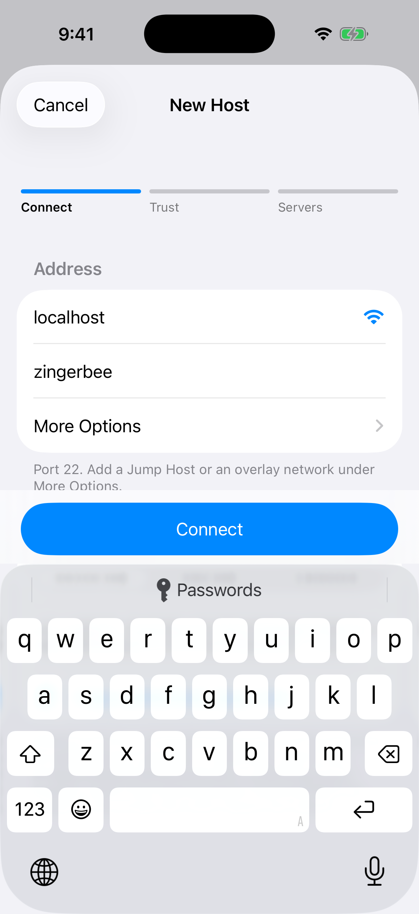
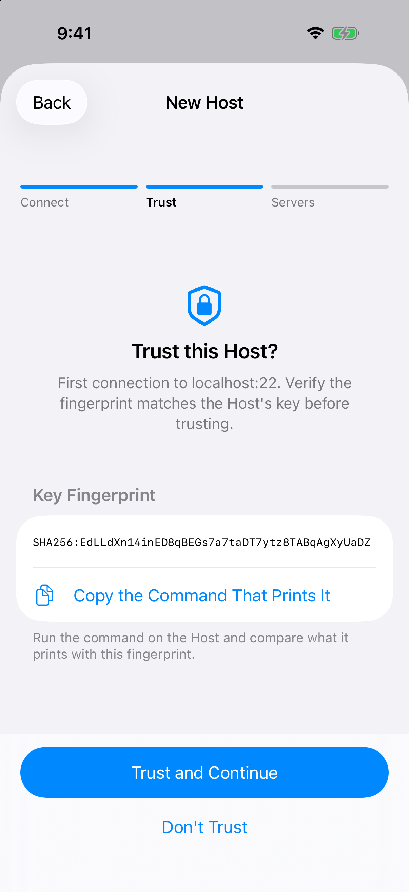

<!-- Translated from docs/guides/rex.md at f5f0d02f -->
# 连接 Rex

通过 SSH 将 Heeler 连接到 Mac 或 Linux Host 上已在运行的 Rex 服务端，在 Rex 继续运行这些终端的同时，在 iPhone 或 iPad 上打开它们。Host 上的 Rex 服务端在 Heeler 中是该 Host 的一个 Server，与 Herdr TUI、[herdr-core](herdr-core.md) 和 [tmux](tmux.md) 并列。

> [!IMPORTANT]
> Rex 支持仍处于实验阶段。它基于 macOS 上的 Rex 0.1.0-preview.14（Rex API revision 12）开发和测试，只能打开 Rex 中已有的终端：请参阅[尚未支持的功能](#尚未支持的功能)与[已知限制](#已知限制)。

## 开始之前

- Host 上的 Rex 以你通过 SSH 登录的账户运行。Heeler 只连接已在运行的 Rex 服务端，绝不会自行启动。
- 在 Mac 上开启“远程登录”并记录其 SSH 指纹：[准备 Host](overlay-networks.md#准备-host)。在 Linux 上运行 OpenSSH。Rex 不支持原生 Windows。
- SSH 服务端允许转发到 Unix socket，OpenSSH 默认即允许。如果它的 `sshd_config` 设置了 `AllowStreamLocalForwarding no` 或 `AllowTcpForwarding no`，Heeler 将无法连接 Rex。
- 让 iPhone 或 iPad 能够连通 Host：处于同一局域网下直连、通过 [Overlay Network](overlay-networks.md) 连接，或经由 [Jump Host](vps-jump-host-setup.md) 中转。一个 Host 可以配置[多条路由](host-routes.md)。

## 添加 Host

Heeler 在连接或检查时绝不会启动 Rex，也从不运行 `rex` 命令。

### 1. 连接

1. 在 **Hosts** 中轻点 **+**，列表为空时轻点 **Add Manually**。[扫码配对](pairing.md)始终添加 Herdr TUI Server。
2. 输入 **Address**，并以运行 Rex 的账户作为 SSH **User**。端口、Jump Host 和 Overlay Network 在 **More Options** 中。
3. 选择 **Device Key**、**RSA Key** 或 **Password**。若选择 **Device Key**，请将公钥行复制到 Host 的 `~/.ssh/authorized_keys` 中。
4. 轻点 **Connect**，核对 Host 的密钥指纹，然后轻点 **Trust and Continue**。

| Connect | Trust |
| --- | --- |
|  |  |

### 2. 选择 Server

Heeler 会通过你的登录 shell 在不启动任何服务的情况下查看一次，并列出这台机器上运行的内容。一个 Host 只有一个 Rex Server，显示为 **Rex**：

| Heeler 检测到 | 操作方法 |
| --- | --- |
| **Rex** 显示 **Running** | 保持勾选 **Rex**，然后轻点 **Add Host with 1 Server**。 |
| **Rex** 显示 **Not running** | Rex 已安装但没有运行，因此 **Rex** 默认不勾选。勾选 **Rex**，等你启动 Rex 后它就会连接。也可以先不勾选它添加 Host，然后启动 Rex，打开该 Host，轻点 **Scan Again**，再开启 **Rex**。 |
| 同时检测到 Rex 与 Herdr TUI、herdr-core 或 tmux | 勾选你想在 Heeler 中使用的每一个。它们都是这同一个 Host 的 Server。 |
| 没有 **Rex** | Rex 没有安装。仍然添加该 Host，安装并启动 Rex，打开该 Host，轻点 **Scan Again**，然后开启 **Rex**。 |

每个 Server 在 Host 页面上都有一个开关。**Rex** 开启后，轻点它可打开它自己的页面，其中有它的连接和检查项。**Add by Name…** 不提供 Rex：一个 Host 唯一的 Rex Server 没有需要输入的名称，而且只要装了 Rex，Heeler 就会列出它。

如果 Host 页面上的 **Rex** 显示 **Socket found, but this account cannot use it**，说明 Rex 以另一个账户运行。请以该账户作为 **User**，把这台机器另外添加为一个 Host。

**成功的标志是**该 Host 所在的行显示绿色的 **Rex** 标签，且该 Server 的页面将 **Server Kind** 显示为 `Rex`，**Socket** 显示 Rex 监听的路径，**SSH connection**、**Rex installed**、**Rex server running** 与 **protocol compatible** 均通过。

## 无法连接时

| Host 显示 | 操作方法 |
| --- | --- |
| **Rex is not running** | 在 Host 上启动 Rex，然后轻点 **Run Checks Again**。 |
| **The SSH server refuses socket forwarding** | 在 Host 的 SSH 服务端中允许转发到 Unix socket（参见[开始之前](#开始之前)），然后轻点 **Run Checks Again**。 |
| **Rex is not answering** | Heeler 无法判断是以上哪一种情况。请两项都检查，然后轻点 **Run Checks Again**。 |
| **Rex did not let this account in** | Rex 以另一个账户运行。请以该账户作为 **User**，把这台机器另外添加为一个 Host。 |
| **This version of Rex is not supported** | Heeler 只支持 Rex API revision 12。如果提示中 Rex 提供的 revision 更旧，请升级 Rex；如果更新，请等待 Heeler 更新。 |
| **Rex was not found on this Host** | 安装并启动 Rex，然后轻点 **Run Checks Again**。 |

## 控制台

Heeler 按原样显示你的 Rex 结构，不做任何改动：

- **Workspaces、Tabs 与 Panes：** 按 Rex 自身的顺序，每个 Rex 会话（session）是一个 Workspace，每个窗口（window）是一个 Tab，每个终端是一个 Pane。会话中不属于任何窗口的终端共用一个名为 **Detached** 的 Tab。没有终端的会话不会列出。
- **Agents 与 Terminals：** 程序为 Claude Code、Codex 或 Heeler 认识的其他编程 Agent 的终端显示在 **Agents** 中，并带有该 Agent 向 Rex 上报的状态。Shell 和其他程序显示在 **Terminals** 中；Agent 退出后，终端会回到 **Terminals**。标题、程序与目录会随 Rex 中的变化同步更新。

| 状态 | 含义 |
| --- | --- |
| **Working** | 正在运行一轮对话。 |
| **Idle** | 在提示符处等待，或已完成一轮对话。Rex 的 Agent 不会显示 **Done**。 |
| **Blocked** | 等待你的回答。 |
| **Error** | 上报了错误，并与 **Blocked** 一起排序。 |
| **Unknown** | 该 Agent 尚未向 Rex 上报状态，或最近一次上报来自另一个程序，例如一个已经退出的程序。 |

作为 Rex 终端自身命令（而不是从其 Shell）启动的 Agent，以及用 `exec` 启动的 Agent，会留在 **Terminals** 中。Heeler 要等终端下一次输出时才能看到其程序的变化，因此 Agent 出现在 **Agents** 中或从中离开可能会稍有延迟。

## 使用终端

在 **Terminals** 中轻点一个终端，或在 **Agents** 中轻点一个 Agent，即可打开。Agent 会以其终端打开，没有 Chat 和 Composer；如果打开期间 Agent 退出，会显示 **Agent Gone**，终端回到 **Terminals**。你操作期间，其他 Rex 客户端会继续显示它：

- **打开：** 终端会在 Rex 重绘完屏幕和历史记录后显示，因此在较慢的连接上，较长的历史记录可能需要几秒钟。持续输出的程序（例如 spinner）在暂停之前，可能有几行重复或错位；暂停后 Heeler 会重新绘制。
- **输入与粘贴：** 在 Text 或 Keys 模式下输入、轻点 **Paste**，或发送 Snippet。无论终端尺寸由哪台设备设定，你都可以输入。你输入的内容按顺序到达终端，Heeler 绝不会重复发送：如果连接在 Rex 回复前断开，终端会显示 **Connection dropped** 和 **Reattach**，此后输入的内容都没有发送。Heeler 重新连接期间输入的按键同样不会发送；终端会重新连接并重新绘制。过大、无法一次发送的粘贴会被阻止而不会拆分；请分几次粘贴。
- **结束：** 当终端在 Rex 中关闭或其中的程序退出时，它的视图随之结束。

终端停止时会说明原因：

| 终端显示 | 操作方法 |
| --- | --- |
| **Connection dropped** | 你输入的内容可能没有送达。轻点 **Reattach**，确认屏幕内容后再继续输入。 |
| **This terminal's history is too long to show** | 在 Rex 中清除该终端的回滚记录，然后轻点 **Reattach**。 |
| **Rex stopped sending this terminal's output** | Host 保持连接期间，Rex 停止了该终端的输出。轻点 **Reattach**。如果是与 Host 的连接断开，终端会自行重新连接并重新绘制，不会显示这条消息。 |
| **This Terminal belongs to a Rex server that is gone** | Rex 已重启。请从 **Terminals** 重新打开该终端。 |

### Sized for another device

Rex 终端只有一个尺寸，同一时间由一台设备设定。没有设备设定时，终端会适配你的屏幕。如果已有其他设备设定（例如 Mac 上的 Rex 应用），Heeler 会按该尺寸显示终端，不会缩放：比屏幕宽的行会折到下一行，因此占满整行宽度的程序（例如表格或编辑器）可能显示错乱。约一秒后终端上会出现 **Sized for another device**：输出只占上半部分时它在底部，否则在顶部，以免挡住提示符：

- **Fit to Screen** 会把尺寸改为适配你的屏幕。Rex 调整的是终端本身而不只是你看到的视图，因此在你在这里打开它期间，所有显示它的设备（包括 Rex 应用）都会变成你屏幕的尺寸。
- 当你离开该终端、Heeler 进入后台或终端结束时，Heeler 会交还尺寸，原先设定尺寸的设备会重新拿回。再次回来时不会自动再取尺寸；请重新轻点 **Fit to Screen**。
- 轻点 **×** 按钮关闭提示，保留其他设备设定的尺寸。当又有另一台设备设定尺寸时，提示会再次出现。
- 如果适配没有成功，提示会说明原因，轻点 **Try Again** 可再试一次。

## 尚未支持的功能

- **Agent 只显示状态：** Rex 没有 Chat、Composer、Stop、Changes、Agent Notifications、Live Activities、Usage 或小组件。同一 Host 的其他 Server 不受影响。
- **不能新建、重命名或关闭：** 不提供 New Agent、New Terminal、New Workspace、Rename 与 Close。请在 Rex 中完成这些操作，Heeler 会显示结果。
- **Rex 不支持上传、Worktrees、Host Helper、扫码配对与 Add by Name。**

## 已知限制

- **只支持 Rex API revision 12：** 不提供 revision 12 的 Rex 会被拒绝。Heeler 基于 Rex 0.1.0-preview.14 开发和测试。
- **尚未在 Linux 上试用：** Heeler 会在 Linux 上 Rex 存放 socket 的位置查找，但还没有用 Linux 上的 Rex 服务端实际试过。
- **首次绘制不包含的内容：** Rex 的重绘不包含光标形状和终端自身的默认颜色，因此在程序重新设置之前光标保持 Heeler 的形状，终端使用你的 Heeler 主题配色。全屏程序打开期间，其后方的历史记录要等程序关闭后才会显示。
- **其他设备设定的尺寸不会适配屏幕：** 在你轻点 **Fit to Screen** 之前，如果其他设备设定的尺寸比你的屏幕宽，终端的行会按你的屏幕宽度折行，占满整行宽度的程序可能显示错乱。只要终端屏幕上有比你的屏幕更宽的行，新的输出和你输入的内容也可能落在错误的行上，覆盖之前的文字，直到 **Fit to Screen** 重新绘制。Heeler 不会将其缩小显示，也不会截掉超出的部分。
- **目前的测试范围：** Rex 只在 iOS 模拟器中、针对 macOS 上的 Rex 0.1.0-preview.14 试用过，并由测试客户端代替其他设备。尚未在实体 iPhone 或 iPad 上试用，也未在 Rex 应用显示同一终端时试用。

最后核对于 2026-11-16，基于 macOS 上的 Rex 0.1.0-preview.14（API revision 12），在 iOS 模拟器中进行。
