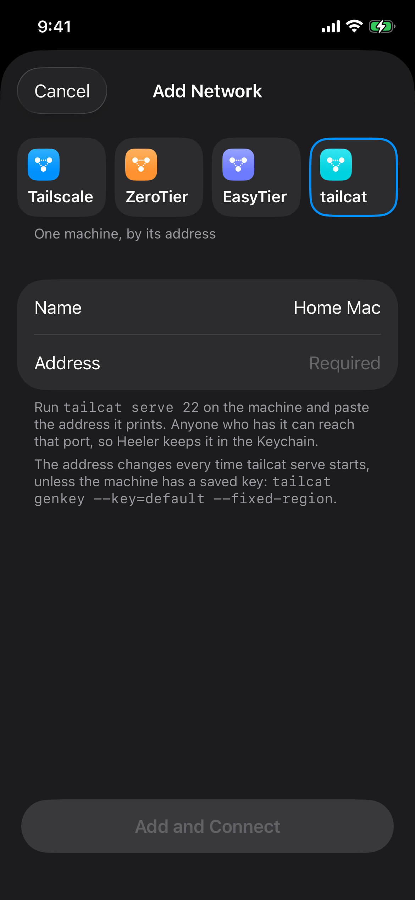

<!-- Translated from docs/guides/tailcat.md at 5001a3ec -->

# 通过 tailcat 连接 Heeler

本指南介绍如何通过 [tailcat](https://github.com/tailscale/tailcat) 连接运行 herdr 的 Mac：它是一条只通向一台机器的隧道，不需要账号，也没有网络要管理。Mac 上运行 `tailcat serve` 并打印一个地址；Heeler 用这个地址连接，因此手机上无需安装其他应用或配置系统 VPN。

你需要使用在 **Settings > Overlay Networks > Add Network** 中提供 **tailcat** 的 Heeler 版本。

## 开始之前

- 在 Mac 上完成[准备 Host](overlay-networks.md#准备-host)：开启“远程登录”、启动 herdr、配置登录方式，并记下 Mac 的 SSH 指纹。
- Mac 上需要有 [Homebrew](https://brew.sh/)，或者用其他方式[安装 tailcat](https://github.com/tailscale/tailcat/blob/main/INSTALL.md)。
- 配置期间请保持 Mac 处于唤醒状态。

请把 tailcat 地址当作密码对待。拿到它的人都能连到你开放的端口，不过 SSH 仍会要求密钥或密码。请用私密的方式把它传到手机上，例如通用剪贴板或隔空投送，不要公开张贴。

## 1. Mac：安装 tailcat 并保存密钥

```sh
brew install tailcat
tailcat genkey --key=default --fixed-region
```

`genkey` 会在 Mac 上保存一把密钥并打印它的地址，是以 `tc` 开头的一长行。保存密钥之后，每次启动 `tailcat serve` 地址都不变。没有保存密钥时，每次启动都会打印一个新地址，你就得重新粘贴到 Heeler 里。

## 2. Mac：开放 SSH 端口

```sh
tailcat serve 22
```

如果 Mac 的 SSH 端口不是 `22`，请改成实际端口。这条命令会再次打印地址并保持运行：

```text
# 🐈 Server listening with saved key "default": tc…
```

隧道只在这条命令运行期间存在，所以请让它留在一个不会关闭的终端里，例如一个 herdr pane。复制完整的地址。

**成功的标志是** 这一行写着 `saved key "default"`。如果写的是 `new address`，说明第 1 步没有保存密钥。

## 3. Heeler：添加隧道

1. 在 Heeler 中打开 **Settings > Overlay Networks > Add Network**，选择 **tailcat**。
2. 输入 **Name**（例如这台 Mac 的名字），把地址粘贴到 **Address**。Heeler 会像密码一样隐藏它，并在输入框下方说明它是不是 tailcat 地址。

   <a href="../images/overlay-networks/tailcat-form.png"></a>

3. 轻点 **Add and Connect**。

**成功的标志是** 隧道显示 **Connected**，后面带有 **Direct** 或 **Relayed** 以及以毫秒计的延迟。**Relayed** 表示流量经过 tailcat 的中继，速度较慢，但仍是端到端加密的。

## 4. Heeler：将 Mac 添加为 Host

在 **Settings > Overlay Networks** 中打开这条隧道，轻点服务器旁边的 **Add**；或者在 **Hosts** 中轻点 **+**，打开 **More Options**，把 **Network** 设为这条隧道。然后按[从 Heeler 连接](overlay-networks.md#从-heeler-连接)的步骤填写以下字段：

| 字段 | 值 |
| --- | --- |
| Address | 由 Heeler 自动填入：一个以 `.tailcat` 结尾的名字，保持不变 |
| User | 你的 Mac 用户名 |
| Network（在 More Options 中） | 刚才添加的隧道 |
| Port（在 More Options 中） | 你开放的端口，通常为 `22` |
| Jump Host（在 More Options 中） | 留空 |
| Authentication | 你所选的登录方式 |

tailcat 隧道只能到达运行 `tailcat serve` 的那台机器，所以这里的地址不是 IP 地址，也不能填写别的机器。然后轻点 **Connect**。

确认 SSH 指纹一致后轻点 **Trust and Continue**，保持勾选需要的 Server 并添加 Host，然后完成[验证连接](overlay-networks.md#验证连接)。

## 故障排查

| 问题 | 处理方法 |
| --- | --- |
| **Add Network** 中没有 **tailcat** | 更新 Heeler；当前版本还不支持。 |
| **Add and Connect** 按钮一直置灰，或提示“This is not a tailcat address” | 复制完整的地址，从 `tc` 一直到行尾。 |
| 提示“The tailcat server did not answer”或 **The server is not answering** | 确认 Mac 上的 `tailcat serve` 仍在运行，并且 Mac 处于唤醒状态。如果它打印了新地址，请打开这条隧道，选择 **…** > **Edit** 并粘贴新地址。 |
| 提示“The tailcat server answered, but not on port …” | Host 的 **Port** 必须是启动 `tailcat serve` 时开放的端口之一。 |
| 提示“This address has no pre-shared key” | 这把密钥是用 `--psk=false` 生成的。请删除它，然后不带该参数重新执行第 1 步。 |
| 提示“A tailcat tunnel only reaches the machine running tailcat serve” | 打开 Host 的路由，轻点 **Use the Tunnel's Address**。要连接另一台机器，请在那台机器上运行 `tailcat serve`，并为它添加一条隧道。 |
| 隧道已连接，但 SSH 登录失败 | 检查用户名、“远程登录”的访问权限以及密钥或密码。 |
| 切出 Heeler 后隧道断开 | 预期行为，切出约 20 秒后会自动断开；返回应用时 Host 会自动重连。 |

## 停用或移除隧道

关闭隧道的开关即可断开连接并保留配置。如需删除隧道，请先迁移或移除正在使用它的 Host，再打开隧道并选择 **…** > **Delete Network**。

在 Mac 上，在运行 `tailcat serve` 的终端里按 **Control-C**。在 Heeler 中删除隧道不会让地址失效。要让它失效，请删除保存的密钥并生成一把新的：

```sh
tailcat genkey --delete --key=default
tailcat genkey --key=default --fixed-region
```

命令已对照 tailcat v0.7.0 核对（2026-11-15）。

维护者：参见[指南维护记录](../../agents/overlay-network-guides.md)。
