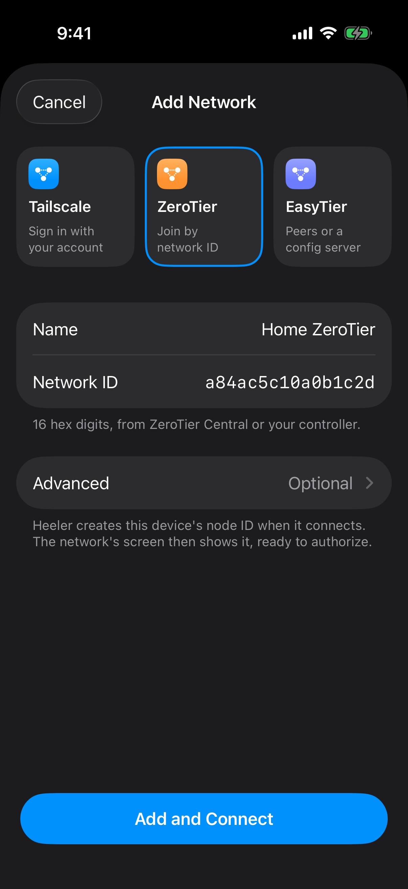

<!-- Translated from docs/guides/zerotier.md at ed1e9e66 -->

# 通过 ZeroTier 连接 Heeler

本指南介绍如何通过私有 ZeroTier 网络连接运行 herdr 的 Mac。Mac 上运行 ZeroTier One 应用；Heeler 会直接加入该网络，因此手机上无需安装 ZeroTier 应用或配置系统 VPN。

你需要使用包含 **Settings > Overlay Networks** 的 Heeler 版本。

## 开始之前

- 在 Mac 上完成[准备 Host](overlay-networks.md#准备-host)：开启“远程登录”、启动 herdr、配置登录方式，并记下 Mac 的 SSH 指纹。
- 你需要拥有 Mac 的管理员权限，以及一个 ZeroTier Central 账号。
- 配置期间请保持 Mac 处于唤醒状态。

ZeroTier 会显示多种 ID，你只需要用到其中两个：填入 Heeler 网络表单的 16 位 **Network ID**（网络 ID），以及填入 Host 表单的 Mac **Managed IP**（受管 IP，形如 `10.147.17.2`）。

## 1. Central：创建私有网络

ZeroTier 有新旧两个控制台。2025 年 11 月 5 日之后注册的账号使用 [New Central](https://central.zerotier.com/)；更早的账号使用 [Legacy Central](https://my.zerotier.com/)。可通过浏览器地址栏区分当前所在的控制台。

| 控制台 | 创建网络 | 授权设备 |
| --- | --- | --- |
| New Central | 使用默认网络，或前往 **Networks > New Network** | 在 **Member Devices** 中找到对应 Node ID，选择 **Actions > Authorize** |
| Legacy Central | 前往 **Networks > Create A Network** 并点进该网络 | 在 **Members** 的 **Address** 列找到对应 Node ID，勾选 **Auth?** |

请将网络保持为私有（Private），并开启 IPv4 自动分配。如果默认网段与你家里或公司的局域网网段冲突，请换一个网段。复制该网络的 Network ID。

## 2. Mac：安装 ZeroTier One 并加入网络

1. 从 [ZeroTier 下载页](https://www.zerotier.com/download/)安装 ZeroTier One，并按提示允许 macOS 系统权限。
2. 点击菜单栏中的 ZeroTier 图标，选择 **Join New Network…**，粘贴 Network ID。或者在终端中将 `YOUR_NETWORK_ID` 替换为你的 Network ID 并运行：

   ```sh
   sudo zerotier-cli join YOUR_NETWORK_ID
   sudo zerotier-cli info
   ```

   `info` 命令会输出 Mac 的 Node ID。
3. 在 Central 控制台中，授权该 Mac 的 Node ID 并为其命名。
4. 检查连接结果：

   ```sh
   sudo zerotier-cli listnetworks
   ```

**成功的标志是** 网络状态显示为 `OK PRIVATE`，并分配了形如 `10.147.17.2/24` 的地址。斜杠 `/` 前面的部分（此处为 `10.147.17.2`）就是 Mac 的 IP 地址。如果显示 `ACCESS_DENIED`，说明还未在控制台中授权这台 Mac。

## 3. Heeler 与 Central：加入网络并授权应用

<a href="../images/overlay-networks/zerotier-form.png"></a>

1. 在 Heeler 中打开 **Settings > Overlay Networks > Add Network**，选择 **ZeroTier**。
2. 输入 **Name**，在 **Network ID** 中粘贴 16 位网络 ID，**Advanced** 保持默认。
3. 轻点 **Add and Connect**。网络详情页会显示 **Waiting for authorization**，并在 **This device** 下显示 Heeler 的 Node ID。
4. 在 Central 控制台中授权 Heeler 的 Node ID（授权 Mac 不会自动授权 Heeler）。获批后 Heeler 会自动完成连接。

**Open ZeroTier Central** 按钮默认打开 Legacy Central；如果使用 New Central，请自行访问 central.zerotier.com。如果你是在手机浏览器里完成的授权，返回 Heeler 后请重新打开该网络的开关。

**成功的标志是** Heeler 显示 **Connected** 并获得自己的 IP 地址，且 Central 控制台中两台设备均显示为已授权。

## 4. Heeler：将 Mac 添加为 Host

前往 **Hosts > Add Host**，在 **Routes** 下轻点 **Add Route**，按[从 Heeler 连接](overlay-networks.md#从-heeler-连接)的步骤填写以下字段：

| 字段 | 值 |
| --- | --- |
| User | 你的 Mac 用户名 |
| Network（在 Route 中） | 刚才连接的 ZeroTier 网络 |
| Address（在 Route 中） | Mac 的受管 IP（不带 `/24` 后缀） |
| Port（在 Route 中） | Mac 的 SSH 端口，通常为 `22` |
| Jump Host（在 Route 中） | 留空 |
| Authentication | 你所选的登录方式 |

请在 Address 中填写 IP 地址，不要填写设备名称或 Node ID。先保存路由，再保存 Host。

核对 SSH 指纹，等待 Host 检查通过，然后完成[验证连接](overlay-networks.md#验证连接)。

## 故障排查

| 问题 | 处理方法 |
| --- | --- |
| **Add and Connect** 按钮一直置灰 | **Network ID** 必须填写 16 位网络 ID，而不是 10 位 Node ID。如果 **Advanced** 下有红色提示，说明 Moon 条目未填写完整。 |
| Heeler 提示网络不存在，或 Mac 显示 `NOT_FOUND` | 从 Central 重新复制 Network ID，然后在 Heeler 中编辑网络或在 Mac 上重新加入。 |
| 显示 **Waiting for authorization**，或 Mac 显示 `ACCESS_DENIED` | 在该网络下授权对应设备的 Node ID；每台设备都需要单独授权。 |
| Mac 显示 `REQUESTING_CONFIGURATION`，或 Heeler 一直未分配到地址 | 检查 Network ID 是否正确以及互联网连接是否正常。 |
| 已授权但没有分配到 IP 地址 | 在 Central 中为该网络开启自动分配 IPv4 地址。 |
| Mac 显示 `PORT_ERROR` | 在 **System Settings > Privacy & Security**（或 **Login Items & Extensions**）中允许 ZeroTier，然后重启 Mac。详见 ZeroTier 的 [macOS 排查说明](https://docs.zerotier.com/faq/macos-porterror/)。 |
| 网络已连接，但 SSH 失败 | 确认 Host 选用了该 ZeroTier 网络且填写了 Mac 的受管 IP，再检查“远程登录”、用户名、端口、防火墙以及密钥或密码。 |
| 显示 **No Members Yet** | 在 Heeler 与其他节点产生通信前属正常现象，直接连接 Host 即可。 |
| 切出 Heeler 后网络断开 | 预期行为，切出约 20 秒后会自动断开；返回应用时 Host 会自动重连。 |

## 进阶：Planet 与 Moon 设置

使用官方 ZeroTier Central 时请保持留空。如果你自建了 ZeroTier 控制器，请使用管理员提供的文件和 ID 配置 **Import Planet File…** 与 **Add Moon**，并在自建控制器中授权 Heeler。

**隐私提示：** Heeler 加入的所有 ZeroTier 网络共享一组根服务器，包括各网络配置的根与 ZeroTier 官方根。地址查询和中继流量可能经过其中任意根服务器。自建根的运营者可能获知你的设备为其他网络查询的 ZeroTier 地址，官方根也可能获知自建网络中的地址查询。请只添加你信任其运营者的根；分别创建网络条目并不能隔离这些查询。

## 停用或移除网络

关闭网络开关即可断开连接并保留配置。如需删除网络，请先迁移或移除正在使用该网络的 Host，再删除网络本身。如果删除了最后一个 ZeroTier 网络，下次重新添加时需要在控制台中再次授权 Heeler。

如需在 Mac 上退出该网络，请运行：

```sh
sudo zerotier-cli leave YOUR_NETWORK_ID
```

断开或删除网络不会撤销设备授权；如需撤销访问权限，请在 Central 控制台中取消对应设备的授权。

命令与控制台标签已对照 ZeroTier [官方文档](https://docs.zerotier.com/quickstart/)核对（2026-10-09）。

维护者：参见[指南维护记录](../../agents/overlay-network-guides.md)。
